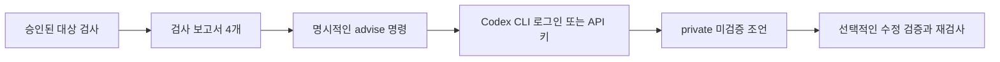

# Wakeio Security CI

**출시 전에 보안 후보를 찾고, CI에서 누락된 검사를 숨기지 않는 무료 독립형 CLI·GitHub Action입니다.**

사용자가 지정한 소스 코드, HTTP 응답, 선택적인 읽기 전용 API 정책을 검사합니다. 발견 결과만 보여 주는 대신 근거·검사 범위·미완료 상태·한계를 같은 보고서에 남겨, 깨끗한 결과가 확인하지 않은 영역을 가리지 않도록 설계했습니다.

[English](README.md) · [日本語](README.ja.md) · [简体中文](README.zh-CN.md) · [구현 체크리스트](docs/checklist.md) · [0.4 사용법](docs/preview-0.4.md) · [검증 기록](docs/verification-0.4.md)

**GitHub 소스:** `0.5.0` · **npm 공개 버전:** `0.4.0` · Apache-2.0 · Node.js 22+

기본 검사는 무료로 로컬에서 실행합니다. Wakeio 계정·구독·호스팅된 Wakeio 서비스·LLM·소스 업로드가 필요하지 않으며 사용 텔레메트리도 전송하지 않습니다. 아래 npm 명령은 공개된 0.4.0을 실행합니다. 뒤의 replay·origin 허용 목록·능동 DAST 예시는 이 0.5.0 소스 checkout을 `npm run build`로 빌드하거나 검토한 Git commit의 Action을 사용해야 합니다. npm 0.5.0은 아직 발행하지 않았습니다. [0.5.0 소스 변경점](CHANGELOG.md#050--github-source-preview)과 [0.4.0 릴리스 범위](docs/release-0.4.0.md)를 참고하세요.

별도의 실험적 [`repair` CLI](docs/repair-preview.md)는 검토한 로컬 수정안을 검증하거나 Codex/Claude를 선택적으로 연결합니다. 에이전트 호출에는 명시적 소스 전송 동의와 API 인증이 필요하며 모델 비용이 발생할 수 있습니다. 준비된 Docker 이미지와 고정 검증기로 private patch·검증 기록만 만들고 원본 적용·커밋은 하지 않습니다. 첫 지원 범위는 선언된 SQL fixture이며 범용 앱 수리 완료를 뜻하지 않습니다.

API preview는 redacted index 기반 실행 ledger로 판정한 단계, 불확실한 단계,
실행하지 못한 단계를 구분한다. [실행 계약](docs/preview-0.4-api.md#계획-대비-실행-ledger)을 참고한다.
[소유 API pilot](docs/api-state-oracle.md)은 명시적으로 두 번 검증을 선택할 수 있다.
정상 기능 대조를 반복하고 결과가 다르면 불확실로 남긴다.

별도의 [소유 PATCH state pilot](docs/api-write-state.md)은 고정 자체 loopback fixture에서 실제 저장 변경과 정상 owner 대조를 확인합니다. SDK·CLI·전용 Action은 명시적 동의를 요구하고 원 phase gate를 보존하며 외부 API를 입력받지 않습니다.

## 무엇을 검사하나요?

| 범위 | 확인할 수 있는 내용 | 기억해야 할 한계 |
| --- | --- | --- |
| 소스 코드 | 요청 입력이 SQL·HTML·프로세스·외부 요청·리디렉션 sink로 흐르는 제한된 JS/TS AST 후보, 동적 코드 실행, 일부 자격증명 형태, 선택적인 Next/React·Supabase migration 후보 | 같은 함수와 제한된 로컬 흐름 중심. 일반적인 함수 간·파일 간·타입 기반·런타임·빌드·실제 DB 검증은 제공하지 않음 |
| 공개 URL | 명시한 페이지와 같은 origin의 정적 JavaScript 모듈, 전송, 보안 헤더, CSP, 쿠키, CORS, 혼합 콘텐츠, source map/debug/version 단서, DOM·비밀값 형태 후보 | 명시된 제한적 GET만 실행. 브라우저 실행, 로그인, endpoint 탐색, API 퍼징, 결제 흐름, 전체 사이트 자동 순회는 하지 않음 |
| 읽기 전용 API 정책 | 선언한 리소스 식별자와 별도의 보호 데이터 canary를 기준으로 identity, 소유자·다른 계정·비로그인 사용자의 접근 결과 | 정책에 정의한 GET 요청만 실행. 쓰기, 자동 로그인, endpoint 탐색, 일반 퍼징은 하지 않음 |
| 능동 DAST 프리뷰(선택) | 명시한 OpenAPI operation에 Schemathesis가 생성한 GET 입력(5xx·응답 스키마 위반), `misconfiguration`/`exposures`의 서명된 Nuclei HTTP GET/HEAD 템플릿 | `--active-consent` 필수. 검증한 origin 하나에 loopback egress gate로만 접속. 쓰기·자격증명·리디렉션·OAST·raw/unsafe 템플릿·크롤링 없음 |
| 전후 보고서 | 논리적 프로젝트 식별자, 의미 기반 source anchor, 새 문제·변경 문제·같은 문제, `not_observed`·`unverified` 상태 | 나중에 발견되지 않았다는 사실만으로 수정 완료라고 판단하지 않음 |

소스와 URL 범위는 한 보고서에 함께 담을 수 있습니다. API 정책은 선택 사항이며 환경변수 이름으로 자격증명을 참조합니다. 토큰과 canary 값은 보고서에 기록하지 않습니다. [API 정책 예제](examples/api-authorization-policy.json)와 [API 안내](docs/preview-0.4-api.md)를 참고하세요.

내장 소스 규칙은 의도적으로 좁게 잡았습니다. 예를 들어 요청값이 로컬 변수를 거쳐 raw SQL 호출·JSX HTML sink·프로세스 호출·외부 요청·리디렉션으로 전달되는 장면을 후보로 표시합니다. 구조 분해·반복문 binding, 일부 Next route 입력, 정적 client/server 환경변수 노출, Supabase migration 이력 후보도 확인합니다. 결과는 검토할 후보이며 exploit 재현이나 애플리케이션 전체의 안전 보장이 아닙니다.

소스 preview는 [Node process API 여섯 개](docs/process-role.md)의 command·executable·argv·shell 필드 역할을 구별합니다. 기본/false argv의 제외는 Node의 셸 해석만 대상으로 하며, 프로그램 옵션 안전이나 실제 실행을 검증하지 않습니다. 이 ruleset 변경은 npm 게시를 뜻하지 않습니다.

## 빠른 시작: 내장 검사만 실행하기

Node.js 22 이상에서 버전을 고정한 npm CLI를 실행합니다. 두 경로를 실제 경로로 바꾸고 보고서는 검사 대상 저장소 밖에 둡니다.

```sh
npx --yes wakeio-security-ci@0.4.0 doctor --source /path/to/your-app --tools none
npx --yes wakeio-security-ci@0.4.0 scan \
  --source /path/to/your-app \
  --tools none \
  --out /path/outside/your-app/reports
```

`npx`는 npm에서 CLI 패키지와 선언된 런타임 의존성을 내려받습니다. 기여하거나 검토한 소스 checkout을 사용하려면 공개 저장소를 clone한 뒤 로컬에서 빌드합니다.

```sh
git clone --branch main https://github.com/dusen0528/wakeio-security-ci.git
cd wakeio-security-ci
npm ci --ignore-scripts
npm run build

node build/src/cli.js doctor --source /path/to/your-app --tools none
node build/src/cli.js scan \
  --source /path/to/your-app \
  --tools none \
  --out wakeio-security-reports
```

`doctor`는 읽기 전용으로 대상 디렉터리의 파일 수와 적용 가능성을 확인하며 대상 코드·패키지 매니저·scanner·네트워크 요청을 실행하지 않습니다. `--tools none`은 내장 검사만 선택해 외부 엔진을 준비하지 않습니다. 검사 대상 파일은 데이터로 읽으며 대상 프로젝트의 install script·hook·build·test는 실행하지 않습니다.

조건부 호출 가정과 실제 입력 전달의 구분은 [조건부 소스 경로 안내](docs/source-conditional-context.md)를 참고하세요.

큰 clone의 수집 한도 선택과 CLI·Action 설정 전달은 [소스 수집 한도 안내](docs/source-collection.md)를 참고하세요.

MarsDB selector 검사와 문자열 guard의 한계, 보고서·에이전트 활용은 [NoSQL 소스 검사 안내](docs/source-nosql.md)를 참고하세요.

URL만 검사할 때는 시작 URL과 추가 페이지를 직접 지정합니다.

```sh
node build/src/cli.js scan \
  --url https://your-app.example \
  --page https://your-app.example/pricing \
  --tools none
```

소스와 URL을 한 보고서에 함께 넣을 수도 있습니다.

```sh
node build/src/cli.js scan \
  --source /path/to/your-app \
  --url https://your-app.example \
  --tools none
```

로컬·사설 URL/API 대상은 `--allow-private`를 명시해야 하며 metadata 주소 차단은 계속 적용됩니다. URL 수집은 지정한 페이지, 같은 origin의 정적 모듈 그래프, 요청·바이트·시간 예산 안에서만 동작하고 전체 페이지 수는 최대 8개입니다.

## GitHub Actions

아래 예제는 `main` 브랜치의 공개 Action을 사용합니다. 운영 workflow에서는 Wakeio를 검토한 commit SHA로 고정하세요. 아래 예제는 내장 검사만 명시적으로 선택하고, 발견 결과로 job이 실패해도 보고서를 artifact로 보관하며, 주변 Action은 현재 저장소의 고정 SHA를 재사용합니다.

```yaml
name: wakeio-security-ci

on:
  push:
  pull_request:
  workflow_dispatch:

permissions:
  contents: read

jobs:
  scan:
    runs-on: ubuntu-latest
    steps:
      - name: 애플리케이션 checkout
        uses: actions/checkout@11d5960a326750d5838078e36cf38b85af677262
        with:
          persist-credentials: false

      - name: Wakeio Security CI 실행
        uses: dusen0528/wakeio-security-ci@main
        with:
          source: .
          tools: none
          out: wakeio-security-reports
          fail-on: high

      - name: 검사 보고서 업로드
        if: always()
        uses: actions/upload-artifact@ea165f8d65b6e75b540449e92b4886f43607fa02
        with:
          name: wakeio-security-ci-reports
          path: wakeio-security-reports
          if-no-files-found: error
```

복사해서 쓸 수 있는 파일은 [`examples/github-action.yml`](examples/github-action.yml)입니다. `@main`은 프리뷰를 바로 시험하기 좋은 이동형 참조입니다. 운영 workflow에서는 `dusen0528/wakeio-security-ci`를 검토한 commit SHA로 고정하고 변경을 직접 검토하세요. 주변 Action도 검토한 SHA를 유지하는 편이 좋습니다. 이 Action은 Node.js 22를 준비하고 대상 프로젝트의 script를 실행하지 않으며 Job Summary와 `report.md`, `report.json`, `report.sarif`, `agent-report.json`, `action-status.json`을 출력 디렉터리에 남깁니다.

## 선택형 외부 엔진

예제에서는 외부 엔진을 명시적으로 선택합니다. 소스 CLI의 기존 기본값은 `gitleaks,osv,trivy`이므로 내장 검사만 원하면 `--tools none`을 지정하고, 외부 엔진을 사용할 때는 검토한 목록을 정확히 지정하세요. Bandit은 자동으로 켜지지 않습니다.

| 엔진 | 이 프리뷰에서 사용한 버전 | 추가하는 검사 | 중요한 한계 |
| --- | ---: | --- | --- |
| Gitleaks | 8.30.1 | 수집한 파일의 Secret 패턴 | 현재 수집 파일 기준이며 전체 Git 이력·키 유효성은 확인하지 않음 |
| OSV-Scanner | 2.6.0 | 지원 lockfile과 자체 포함된 고정 Python requirements의 advisory | advisory 조회이며 source reachability·악성코드 분석 아님. 온라인 모드에서는 패키지 식별자가 공개 OSV 서비스로 전송될 수 있음 |
| Trivy | 0.74.0 | Dockerfile·Kubernetes·Terraform 설정 | 설정 검사만 하며 이미지 CVE·실제 클라우드 상태·외부 module까지 검증하지 않음 |
| Bandit | 1.9.4 | 선택적인 Python AST 검사 | 별도 실행 파일을 준비해야 하며 선택한 Python 파일만 검사하고 대상 코드는 실행하지 않음 |

예시는 다음과 같습니다.

```sh
# 검토한 native engine만 명시적으로 켭니다.
node build/src/cli.js scan --source /path/to/app --tools gitleaks,osv,trivy

# Bandit은 별도로 준비한 뒤 명시적으로 선택합니다.
node build/src/cli.js scan \
  --source /path/to/python-app \
  --tools bandit \
  --bandit /path/to/venv/bin/bandit
```

선택형 엔진 명령을 실행하기 전에 고정된 native binary를 준비하거나 신뢰할 수 있는 실행 파일 경로를 지정해야 합니다. 설치기·cache·provenance는 [배포 안내](docs/preview-0.4-distribution.md)에 정리했습니다. 설치기는 native release asset의 SHA-256을 확인합니다. OSV는 `--osv-offline`과 준비된 로컬 DB를 사용할 수 있으며 DB가 없으면 완료로 처리하지 않습니다. Trivy는 scanner가 관리하는 policy 또는 DB 데이터를 내려받을 수 있습니다. scan 모드에서 Wakeio 자체는 소스를 업로드하거나 LLM을 호출하지 않습니다.

## 보고서와 종료 코드

시작한 각 검사는 `wakeio-security-reports/`(또는 `--out DIR`)에 다음 네 파일을 기본으로 만듭니다.

- `report.md`: 사람이 읽는 요약, 근거, 한계, 수정 방향;
- `report.json`: 구조화된 검사·범위·provenance·발견·미완료 상태;
- `report.sarif`: 선택적인 code-scanning workflow용 SARIF 2.1.0;
- `agent-report.json`: 버전이 있는 scan gate, finding/check 연결, 미검증 수정 상태. [agent 보고서 계약](docs/agent-report.md)을 참고하세요. scan gate는 최종 process 종료·보고서 전달 상태와 구분합니다.

발견 결과는 candidate·observation·advisory를 구분합니다. 도구 누락, timeout, 변경되거나 알 수 없는 provenance, 지원하지 않는 입력, 중복된 의미 anchor, 수집 한계는 보고서에 남고 검사를 미완료로 만들 수 있습니다.

| 종료 코드 | 의미 |
| ---: | --- |
| `0` | 적용 가능한 검사가 끝났고 선택한 기준 이상 발견이 없음 |
| `1` | 선택한 `--fail-on` 기준 이상의 발견이 있음(기본 high) |
| `2` | 설정 오류, 실패·미완료 검사, 또는 적용 가능한 보안 검사가 없음 |

`--fail-on none`은 발견 결과에 따른 실패만 끄며 미완료 검사를 통과로 바꾸지 않습니다. 보고서는 원문 소스와 Secret 값을 제외하지만 프로젝트 경로·패키지 식별자·URL을 포함할 수 있으므로 CI artifact 공개 범위를 확인하세요.

소스 프리뷰는 문서에 명시한 버전의 [파일명→process argv 흐름](docs/source-filesystem-flow.md)을 지원합니다. 파일명 callback과 공유 배열의 누적을 argv에 연결하며, 조건부 low-confidence 후보와 미완료 검사를 함께 남깁니다. 지원 범위와 공개 advisory 검증 결과는 링크 문서에서 확인할 수 있으며, 새 취약점 발견이나 수정 소스 전체의 안전 판정을 뜻하지 않습니다. 공개 npm은 아직 0.4.0입니다.

## 로컬 소스 handoff

검토한 0.5.0 소스 프리뷰에서는 소스 candidate와 현재 수집한 소스를 연결해
비공개 검토·재검사 패킷을 만듭니다. 공개 npm 0.4.0에는 이 명령이 없습니다.
`FINDING_ID`와 0부터 시작하는 `CHECK_INDEX`를 agent 보고서의 실제 값으로 바꾸고,
보고서와 패킷은 모두 소스 디렉터리 밖에 둡니다.

```sh
wakeio-security-ci handoff create --report /path/outside/your-app/before --source /path/to/your-app --finding FINDING_ID --check-index CHECK_INDEX --out /path/outside/your-app/review
wakeio-security-ci handoff finish --handoff /path/outside/your-app/review --report /path/outside/your-app/after --source /path/to/your-app --out /path/outside/your-app/recheck
```

사용자가 원 scan을 같은 옵션으로 별도 재실행해 `after`를 준비합니다. Handoff는
scan·모델 호출·argv 생성/실행·패치 적용을 하지 않습니다. Finish는 비교와
**after 전체 gate**를 함께 확인하므로 같은 high finding도 실패하며 partial은
exit `2`입니다. `not_observed`는 수정 검증이 아닙니다.
[전체 동선·snapshot 연결·출력 위치](docs/source-handoff.md)를 참고하세요.

## 읽기 전용 API 정책과 비교

현재 소스 checkout에서는 staging 실행 전에 대상에 연결하지 않고 로컬 설정을 확인할 수 있습니다.

```sh
# 합성 placeholder만 사용하며 서버로 전송하지 않습니다.
WAKEIO_OWNER_AUTH='Bearer synthetic-owner' \
WAKEIO_OTHER_AUTH='Bearer synthetic-other' \
node build/src/cli.js plan --openapi-input examples/openapi-preflight-input.json

# 기존 API 정책은 해당 정책이 참조하는 환경변수를 준비한 뒤 확인합니다.
node build/src/cli.js plan --api-policy /path/to/your-api-policy.json
```

`plan`은 입력 하나와 선택적인 `--allow-private`, `--timeout-ms 1..120000`을 받습니다. 결과와 설정 오류는 JSON이며 종료 코드 `0`은 설정 `ready`, `2`는 `blocked`입니다. DNS 조회·HTTP 요청·scan 보고서 작성은 하지 않습니다. GET 순서와 요청·시간·응답 예산은 배열 index로 보여 주고 대상 URL·요청 경로·사용자 지정 ID·환경변수 이름·assertion 값은 출력하지 않습니다. [완전한 합성 OpenAPI 입력](examples/openapi-preflight-input.json)의 `.invalid` 주소는 실제로 검증한 staging이 아닙니다.

`ready`는 실행 승인이나 보안 통과가 아닙니다. 허가받은 endpoint, 합성 계정·리소스, GET의 부작용 가능성을 직접 확인해야 하며 자격증명 유효성·DNS·TLS·응답 control은 승인된 실제 실행에서 확인합니다. SDK와 index 기반 오류 확인은 [preflight 안내](docs/preview-0.4-api.md#zero-network-staging-preflight)를 참고하세요. `--openapi-input`은 `plan` 전용이며 API 실행은 기존 `scan --api-policy` 또는 SDK를 사용합니다.

API 정책은 identity endpoint와 기대 principal, 소유자·다른 계정·비로그인 actor, 리소스 식별자, 보호 데이터 canary, 허용할 거부 상태를 선언합니다. 자격증명은 환경변수 이름으로 참조합니다. identity와 소유자의 정상 접근을 deny probe 전후에 확인합니다. 다른 actor가 보호 canary를 받으면 HTTP 상태가 `403`이어도 발견 결과입니다. 오류 응답에 공개 ID만 반복된 경우만으로 정보 유출을 확정하지 않습니다.

```sh
node build/src/cli.js scan \
  --api-policy /path/to/your-api-policy.json \
  --tools none
```

저장소에 포함된 정책은 `127.0.0.1:8877`의 합성 서버를 대상으로 합니다. 재현하려면 다른 터미널에서 `node examples/api-authorization-demo.mjs --vulnerable`을 실행하고 두 demo authorization 환경변수를 export한 뒤 `--allow-private`를 추가하세요. 전체 명령과 수정된 fixture 실행은 [API 안내](docs/preview-0.4-api.md)에 있습니다.

쓰기·결제·자동 로그인·endpoint 탐색·일반 퍼징은 수행하지 않습니다. 만료된 자격증명, 구분되지 않는 actor, rate limit, 예상하지 못한 응답, 불완전한 control은 partial 또는 unverified로 남습니다.

각 `api.authorization-data-exposure` finding에는 이번 실행의 control 결과가 붙습니다. `controlVerification.state`는 probe actor의 identity before/after, owner positive control before/after, 완료된 probe가 모두 통과했을 때만 `controls_passed`이고 그 외에는 `inconclusive`입니다. `evidence`는 같은 check의 `apiExecution` ledger 단계(ordinal, phase, outcome, HTTP status)만 참조하며 응답 값은 저장하지 않습니다. `replay`는 정책 digest, case, actor를 기록합니다. 이것은 scanner 증거일 뿐이며 finding `kind`는 `candidate`로 유지되고 agent report의 exploit/fix `verification`은 계속 `not_run`입니다.

```sh
node build/src/cli.js replay \
  --report /tmp/wakeio-api/report.json \
  --api-policy /path/to/your-api-policy.json \
  --finding <report.json의 finding id> \
  --out /tmp/wakeio-replay
```

`replay`는 정책 digest가 일치할 때만 해당 case, owner, probe actor만 다시 실행합니다. 완료된 실행에서만 `reproduced`(종료 코드 1) 또는 `not_reproduced`(0, 거부 확인)가 나옵니다. 앞선 응답에서 canary가 노출되어도 뒤의 control 실패나 요청 중단으로 검사가 미완료면 `inconclusive`(2)이며 정책 거부도 종료 코드 2입니다. `replay.json`과 축소 실행의 보고서를 씁니다. `not_reproduced`는 이번 실행 범위의 증거이며 수정 증명이 아닙니다.

수정 전후를 비교하려면 논리적 프로젝트 식별자와 검사 옵션을 유지하세요.

```sh
node build/src/cli.js scan \
  --source /path/to/app \
  --project-id team/app \
  --tools none \
  --out /tmp/wakeio-before

# 수정한 뒤 같은 범위와 옵션으로 다시 검사합니다.
node build/src/cli.js scan \
  --source /path/to/app \
  --project-id team/app \
  --tools none \
  --out /tmp/wakeio-after

node build/src/cli.js compare \
  --before /tmp/wakeio-before/report.json \
  --after /tmp/wakeio-after/report.json \
  --out /tmp/wakeio-comparison
```

범위가 다르거나 미완료인 검사를 깨끗한 결과로 보여 주지 않습니다. 이전 발견이 사라져도 `not_observed`이며 자동 수정 인증서가 아닙니다. [비교 안내](docs/preview-0.4-comparison.md)를 참고하세요.

## 네이티브 DAST와 선택형 Codex 조언

[명시적 단일 인용 문자열 정책 v3](docs/native-dast-quoted.md)는 GET 파라미터가 SQL 문자열 안에 들어가는 맥락을 사용자가 확인하고 선택합니다. 비인증 8회·인증 10회의 제한된 차등 검사이며 숫자형 v1/v2가 자동으로 전환되지 않습니다. 소스 0.5.0 프리뷰 기능이며 npm 0.5.0 발행을 뜻하지 않습니다.

[인증된 숫자형 정책 v2](docs/native-dast.md#authenticated-numeric-policy-v2)는 지정한 Authorization 환경변수와 SQL 요청 8개 전후의 identity 확인을 사용합니다. 기본 공유 예산은 10회입니다. control 실패는 미완료이며, 이미 관찰한 차등은 재검사 권한 없는 low-confidence 후보로 남습니다. v1의 기본 8회는 유지합니다. GitHub 소스 프리뷰 기능이며 npm 발행본은 계속 0.4.0입니다.

소스 checkout에는 명시한 GET 쿼리 파라미터 하나에 숫자형 SQL 차등 검사를 수행하는 기능이 포함됩니다. 정책에 정상·참·거짓 JSON 응답 기준을 정하고, 정상/참/거짓/정상 순서를 두 번 반복합니다. 대조군과 차등 결과가 모두 반복될 때만 제한된 `candidate`를 기록합니다. [정책 작성, HTTPS 경계, Action 입력과 SDK](docs/native-dast.md)를 참고하세요. 이 명령은 소스 프리뷰용이며 npm 0.5.0은 아직 발행하지 않았습니다.



```sh
npm run build
node build/src/cli.js plan --dast-policy dast-policy.json
node build/src/cli.js scan --dast-policy dast-policy.json --active-consent --out dast-reports
node build/src/cli.js advise --report dast-reports --agent codex --auth cli-login \
  --allow-report-upload --out dast-advice
# CODEX_API_KEY 인증을 선택하려면 --auth api-key를 사용합니다.
```

`advise`는 전송 동의를 받은 제한된 보고서 요약만 보내고 `agent-advice.json`을 만듭니다. 소스를 보내거나 수정안을 적용하지 않으며 candidate를 확정 취약점으로 바꾸거나 수정 완료를 선언하지 않습니다. 검사 판정과 조언은 독립적이고, `scan`은 모델을 호출하지 않습니다.

조언에는 대조군·실행 단계 또는 정적 흐름의 구조화된 증거와 로컬에서 검증한 재검사 경로가 포함됩니다. 네이티브 finding은 원래 정책과 새 실행 동의로 다시 검사할 수 있습니다.

```sh
node build/src/cli.js replay --report dast-reports/report.json \
  --dast-policy dast-policy.json --finding <finding-id> --active-consent --out dast-replay
```

원래 private 대상이면 `--allow-private`도 다시 명시해야 합니다. 원래 요청·시간 제한을 그대로 쓰며 출력 디렉터리는 새 경로여야 합니다. `replay.json`과 새 보고서를 기록합니다. 종료 코드 1은 재현, 0은 완료된 범위 내 미재현, 2는 거부 또는 불충분한 결과입니다. 미재현은 수정 증명이 아닙니다. [네이티브 재검사 상세](docs/native-dast.md#repeat-a-native-finding-with-its-original-policy).


## 능동 DAST 프리뷰(선택)

능동 검사는 대상에 생성 요청이나 템플릿 요청을 보내므로 저절로 실행되지 않습니다. 모든 능동 실행에는 `--active-consent`가 필요하며, 없으면 DNS 조회나 요청 전에 exit 2로 끝납니다. 소유했거나 검사 권한을 받은 대상만 검사하세요. 사설·loopback 대상은 `--allow-private`도 필요하고, 메타데이터·link-local 주소는 계속 차단됩니다. `--allowed-origin ORIGIN`(반복 가능)을 지정하면 목록에 없는 `--url`, `--api-base`, API·네이티브 DAST 정책 `baseUrl`은 DNS 조회나 요청 전에 거부됩니다.

```sh
# Schemathesis: 명시한 OpenAPI operation에 생성한 GET 입력
node build/src/cli.js scan --openapi openapi.json --api-base https://staging.example.test/ \
  --operation '/items/{id}' --operation /search --active-consent --fail-on low

# Nuclei 3.11.1: 한 번 준비한 뒤 --url origin을 준비된 템플릿으로 검사
node scripts/install-tools.mjs --tools nuclei          # 고정된 upstream SHA-256 검증
nuclei -ut -ud /path/to/nuclei-templates                # 검사 중에는 템플릿을 내려받지 않음
node build/src/cli.js scan --url http://127.0.0.1:3000/ --engine nuclei \
  --nuclei /path/to/nuclei --nuclei-templates /path/to/nuclei-templates \
  --nuclei-scope misconfiguration,exposures --active-consent --allow-private --nuclei-timeout-ms 300000
```

두 엔진은 실행마다 새로 여는 loopback egress gate에만 접속합니다. Gate는 URL 검사와 같은 URL-network 정책으로 origin을 검증하고 검증한 주소에 고정합니다. 일반 HTTP에서는 해당 origin의 GET/HEAD만 전달하고 identity 인코딩과 요청 수·응답당/전체 바이트 예산을 전송 구간에서 적용합니다. 다른 포트를 찌르는 템플릿처럼 origin을 벗어나는 요청은 보내지 않고 거부한 수를 기록합니다. HTTPS Nuclei는 대상에 요청을 보내기 전에 `error`(exit 2)로 거부합니다. CONNECT 터널 안의 HTTP 요청은 gate에서 볼 수 없어 터널 수만으로 요청 예산을 지킬 수 없기 때문입니다. Nuclei는 `-ni -duc -dr`로 서명된 HTTP 템플릿만 실행하며 raw/unsafe·non-GET·self-contained·다른 프로토콜 템플릿은 제외하고 수를 기록합니다. Nuclei는 일부만 진행해도 exit 0을 반환하므로 엔진 진행률 100%, 엔진 오류 0, 예산 중단·upstream 실패 없음까지 확인해야 완료입니다. 그 밖에는 `partial`(exit 2)입니다. 엔진·Python 런타임·템플릿 디렉터리가 없으면 `error`(exit 2)이며 통과로 처리하지 않습니다.

GitHub Actions에서는 별도의 `dast` Action을 씁니다. 수동 검사 workflow가 능동 검사를 시작할 일이 없게 분리했습니다. `active-consent: 'true'`와 모든 대상 origin을 담은 `allowed-origins`가 필요합니다. 정책 평가를 위한 Node.js 설정 후 `pull_request_target`·fork PR·fork `workflow_run`은 엔진 다운로드·Python 설정·대상 요청 전에 거부합니다. Nuclei는 고정 아카이브로 설치하고, nuclei-templates는 기대한 `templates-checksum.txt` digest와 일치해야 합니다. [`examples/github-dast.yml`](examples/github-dast.yml)은 job 안에서 앱을 띄우고 push·PR·매일 스케줄로 검사한 뒤 SARIF를 올리고 보고서를 남깁니다.

보고서에는 실행한 요청 수, 예산 때문에 거부한 요청 수, egress 거부 수, seed와 스키마 digest(Schemathesis), 템플릿 수·제외 수·`templates-checksum.txt` digest(Nuclei)를 남깁니다. 응답 본문, 생성 값, 추출 값, proxy 자격증명, 템플릿 원문은 남기지 않습니다. `wakeio-security-ci doctor --dast`는 아무것도 실행하지 않고 엔진 준비 상태만 보여 줍니다. 인증, 쓰기 요청, 상태 기반 workflow, 브라우저 기반 검사와 크롤링은 외부 Schemathesis/Nuclei 프리뷰 범위가 아닙니다. 앞서 안내한 네이티브 숫자형 SQL v2 인증 정책은 별도 기능입니다.

소스·DAST 스캔 단계는 SIGINT/SIGTERM을 실행 중인 설치·정책 사전 점검·스캔 프로세스에 전달합니다. CLI가 부분 보고서를 저장할 제한된 유예 시간을 준 뒤 소유한 프로세스 그룹을 정리합니다. 자식 프로세스가 0으로 끝나도 취소는 성공으로 처리하지 않고 Action 상태와 종료 코드 2를 남기며, 갱신되지 않은 이전 보고서를 이번 실행의 증거로 집계하지 않습니다. 별도 DAST preflight 단계는 취소 시 엔진 준비를 비활성화하고 스캔 보고서 없이 종료합니다. egress gate는 취소·명시적 종료·엔진 연결 종료 시 대상 요청도 닫고 HTTP/CONNECT 연결 정리를 기다립니다. SIGKILL, 프로세스 충돌, 별도로 분리된 프로세스는 정상 취소 보장 범위 밖입니다.

## 작은 합성 예시

다음은 실제 애플리케이션 결과가 아니라 명시적으로 표시한 회귀 fixture입니다.

```text
candidate · high · ast:sql-input-sink
app/routes/users.ts:4
evidence: req.query.id -> statement -> db.query(...)
review: DB driver의 parameter binding을 사용하고 생성된 query를 확인하세요
```

Wakeio는 인식한 코드 흐름과 검토가 필요한 이유를 보고합니다. fixture를 실행하거나 exploit을 보내지 않으며 주변 애플리케이션의 안전을 보장하지 않습니다.

## 검증 기록과 알려진 한계

0.4.0 로컬 릴리스 검증에서 `npm run test:schemathesis`는 실제 필수 엔진을 사용해 **489/489** 통과했으며 실패·건너뜀은 0개였습니다. 엄격한 합성 JS/TS corpus는 위험 15개·수정 15개로 구성된 30개 사례이며, 지원 범위의 기대 결과 15개를 모두 관측했고 false positive와 지원 범위 false negative는 0개였습니다. 이는 선언된 회귀 검증 결과이며 실제 운영 탐지율·전체 커버리지·보안 인증이 아닙니다. [릴리스 검증](docs/release-0.4.0.md)을 참고하세요. 이전 날짜의 검증 기록은 당시 수치를 유지합니다.

로컬 검증은 다음과 같이 재현할 수 있습니다.

```sh
node scripts/bootstrap-schemathesis.mjs
node --test scripts/ci-verification.test.mjs
npm run test:schemathesis
npm run benchmark -- --strict
```

[구현 체크리스트](docs/checklist.md), [0.4 안내](docs/preview-0.4.md), [검증 기록](docs/verification-0.4.md)에 실제 범위가 적혀 있습니다. 완전한 침투 테스트, exploit 생성, 브라우저·런타임 검증, 광범위한 API 퍼징, 실제 DB·클라우드 검사, 이미지 CVE 검사, 서비스 전체 안전 판정은 이 프로젝트의 계약에 포함되지 않습니다.

## 기여와 라이선스

규칙을 추가할 때는 취약·수정 합성 fixture, 근거와 한계, 호환 가능한 라이선스를 함께 남겨 주세요. [CONTRIBUTING.md](CONTRIBUTING.md)와 [SECURITY.md](SECURITY.md)를 참고하세요. Wakeio Security CI는 Apache-2.0이며 외부 scanner와 rule은 [THIRD_PARTY_NOTICES.md](THIRD_PARTY_NOTICES.md)의 각 라이선스를 따릅니다.
