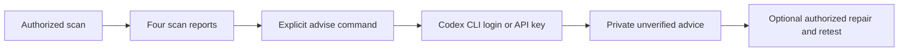

# Wakeio Security CI

**Find security candidates before release and keep incomplete checks visible in CI.**

Wakeio checks the code, HTTP responses, and optional read-only API policy that you explicitly provide. It keeps findings, evidence, scope, incomplete checks, and limits visible together, so a clean result does not hide an untested area.

[한국어](README.ko.md) · [日本語](README.ja.md) · [简体中文](README.zh-CN.md) · [implemented checklist](docs/checklist.md) · [0.4 guide](docs/preview-0.4.md) · [verification record](docs/verification-0.4.md)

**GitHub source:** `0.5.0` · **published npm:** `0.4.0` · Apache-2.0 · Node.js 22+

The default scan is a free local tool. It does not require a Wakeio account, subscription, hosted Wakeio service, LLM, or source upload, and it does not send usage telemetry. The npm commands below run the published 0.4.0 package. The newer replay, origin allowlist and active DAST examples use this 0.5.0 source checkout after `npm run build`, or a reviewed Git commit of its Action; npm 0.5.0 is not published. See the [0.5.0 source changes](CHANGELOG.md#050--github-source-preview) and [0.4.0 release scope](docs/release-0.4.0.md).

An experimental, separate [`repair` CLI](docs/repair-preview.md) can verify a reviewed local proposal or optionally request one from Codex/Claude. Agent calls require explicit source-upload consent and API authentication; they may incur provider costs. Repair uses a prepared local Docker image and frozen verifier, writes private patch/verification artifacts only, and never applies changes or commits to the original checkout. Its initial SQL fixture support is not general-purpose application remediation.

The API preview now records a redacted, indexed execution ledger so CI can
separate evaluated probes from inconclusive and never-attempted steps.
See the [execution contract](docs/preview-0.4-api.md#계획-대비-실행-ledger).
The [owned API pilot](docs/api-state-oracle.md) also offers explicit two-round
normal-behavior controls; inconsistent repeats remain inconclusive.

The separate [owned PATCH state pilot](docs/api-write-state.md) checks actual persisted writes and normal owner controls on fixed synthetic loopback fixtures. Its SDK, CLI and dedicated Action require explicit consent, preserve the original phase gates, and do not accept an external API target.


The [collected-code coverage contract](docs/source-code-coverage.md) separates file collection from completed language analysis. Opt into `--require-code-analysis` to gate uncovered collected code; this does not add a language analyzer or establish whole-project coverage.


The explicit [authenticated POST JSON numeric SQL profile](docs/native-dast-post-json.md) adds a fixed body field and a distinct benign-value control to the consented differential contract. It uses a separate v4 policy; GET policies retain their scope.

## What it checks

| Scope | What Wakeio can observe | Boundary to keep in mind |
| --- | --- | --- |
| Source code | Bounded JS/TS AST candidates where request input reaches SQL, HTML, process, outbound-request, or redirect sinks; dynamic evaluation; selected credential shapes; selected Next/React and Supabase migration candidates | Same-function and bounded local-flow analysis. No general cross-function, cross-file, type-aware, runtime, build, or live database proof |
| Public URL | Explicit pages, same-origin static JavaScript modules, transport, security headers, CSP, cookies, CORS, mixed content, source-map/debug/version clues, DOM and secret-shaped candidates | Explicit bounded GET requests only. No browser execution, login, endpoint discovery, API fuzzing, payment flow, or automatic site crawl |
| Read-only API policy | Identity checks and owner/other-account/anonymous cases for a declared resource identity and distinct protected-data canary | GET requests defined by the policy. No writes, automatic login, endpoint discovery, or general fuzzing |
| Active DAST preview (opt-in) | Schemathesis-generated GET inputs for explicitly selected OpenAPI operations (5xx and response-schema violations); signed Nuclei HTTP GET/HEAD templates from `misconfiguration`/`exposures` | Requires `--active-consent`. One validated origin through a loopback egress gate; no writes, redirects, OAST, raw/unsafe templates, or crawling; credentials only in the explicit [Schemathesis auth-control profile](docs/schemathesis-auth-controls.md) |
| Before/after reports | Logical project identity, semantic source anchors, changed findings, unchanged findings, and `not_observed`/`unverified` states | A missing later finding is never treated as proof that a fix is complete |

Source and URL scopes can be combined in one report. The API policy is opt-in and reads credentials from named environment variables; token and canary values are not written to reports. See the [API policy example](examples/api-authorization-policy.json) and [API guide](docs/preview-0.4-api.md).

The built-in source rules are intentionally narrow. They cover useful code scenes such as a request value flowing through a local variable into a raw SQL call, a JSX HTML sink, a process invocation, an outbound request, or a redirect. They also include bounded destructuring and loop bindings, selected Next route inputs, static client/server environment exposure, and Supabase migration history candidates. These are reviewable candidates, not exploit demonstrations or a claim that the whole application is safe.

The [Koa request-context source contract](docs/source-koa-context.md) describes declared middleware registration inputs, request/response alias boundaries, and the source-only four-report workflow.

The source preview distinguishes command, executable, argv and shell-option
roles for the [six Node process APIs](docs/process-role.md). Default/false argv
exclusions cover Node's shell interpretation only; program-option safety and
runtime execution remain unverified. This ruleset change is not an npm release.

## Quick start: built-in checks only

With Node.js 22+, run the versioned npm CLI. Replace both paths and keep reports outside the scanned repository:

```sh
npx --yes wakeio-security-ci@0.4.0 doctor --source /path/to/your-app --tools none
npx --yes wakeio-security-ci@0.4.0 scan \
  --source /path/to/your-app \
  --tools none \
  --out /path/outside/your-app/reports
```

`npx` downloads the CLI package and its declared runtime dependencies from npm. For contributors or a reviewed source checkout, clone and build locally:

```sh
git clone --branch main https://github.com/dusen0528/wakeio-security-ci.git
cd wakeio-security-ci
npm ci --ignore-scripts
npm run build

node build/src/cli.js doctor --source /path/to/your-app --tools none
node build/src/cli.js scan \
  --source /path/to/your-app \
  --tools none \
  --out wakeio-security-reports
```

`doctor` is read-only: it inventories the target without running target code, package managers, scanners, or network requests. `--tools none` selects only the built-in checks and avoids optional engine setup. The scanner reads target files as data; it does not run the target project's install scripts, hooks, build, or tests.

For a URL-only check, name the root and any additional same-origin pages explicitly:

```sh
node build/src/cli.js scan \
  --url https://your-app.example \
  --page https://your-app.example/pricing \
  --tools none
```

For one report containing source and URL scopes:

```sh
node build/src/cli.js scan \
  --source /path/to/your-app \
  --url https://your-app.example \
  --tools none
```

Private or local URL/API targets require explicit `--allow-private`; metadata-address protections remain enabled. URL collection is limited to the declared pages, their same-origin static module graph, request/byte/time budgets, and a hard maximum of eight pages.

Static HTML references use the first HTML document base without expanding the allowed origin. Text collection supports explicit BOM, HTTP and early HTML-meta encodings; undeclared text keeps the UTF-8 fallback and module scripts use UTF-8. Unsupported/malformed decoding and bounded parser failures remain partial. CLI SIGINT/SIGTERM cancels source, URL and API stages and writes retained findings with an incomplete result; SIGKILL/crashes and arbitrary synchronous parser preemption are not covered.

## GitHub Actions

Use a reviewed full commit SHA and keep reports outside the target checkout. This example uses the preexisting reviewed scanner at `575dbff63c6adc36e327487a2a9a2ead8337b4f0`, selects built-in checks, and uploads reports after scan failure.

```yaml
name: wakeio-security-ci

on:
  push:
  pull_request:
  workflow_dispatch:

permissions:
  contents: read

jobs:
  security:
    runs-on: ubuntu-latest
    steps:
      - name: Check out source as data
        uses: actions/checkout@11d5960a326750d5838078e36cf38b85af677262
        with:
          persist-credentials: false
          path: wakeio-source
      - name: Run pinned Wakeio Action
        id: wakeio
        uses: dusen0528/wakeio-security-ci@575dbff63c6adc36e327487a2a9a2ead8337b4f0
        with:
          source: wakeio-source
          tools: none
          out: "wakeio-security-reports/${{ github.run_id }}-${{ github.run_attempt }}"
      - name: Upload reports
        if: always()
        uses: actions/upload-artifact@ea165f8d65b6e75b540449e92b4886f43607fa02
        with:
          name: wakeio-security-reports-${{ github.run_id }}-${{ github.run_attempt }}
          path: "wakeio-security-reports/${{ github.run_id }}-${{ github.run_attempt }}"
          if-no-files-found: error
```

Copy-ready version: [`examples/github-action.yml`](examples/github-action.yml). The Action provisions Node.js 22, reads target source without installing or running target scripts, writes a Job Summary, and leaves `report.md`, `report.json`, `report.sarif`, `agent-report.json`, and `action-status.json` in the fresh output directory. Artifact upload success does not change the scan gate.

With the newer source CLI, generate this layout explicitly:

```sh
node /path/to/wakeio-security-ci/build/src/cli.js init \
  --source /path/to/your-app --mode action \
  --action-ref 575dbff63c6adc36e327487a2a9a2ead8337b4f0 \
  --tools none --out wakeio-security-reports
```

The new init flags are added after that scanner commit and are not available in published npm 0.4.0. Default `init` remains npm mode. The [CI artifact-to-handoff guide](docs/init-action-onboarding.md) explains downloading a specific run/attempt, recovering the actual checkout commit, using a compatible CLI, and comparing after reports. Source-analysis limits remain unchanged.

## Optional engines

External engines are opt-in in the examples. The source CLI historically defaults to `gitleaks,osv,trivy`, so pass `--tools none` when you want built-in-only behavior or pass the exact set you reviewed. Bandit is never implicit.

| Engine | Version used in this preview | Adds | Important limit |
| --- | ---: | --- | --- |
| Gitleaks | 8.30.1 | Secret-pattern scanning over collected files | Current collected files only; no complete Git history and no key-validity check |
| OSV-Scanner | 2.6.0 | Advisories for supported lockfiles and self-contained pinned Python requirements | Advisory lookup, not source reachability or malware analysis; online mode may send package identifiers to the public OSV service |
| Trivy | 0.74.0 | Dockerfile, Kubernetes, and Terraform configuration checks | Configuration only; no image CVEs, live cloud inspection, or external-module proof |
| Bandit | 1.9.4 | Optional Python AST checks | Separately installed executable; selected Python files only and no target execution |

Examples:

```sh
# Explicitly enable the native engines you have reviewed.
node build/src/cli.js scan --source /path/to/app --tools gitleaks,osv,trivy

# Bandit is separately prepared and then selected explicitly.
node build/src/cli.js scan \
  --source /path/to/python-app \
  --tools bandit \
  --bandit /path/to/venv/bin/bandit
```

Prepare the pinned native binaries, or provide trusted executable paths, before enabling the optional-engine command. The [distribution guide](docs/preview-0.4-distribution.md) covers the installer, cache, and provenance details. The installer verifies native release assets with SHA-256. OSV can use a prepared database with `--osv-offline`; offline mode fails when that database is unavailable. Trivy may download scanner-managed policy or database data. In scan mode, Wakeio itself does not upload source or call an LLM.

## Reports and exit codes

Every started scan writes four primary files to `wakeio-security-reports/` (or `--out DIR`):

- `report.md` for a human-readable summary, evidence, limits, and remediation hints;
- `report.json` for the structured checks, scope, provenance, findings, and incomplete states;
- `report.sarif` as SARIF 2.1.0 for optional code-scanning workflows;
- `agent-report.json` for versioned scan-gate, finding/check links, and unverified remediation state. See the [agent report contract](docs/agent-report.md). Its scan gate is separate from final process/delivery status.

Findings are labeled as candidates, observations, or advisories. Missing tools, timeouts, changed or unknown provenance, unsupported input, duplicate semantic anchors, and collection gaps remain visible in the report and can make the run incomplete.

| Exit code | Meaning |
| ---: | --- |
| `0` | Applicable checks completed with no finding at or above the selected threshold |
| `1` | A finding reached the selected `--fail-on` threshold (high by default) |
| `2` | Configuration error, failed or incomplete check, or no applicable security check |

`--fail-on none` disables finding-based failure only; it does not turn an incomplete scan into a pass. Reports omit raw source and secret values, but can contain project paths, package identifiers, and URLs. Set CI artifact visibility accordingly.

The source preview supports [bounded filesystem filename flow](docs/source-filesystem-flow.md) for the documented exact versions, connecting filename callbacks and shared accumulation to process argv. Findings preserve low-confidence conditional evidence and incomplete checks. The linked scope and validation record explains the known-advisory replay; it does not establish a new vulnerability or whole-fixed-source safety. Published npm remains 0.4.0.

## Local source handoff

The reviewed 0.5.0 source preview can bind a source-only candidate to current
collected source and prepare a private review/recheck packet. Published npm
0.4.0 does not include handoff. Replace `FINDING_ID` and zero-based `CHECK_INDEX`
with the selected agent-report entry; keep all report/packet paths outside source.

```sh
wakeio-security-ci handoff create --report /path/outside/your-app/before --source /path/to/your-app --finding FINDING_ID --check-index CHECK_INDEX --out /path/outside/your-app/review
wakeio-security-ci handoff finish --handoff /path/outside/your-app/review --report /path/outside/your-app/after --source /path/to/your-app --out /path/outside/your-app/recheck
```

The user separately reruns the original scan with the same options to produce
`after`. Handoff never scans, invokes a model, creates/runs argv or applies a
patch. Finish checks comparison **and the full after gate**; unchanged high
findings block and partial results stay exit `2`. `not_observed` is not a verified
fix. See [the complete flow, snapshot binding and output locations](docs/source-handoff.md).

## Read-only API policy and comparison

Before an authorized staging run, the current source checkout can check local configuration without contacting the target:

```sh
# Synthetic placeholders only; this command never sends them to a server.
WAKEIO_OWNER_AUTH='Bearer synthetic-owner' \
WAKEIO_OTHER_AUTH='Bearer synthetic-other' \
node build/src/cli.js plan --openapi-input examples/openapi-preflight-input.json

# Or inspect an existing API policy, using its referenced environment variables.
node build/src/cli.js plan --api-policy /path/to/your-api-policy.json
```

`plan` accepts exactly one input, plus optional `--allow-private` and `--timeout-ms 1..120000`. Results and configuration errors are JSON: exit `0` means configuration `ready`; exit `2` means `blocked`. It performs no DNS lookups or HTTP requests and writes no scan reports. The redacted plan shows indexed GET steps and request/time/response budgets without target URLs, request paths, caller IDs, environment-variable names or assertion values. The complete [synthetic OpenAPI input](examples/openapi-preflight-input.json) uses an `.invalid` placeholder, not a tested staging service.

Readiness is neither permission to scan nor a security pass. Manually verify the authorized endpoints, synthetic accounts/resources and possible GET side effects; credential freshness, DNS, TLS and response controls still require an authorized runtime check. See the [preflight guide](docs/preview-0.4-api.md#zero-network-staging-preflight) for SDK usage and indexed diagnostics. `--openapi-input` is plan-only; API execution still uses `scan --api-policy` or the SDK.

An API policy names the identity endpoint, expected principal, owner and other actors, resource identity, protected-data canary, and acceptable denial statuses. Credentials are referenced by environment-variable name. Identity controls and owner positive controls run around the deny probes. A protected canary received by the wrong actor is a finding even when the HTTP status is `403`; a repeated public ID by itself is not proof of a leak.

```sh
node build/src/cli.js scan \
  --api-policy /path/to/your-api-policy.json \
  --tools none
```

The checked-in policy targets the local synthetic server at `127.0.0.1:8877`; start `node examples/api-authorization-demo.mjs --vulnerable` in another terminal, export the two demo authorization variables, and add `--allow-private` to reproduce it. The [API guide](docs/preview-0.4-api.md) has the complete commands and fixed-variant run.

No write operation, payment action, automatic login, endpoint discovery, or general fuzzing is performed. Expired credentials, indistinguishable actors, rate limits, unexpected responses, and incomplete controls remain partial or unverified.

Opt-in `allow.protected.match: "json-values"` checks the same configured synthetic canary at other JSON value positions, with bounded traversal and unchanged owner/identity controls. The SDK's `buildOpenApiPolicy` / `runOpenApiPolicy` compiles an explicit OpenAPI GET allowlist, including identity routes, with caller-supplied scalar path bindings into that same executor. It never follows remote references or generates arbitrary payloads. Run `node examples/openapi-owned-fixture.mjs` for the owned loopback example and `npm run test:dast` for repeated positive/safe/error task coverage, request counts and timing. Real staging remains separately configured and unverified; see the [API guide](docs/preview-0.4-api.md).

Each `api.authorization-data-exposure` finding now carries this run's control results. `controlVerification.state` is `controls_passed` only when the probe actor's identity before/after, the owner positive controls before/after and a completed probe all passed; otherwise it is `inconclusive`. `evidence` references steps of the same check's `apiExecution` ledger (ordinal, phase, outcome, HTTP status) and never response values. `replay` records the policy digest, case and actor. This is scanner evidence: the finding `kind` stays `candidate`, and the agent report's exploit/fix `verification` stays `not_run`.

```sh
node build/src/cli.js replay \
  --report /tmp/wakeio-api/report.json \
  --api-policy /path/to/your-api-policy.json \
  --finding <finding id from report.json> \
  --out /tmp/wakeio-replay
```

`replay` refuses a policy whose digest differs, then re-executes only that case, its owner and the probe actor. Only a completed run can return `reproduced` (exit 1) or `not_reproduced` (exit 0, with an accepted denial). An incomplete check, including a failed control or interrupted request, remains `inconclusive` (exit 2), even if an earlier response exposed the canary; policy refusal also exits 2. It writes `replay.json` plus the reduced run's reports. `not_reproduced` is scoped evidence, not proof of a fix.

For a before/after review, keep the logical project identity and scan options stable:

```sh
node build/src/cli.js scan \
  --source /path/to/app \
  --project-id team/app \
  --tools none \
  --out /tmp/wakeio-before

# Make the change, then use the same declared scope and options.
node build/src/cli.js scan \
  --source /path/to/app \
  --project-id team/app \
  --tools none \
  --out /tmp/wakeio-after

node build/src/cli.js compare \
  --before /tmp/wakeio-before/report.json \
  --after /tmp/wakeio-after/report.json \
  --out /tmp/wakeio-comparison
```

Comparison refuses to present mismatched or incomplete scopes as a clean result. A finding that disappeared is `not_observed`, not an automatic fix certificate. See the [comparison guide](docs/preview-0.4-comparison.md).

## Native DAST and optional Codex advice

[Authenticated numeric policy v2](docs/native-dast.md#authenticated-numeric-policy-v2) uses a selected Authorization environment value and identity checks before and after the eight SQL requests (default ten shared attempts). Failed controls stay incomplete; an already observed differential remains a low-confidence candidate without replay authority. Version 1 keeps its eight-request default. This is GitHub source-preview functionality; npm remains 0.4.0.

The source checkout includes explicit numeric v1/v2 and manually selected [single-quoted v3](docs/native-dast-quoted.md) SQL differential profiles for one approved GET query parameter. A policy supplies the normal/true/false JSON oracle; two baseline/true/false/baseline rounds produce a scoped candidate only when controls and the differential repeat. Numeric policies never select the string profile automatically. See [the policy, HTTPS boundaries, Action inputs and SDK](docs/native-dast.md). These are source-preview commands; npm 0.5.0 remains unpublished.



```sh
npm run build
node build/src/cli.js plan --dast-policy dast-policy.json
node build/src/cli.js scan --dast-policy dast-policy.json --active-consent --out dast-reports
node build/src/cli.js advise --report dast-reports --agent codex --auth cli-login \
  --allow-report-upload --out dast-advice
# To select CODEX_API_KEY authentication instead, use --auth api-key.
```

`advise` sends only a bounded report projection with explicit upload consent and creates `agent-advice.json`. It sends no source, applies no changes, and never upgrades a candidate or declares a fix verified. Scan gates remain deterministic and independent of advice. `scan` never starts a model.

Advice includes typed control/phase or static-flow evidence and a locally validated recheck route. To repeat a native finding, use the original policy and explicit consent:

```sh
node build/src/cli.js replay --report dast-reports/report.json \
  --dast-policy dast-policy.json --finding <finding-id> --active-consent --out dast-replay
```

Add `--allow-private` again for an originally private target. Replay retains the original request/time limits and requires a new output directory. It writes `replay.json` and fresh reports; exit 1 means reproduced, 0 means complete scoped non-reproduction, and 2 means refusal or inconclusive. Neither outcome proves a fix. [Native replay details](docs/native-dast.md#repeat-a-native-finding-with-its-original-policy).


## Active DAST preview (opt-in)

For a reviewed agent-authored selection of several existing DAST checks, see the
experimental [plan runner](docs/agent-dast-runner.md). `run-plan` executes bounded
built-in tasks with shared owner limits, separate task reports and CI exits 0/1/2;
it executes no agent code or model and leaves source analysis on the existing scan path.

Active checks send generated or template requests to a target, so they never run implicitly. Every active run needs `--active-consent` (exit 2 before any DNS lookup or request without it). Only test targets you own or are authorized to test; private/loopback targets additionally need `--allow-private`, and metadata/link-local addresses stay blocked. Add `--allowed-origin ORIGIN` (repeatable) to pin a scan to known origins: `--url`, `--api-base` and an API/native DAST policy `baseUrl` outside the list are refused before any DNS lookup or request.

```sh
# Schemathesis: generated GET inputs for explicitly listed OpenAPI operations
node build/src/cli.js scan --openapi openapi.json --api-base https://staging.example.test/ \
  --operation '/items/{id}' --operation /search --active-consent --fail-on low

# Nuclei 3.11.1: prepare once, then scan the --url origin with prepared templates
node scripts/install-tools.mjs --tools nuclei          # verifies the pinned upstream SHA-256
nuclei -ut -ud /path/to/nuclei-templates                # templates are never downloaded during a scan
node build/src/cli.js scan --url http://127.0.0.1:3000/ --engine nuclei \
  --nuclei /path/to/nuclei --nuclei-templates /path/to/nuclei-templates \
  --nuclei-scope misconfiguration,exposures --active-consent --allow-private --nuclei-timeout-ms 300000
```

Both engines connect only to a per-run loopback egress gate. The gate validates the origin with the same URL-network policy as URL scans and pins the validated address. For plain HTTP, it forwards only that origin and GET/HEAD, forces identity encoding, and enforces request and per-response/total byte budgets on the wire. Requests that leave the origin (for example templates probing another port) are refused and counted, not sent. HTTPS Nuclei is refused before target execution (error, exit 2): a CONNECT tunnel hides the HTTP requests inside it, so counting tunnels cannot enforce the request budget. Nuclei runs only signed HTTP templates with `-ni -duc -dr`; raw/unsafe, non-GET, self-contained and other-protocol templates are excluded and counted. Nuclei can exit 0 after partial progress, so completion also requires 100% engine progress, zero engine errors, no budget stop and no upstream failure; anything else is `partial` (exit 2). A missing engine, Python runtime or template directory is an `error` (exit 2), never a clean pass.

In GitHub Actions, use the separate `dast` Action so passive workflows can never start active testing. It requires `active-consent: 'true'` and an `allowed-origins` list that contains every target origin. After Node.js setup for policy evaluation, it refuses `pull_request_target`, fork pull requests and fork `workflow_run` events before engine download, Python setup or target request. Nuclei is installed from the pinned archive and nuclei-templates must match an expected `templates-checksum.txt` digest. [`examples/github-dast.yml`](examples/github-dast.yml) starts the application inside the job, scans it on push, pull request and a daily schedule, uploads SARIF and keeps the reports:

```yaml
- uses: dusen0528/wakeio-security-ci/dast@REVIEWED_COMMIT_SHA
  with:
    active-consent: 'true'
    allowed-origins: ${{ vars.WAKEIO_DAST_ALLOWED_ORIGINS }}
    allow-private: 'true'
    url: http://127.0.0.1:3000/
    engines: nuclei
    nuclei-templates: .wakeio/nuclei-templates
    nuclei-templates-sha256: a221c053f1bb5562f5c790c76184bc91da2af3819080776a8c87e9c6787cb473
    openapi: openapi.json
    api-base: http://127.0.0.1:3000/
    operations: /items/{id}
```

Reports record executed requests, requests refused by the budget, egress refusals, the seed and schema digest (Schemathesis), and template counts, exclusions and the `templates-checksum.txt` digest (Nuclei). Response bodies, generated values, extracted values, proxy credentials and template text are not retained. `wakeio-security-ci doctor --dast` reports engine readiness without running anything. The default external mode remains credential-free. The explicit [Schemathesis GET auth-control policy](docs/schemathesis-auth-controls.md) adds a single Authorization snapshot, anonymous/normal controls and principal checks through a Node TLS-aware gate. It does not add authentication to Nuclei. Write operations, stateful workflows, browser-driven checks and crawling remain outside this scope. Native numeric v2 and optional single-quoted v3 authentication use the separate policies described above.

Source and DAST scan steps forward SIGINT/SIGTERM to the active setup, policy-plan or scan process. A bounded grace period lets the CLI save partial evidence before cleanup of its owned process group. Cancellation writes non-success Action status and exit 2 even if a child exits 0; unchanged older reports are not counted as current evidence. The separate DAST preflight exits without a scan receipt and disables engine preparation when cancelled. The egress gate closes outstanding target requests on cancellation, explicit close or engine disconnect and awaits its HTTP/CONNECT connections. SIGKILL, crashes and independently detached processes remain outside this graceful-cancellation guarantee.

## A small synthetic example

The following is a labeled regression fixture, not a real application result:

```text
candidate · high · ast:sql-input-sink
app/routes/users.ts:4
evidence: req.query.id -> statement -> db.query(...)
review: use the database driver's parameter binding and verify the generated query
```

Wakeio reports the code path it recognized and why it needs review. It does not execute the fixture, send an exploit, or claim that the surrounding application is secure.

## Verification and known limits

The local 0.4.0 release verification passed **489/489** tests in `npm run test:schemathesis`, with zero failures or skips and the required real engine available. The strict synthetic JS/TS corpus has 30 cases: 15 risky and 15 fixed; all 15 supported expected findings were observed with zero false positives or supported false negatives. These are scoped regression results, not production accuracy, whole-project coverage, or a security certification. See the [release verification](docs/release-0.4.0.md); earlier dated records retain their original counts.

To reproduce the local checks:

```sh
node scripts/bootstrap-schemathesis.mjs
node scripts/bootstrap-nuclei.mjs
node --test scripts/ci-verification.test.mjs scripts/bootstrap-nuclei.test.mjs
npm run test:schemathesis
npm run benchmark -- --strict
```

The explicit Nuclei bootstrap verifies the pinned 3.11.1 binary and the SHA-256 of the official v10.5.0 template source archive at commit `f8b8b8dcd70d93826c3767e1829ef8243af9f03b`. It retains the complete upstream scopes and MIT license outside tracked source, writes a local setup receipt under `artifacts/ci/`, and exports engine paths in GitHub Actions. `test:schemathesis` reads that receipt locally (or explicit `WAKEIO_NUCLEI` and `WAKEIO_NUCLEI_TEMPLATES` paths), requires both real engines, and fails on any skip. It only scans owned loopback fixtures; setup downloads are separate from scans.

The implemented [checklist](docs/checklist.md), [0.4 guide](docs/preview-0.4.md), and [verification record](docs/verification-0.4.md) describe the exact scope. Complete penetration testing, exploit generation, browser/runtime proof, broad API fuzzing, live database or cloud inspection, image CVE scanning, and a whole-service safety verdict are outside this project’s contract.

## Contributing and license

Add rules with vulnerable/fixed synthetic fixtures, evidence and limits, and a compatible license. See [CONTRIBUTING.md](CONTRIBUTING.md) and [SECURITY.md](SECURITY.md). Wakeio Security CI is Apache-2.0; external scanners and rules keep their own licenses in [THIRD_PARTY_NOTICES.md](THIRD_PARTY_NOTICES.md).

### AST workload selection

The current source preview documents [conditional source-path evidence](docs/source-conditional-context.md) separately from proven dispatch or runtime execution.

The current source/Action preview also accepts explicit `--source-max-files` and `--source-max-bytes` collection bounds, with matching Action inputs and unchanged defaults. This is separate from AST workload and does not imply a new npm release. See the [collection workflow guide](docs/source-collection.md).

Source scans support SDK `analysisProfile: 'default' | 'extended'`, CLI `--analysis-profile default|extended`, and Action input `analysis-profile`. Omission keeps the current default; extended requires source and selects four times the six workload caps while depth/alias/trace limits stay unchanged. Invalid Action selections are rejected before setup/install. No automatic retry or numeric override is provided. The `ast-work-v1` identity is recorded in reports and comparison scope; legacy missing identity is unverified. Completion, equivalent precision and RAM/time use are not guaranteed. See [source-flow budget contract](docs/source-flow.md#explicit-ast-workload-selection).
