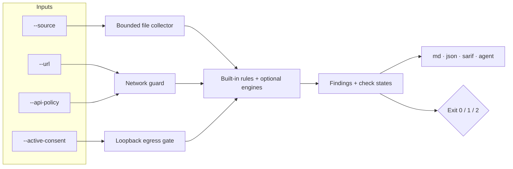

# Wakeio Security CI

**Local security checks for CI that never let a clean result hide what wasn't checked.**

[](LICENSE)
[](package.json)
[](https://www.npmjs.com/package/wakeio-security-ci)

[한국어](README.ko.md) · [日本語](README.ja.md) · [简体中文](README.zh-CN.md)

Wakeio scans the source code, URLs and API policies you explicitly point it at, and writes Markdown, JSON and SARIF reports. Every report shows **findings, evidence and incomplete checks side by side**, so "0 findings" can't quietly mean "didn't run".

- **Local by default.** No account, no hosted service, no LLM, no source upload, no telemetry.
- **Reads your code as data.** Never runs your install scripts, builds or tests.
- **Honest exit codes.** An incomplete check fails the run, even with zero findings.

```text
candidate · high · ast:sql-input-sink
app/routes/users.ts:4
evidence: req.query.id -> statement -> db.query(...)
review: use the database driver's parameter binding and verify the generated query
```
<sub>Synthetic regression fixture, not a real application result.</sub>

## Quick start

Requires Node.js 22+. Keep reports outside the scanned project.

```sh
npx --yes wakeio-security-ci@0.4.0 scan \
  --source ./your-app \
  --tools none \
  --out ../wakeio-reports
```

`--tools none` runs only the built-in checks, so nothing else needs to be installed. Run `doctor` first if you want a read-only inventory of what will be scanned:

```sh
npx --yes wakeio-security-ci@0.4.0 doctor --source ./your-app --tools none
```

More targets:

```sh
# A live site (explicit pages only, no crawling)
wakeio-security-ci scan --url https://your-app.example --page https://your-app.example/pricing --tools none

# Source and URL in one report
wakeio-security-ci scan --source ./your-app --url https://your-app.example --tools none
```

## GitHub Actions

Pin a reviewed commit SHA and upload the reports even when the scan fails.

```yaml
- uses: actions/checkout@11d5960a326750d5838078e36cf38b85af677262
  with:
    persist-credentials: false
    path: wakeio-source

- uses: dusen0528/wakeio-security-ci@575dbff63c6adc36e327487a2a9a2ead8337b4f0
  with:
    source: wakeio-source
    tools: none
    out: wakeio-security-reports

- uses: actions/upload-artifact@ea165f8d65b6e75b540449e92b4886f43607fa02
  if: always()
  with:
    name: wakeio-security-reports
    path: wakeio-security-reports
```

Full workflow: [`examples/github-action.yml`](examples/github-action.yml) · Inputs: [`action.yml`](action.yml) · Active testing uses a separate [`dast` Action](dast/action.yml) ([example](examples/github-dast.yml)).

## What it checks

| Target | Checks | Enabled by |
| --- | --- | --- |
| **Source code** | JS/TS paths where request input reaches SQL, HTML, process, outbound request or redirect sinks; credential shapes; Next/React and Supabase candidates | `--source` |
| **Public URL** | Security headers, CSP, cookies, CORS, mixed content, source maps and debug clues, secret-shaped strings | `--url` |
| **API policy** | Whether another account or an anonymous caller can read a protected resource (read-only GET) | `--api-policy` |
| **Active DAST** | Schemathesis inputs for chosen OpenAPI operations, signed Nuclei templates, SQL differential profiles | `--active-consent` |
| **Optional engines** | Gitleaks, OSV-Scanner, Trivy, Bandit | `--tools` |

Each check is deliberately narrow. Results are **candidates for review**, not exploit proof or a whole-application safety verdict. The exact scope of every rule is in the [checklist](docs/checklist.md).

## Reports and exit codes

Every scan writes four files to `--out`:

| File | For |
| --- | --- |
| `report.md` | People: summary, evidence, limits, remediation hints |
| `report.json` | Tools: checks, scope, provenance, findings, incomplete states |
| `report.sarif` | GitHub code scanning (SARIF 2.1.0) |
| `agent-report.json` | Agents and automation: scan gate and finding links |

| Exit | Meaning |
| ---: | --- |
| `0` | All applicable checks completed, nothing at or above `--fail-on` (default `high`) |
| `1` | A finding reached the `--fail-on` threshold |
| `2` | A check failed, timed out or was incomplete, or the configuration was invalid |

`--fail-on none` turns off finding-based failure only. An incomplete scan still exits `2`.

## How it works



Collectors read only what you declared, within file, byte, request and time budgets. Network checks refuse private and metadata addresses unless you allow them, and active engines can only reach one validated origin through a loopback egress gate. Every check reports a state (`completed`, `partial`, `error`), and the exit code comes from those states, not just from the finding count.

| Path | What lives there |
| --- | --- |
| [`src/source/`](src/source) | Source collection, AST data flow and framework rules |
| [`src/`](src) | CLI, URL/API scanners, DAST runners, reports, compare and replay |
| [`src/agent-dast/`](src/agent-dast) | Plan runner for agent-selected DAST tasks |
| [`workers/`](workers) | Isolated workers (Schemathesis, API state) |
| [`action.yml`](action.yml), [`dast/`](dast), [`actions/`](actions) | GitHub Actions |
| [`schemas/`](schemas) | JSON schemas for reports and worker results |
| [`examples/`](examples) | Policies, demo servers and workflows |
| [`docs/`](docs) | Guides, contracts and verification records |

## Commands

| Command | What it does |
| --- | --- |
| `scan` | Run checks and write reports |
| `doctor` | Read-only inventory of targets and engine readiness |
| `compare` | Diff two reports (a disappeared finding is `not_observed`, not "fixed") |
| `plan` | Validate an API or DAST policy without sending any request |
| `replay` | Re-run exactly one finding with its original policy |
| `init` | Generate a CI workflow |
| `advise` | Optional, consent-gated AI advice on a report (never changes code) |
| `handoff` | Package one finding for review and recheck |

`npx wakeio-security-ci@0.4.0` is the latest npm release. Newer commands and flags (`0.5.0` preview) run from source:

```sh
git clone https://github.com/dusen0528/wakeio-security-ci.git
cd wakeio-security-ci && npm ci --ignore-scripts && npm run build
node build/src/cli.js scan --source /path/to/your-app --tools none
```

## Documentation

- **Guides:** [API policy](docs/preview-0.4-api.md) · [Before/after comparison](docs/preview-0.4-comparison.md) · [Native DAST](docs/native-dast.md) · [Source handoff](docs/source-handoff.md) · [AI advice](docs/agent-advice.md) · [Repair preview](docs/repair-preview.md)
- **Contracts:** [Agent report](docs/agent-report.md) · [Action delivery](docs/action-delivery.md) · [Source flow budgets](docs/source-flow.md) · [Code coverage](docs/source-code-coverage.md)
- **Releases and verification:** [Changelog](CHANGELOG.md) · [0.4.0 release](docs/release-0.4.0.md) · [Verification record](docs/verification-0.4.md)
- **Everything else:** [Detailed reference](docs/reference.md) (the full previous README)

## Contributing

New rules come with vulnerable and fixed synthetic fixtures, evidence and documented limits. See [CONTRIBUTING.md](CONTRIBUTING.md) and [SECURITY.md](SECURITY.md).

## License

[Apache-2.0](LICENSE). External scanners and rules keep their own licenses ([THIRD_PARTY_NOTICES.md](THIRD_PARTY_NOTICES.md)).
