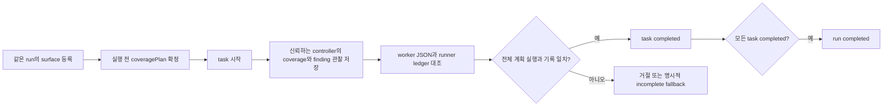

# agent-dast RunStore의 증거와 완료 기준

RunStore v2는 신뢰하는 로컬 controller가 task 계획, 실행 관찰, finding 참조와
종료 ledger를 저장하는 SQLite SDK입니다. worker가 stdout으로 `completed`를
주장하는 것만으로 task나 run이 완료되지는 않습니다. agent/provider 실행,
네트워크 검사, CLI/Action 통합, 자동 증거 파일 작성은 이 모듈의 기능이 아닙니다.
[experimental SDK 사용법](agent-dast-sdk.md)을 함께 참고하세요.

## 계획과 원자적 기록

`NewTask.coveragePlan`은 `{ surfaceId, check }`의 비어 있지 않은 배열입니다.
최대 256개이며 같은 조합을 중복할 수 없습니다. 모든 surface는 이미 같은
run에 존재하고 `surfaceIds`에 배정되어 있어야 합니다. 배정한 surface마다
최소 한 개의 계획 항목이 필요합니다. 시작 후 계획을 바꾸는 API는 없습니다.
`check`와 `ruleId`는 소문자 영숫자로 시작하는 최대 100자의 고정 식별자입니다.

`recordCoverage`와 `recordFinding`/`recordFindings`는 task와 run이 모두
`running`일 때만 배정된 계획 항목을 기록합니다. batch는 최대 256개이며,
하나라도 잘못되면 그 호출 전체를 rollback합니다. 기존 coverage의 정확한
반복은 아무 변경도 하지 않습니다. 결과나 이유가 다른 재기록은 거절합니다.
예를 들어 이전 `error`를 뒤늦은 `executed`로 덮어쓸 수 없습니다.

`NewFinding`은 `findingId`, `runId`, `taskId`, `surfaceId`, `check`, `ruleId`,
`severity`, 선택적인 `evidenceRef`를 받습니다. method/path/parameter,
parameter location과 auth state는 caller의 finding 주장이 아니라 배정된
surface에서 가져옵니다. 증거 참조는 최대 200자의 상대 `evidence/...json`
경로이며, 기본값은 `evidence/<입력 findingId>.json`입니다. 이 SDK는 그 파일의
존재나 내용을 검증하거나 생성하지 않습니다. 같은 observation ID의 정확한
반복만 허용하고, 다른 task·severity·증거 참조·문제로 재사용하면 거절합니다.

## 중복과 task별 관찰

같은 run의 rule/method/정규화한 path/parameter/auth state/parameter location이
같으면 하나의 canonical finding ID를 유지합니다. 숫자 또는 UUID path segment는
`{id}`로 정규화합니다. 다른 auth state나 parameter location은 합치지 않습니다.
canonical ID는 최초 ID를 유지하고 severity는 관찰한 최대 수준만 보존합니다.
`finding_observations`에는 각 입력 finding ID와 task/check/severity/evidence ref를
모두 남깁니다. `inserted: false`도 새로운 관찰은 저장될 수 있다는 뜻입니다.

완료를 대조할 때는 **해당 task에서 관찰한 distinct canonical findings와 task별
최대 severity**를 사용합니다. 다른 task의 더 높은 severity를 빌려 오지 않습니다.
새로운 관찰이 이전 `rejected` finding에 합쳐지면 다시 `candidate`가 됩니다.
동일 observation의 반복은 rejected 상태를 다시 열지 않습니다. `confirmed`는
severity 집계에서 사라지지 않으며, `open_by_severity`는 non-rejected 항목을 셉니다.
이 상태 이름들은 이 SDK가 exploit이나 fix를 검증했다는 뜻이 아닙니다.

## 완료와 fallback

`completeTask(result, ledger)`는 worker-result v1을 다시 immutable JSON snapshot으로
검증합니다. `completed`에는 다음 조건을 모두 요구합니다.

- 비어 있지 않은 전체 계획이 실제 coverage에서 `executed`로 기록되고 오류·skip이 없음.
- worker의 planned/executed/skipped와 task별 distinct finding 개수·전체 ID·severity가 저장된 관찰과 일치.
- distinct finding은 최대 20개. 그보다 많으면 관찰은 보존하되 incomplete 상태로 닫아야 함.
- ledger provider가 배정된 task provider와 같고 exit code가 0이며 stdout이 1–2048 UTF-8 bytes, truncation이 없음.

실패한 완료 호출은 status, gaps, ledger를 포함해 아무것도 변경하지 않습니다.
명시적인 `partial`/`error`/`skipped` 결과는 유효한 형식과 gap을 요구하지만,
그 descriptive counts를 DB coverage/finding 집계로 복사하지 않습니다.
runner의 zero-count error fallback도 이미 저장된 finding과 coverage를 지우지
않습니다. gaps는 worker/runner가 전달한 진단이며 독립 실행 증명이 아닙니다.
task나 run이 terminal이면 반복 전이와 늦은 기록을 거절합니다. run은 task가
최소 하나 있고 모두 `completed`일 때만 `completed`로 닫힙니다.

계획·배정 surface와 batch는 각각 256개, run의 surfaces/tasks와 DB의 runs는
각각 4096개, task 관찰은 4096개로 제한합니다. ledger count와 task 진단 count는
최대 10억, ledger bytes는 최대 1 GiB입니다. 이 수치는 로컬 metadata 한도이며
네트워크 요청 예산이나 실제 실행 한도가 아닙니다.

## DB 버전, private 파일과 신뢰 경계

`openRunStore(':memory:')` 또는 factory의 disk DB를 사용합니다. Node.js는
22.x의 22.13 이상, 23.x의 23.4 이상, 또는 24 이상을 지원합니다. 지원하지 않는
runtime은 자신의 파일/스키마 변경 전에 `node_sqlite_unavailable`로 거절합니다.
다른 CLI 기능의 package Node floor와는 별개입니다. 이 정책은 `readOnly` 지원과
flag 없이 사용하는 SQLite를 기준으로 합니다.
[Node 22 SQLite 문서](https://nodejs.org/download/release/v22.22.1/docs/api/sqlite.html),
[Node 23.4 SQLite 문서](https://nodejs.org/download/release/v23.4.0/docs/api/sqlite.html).

disk factory에는 **이미 존재하는 현재 UID 소유의 0700 디렉터리**가 필요합니다.
신규 파일은 exclusive create와 0600으로 만들고, 기존 파일도 소유권·0600·regular
file·single link를 요구합니다. 마지막 parent나 DB symlink는 거절하고 ancestors는
canonicalize합니다. 부모 디렉터리를 자동 생성하거나 기존 permission을 바꾸지
않습니다. 같은 UID의 적대적인 path swap을 막는 OS sandbox는 제공하지 않습니다.
`new RunStore(callerOwnedDatabaseSync)`는 이미 열린 native 연결을 받아 같은 schema
검증을 수행하며, 그 연결/파일의 private 관리 책임은 caller에게 있습니다.

`PRAGMA user_version`은 2입니다. 정확한 빈 prototype v1 schema만 v2로 migration합니다.
v1에 어느 table이든 데이터가 있으면 `legacy_evidence_untrusted`로 명시적으로
거절하고 기존 DB bytes를 바꾸지 않습니다. 오래된 completed 행에 신뢰할 계획을
추정해 넣지 않습니다. 별도 파일에 새 run을 시작하고 기존 증거를 보존하세요.
잘못된 schema나 version은 `unsupported_version`이며 clean 결과로 바뀌지 않습니다.
factory는 SQLite를 열기 전에 100-byte header의 WAL 표시와 `-wal`/`-shm`
존재를 확인하고, 해당 파일은 `legacy_evidence_untrusted`로 거절합니다. WAL-mode
기존 증거를 자동 checkpoint하거나 지우지 않습니다. 현재 factory는 rollback
journal을 사용합니다. `readOnly`만으로 filesystem 무변경을 보장할 수는 없으며,
정상 rollback journal의 transaction/recovery는 SQLite가 담당합니다.
[SQLite WAL read-only 조건](https://sqlite.org/wal.html#read_only_databases).
기록은 `BEGIN IMMEDIATE` transaction으로 묶고 SQLite busy wait는 5초입니다.
여러 연결의 변경을 serialize하지만 별도 async executor나 자동 재시도는 없습니다.
`roundSummary`의 존재 확인과 모든 집계는 하나의 `BEGIN DEFERRED` read transaction에
묶습니다. commit 성공 뒤에만 반환하고 실패하면 rollback한 뒤 fixed error를 냅니다.
같은 요약에는 다른 연결의 중간 commit을 섞지 않습니다. 이 read snapshot은 writer
권한을 예약하지 않습니다. caller가 관리하는 native WAL 연결에서는 별도 writer가
commit할 수 있지만, factory의 기존 WAL 입력 거절 정책은 그대로입니다.
[SQLite read transaction 동작](https://www.sqlite.org/lang_transaction.html#read_transactions_versus_write_transactions).

이 계약은 **controller만 DB/API write 권한을 가진 경우**에 의미가 있습니다.
worker나 다른 코드에 SQLite 파일/연결을 직접 주면 SQL로 검증을 우회할 수 있습니다.
ledger/coverage 역시 trusted caller가 전달한 관찰이지 암호학적 attestation이 아닙니다.
raw request/response/credential을 저장하지 마세요. SDK는 실제 DAST 완료나 운영 보안,
provider 호출, 상용 동등성 또는 네 가지 기존 scan report 생성까지 증명하지 않습니다.

검증 결과는 [독립 acceptance](agent-dast-integrity-acceptance.md)에 별도로 기록합니다.
이 문서 작성 단계에서 candidate build/test/패키지 consumer 성공은 주장하지 않습니다.
