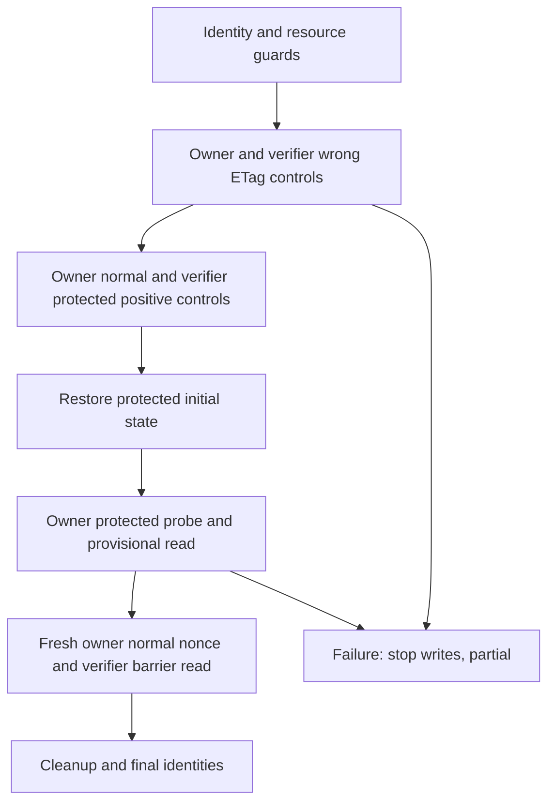

# Explicit property-write API check

`api-property-write` checks one operator-declared disposable resource for a protected
property change made with its owner's credential. It uses privileged HTTP readback,
normal-write and privileged-write controls, strong ETags, and a freshness barrier.
It does not discover endpoints or fields, independently inspect storage, or verify a fix.
This is separate from the [fixed owned PATCH pilot](api-write-state.md).

Use a reviewed source build. The feature is not automatically enabled by `scan`, the
GitHub Action, `agent-dast-run`, or advice. Every active invocation needs consent.

```sh
node build/src/cli.js api-property-write --policy ./property-policy.json --preflight
node build/src/cli.js api-property-write --policy ./property-policy.json \
  --active-consent --out ./property-run-001 --timeout-ms 30000 --max-requests 23
```

Preflight validates the policy/credential configuration without DNS or HTTP. Its 0
means ready, not secure or executed. The output directory for an active run must be
new. Credentials are read from the selected environment variables once; provide full
Authorization header values through your secret manager, never through CLI arguments.
Do not commit populated policies containing private identities or resource markers.

## Server and policy prerequisites

The resource must be disposable staging data, permit the generated normal-field nonce
format, and have no business side effects that restoring two fields cannot undo.
The same exact URI supports JSON GET and `application/merge-patch+json` PATCH. The
privileged verifier must read/write both fields and restore the initial values.
Owner/verifier representations must share strong mutation-validator semantics.

```json
{
  "version": 1,
  "origin": "https://staging.example.test",
  "declarations": {
    "disposable": true,
    "staging": true,
    "sharedStrongEtag": true,
    "normalNonceFormat": "wakeio-property-v1"
  },
  "actors": {
    "owner": {"authorizationEnv": "PROPERTY_OWNER_AUTH", "identity": {"path": "/whoami", "pointer": "/id", "equals": "owner-fixture"}},
    "verifier": {"authorizationEnv": "PROPERTY_VERIFIER_AUTH", "identity": {"path": "/whoami", "pointer": "/id", "equals": "verifier-fixture"}}
  },
  "resource": {
    "path": "/resources/disposable-001",
    "id": {"pointer": "/id", "equals": "disposable-001"},
    "ownerPointer": "/ownerId",
    "runMarker": {"pointer": "/runMarker", "equals": "operator-disposable-run-001"}
  },
  "normal": {"field": "title", "initial": "initial title"},
  "protected": {"field": "role", "initial": "reader", "probe": "writer", "control": "operator"}
}
```

Paths are fixed same-origin paths without query/fragment, encoded separators or dot
segments. HTTPS is required except explicitly permitted literal loopback HTTP;
`--allow-private` is a separate private-address opt-in. Redirects and address fallback
are refused. Identity assertions use JSON pointers; resource ID, owner and run marker
must be separate from the two top-level write fields. Protected values are bounded,
same-type, non-null scalars; initial differs from probe/control. Containers, deletion,
nested writes, duplicate JSON keys and prototype keys are unsupported.

Owner resource GET need not expose the protected field. Verifier JSON must expose both
fields and preserve all other visible JSON fields throughout the experiment. Dynamic
metadata such as changing `updatedAt` makes this v1 experiment incomplete. There is no
ignore list. Resource-owner and before/after principal assertions do not establish
uninterrupted authentication or generic organization/tenant isolation.

## Fixed request order and stopping



There are 22 planned HTTP requests and eight PATCHes. The full ordinal plan is in the
[contract note](research/property-write-contract-2026-10-15.md#frozen-plan-22-http-requests-eight-patches).
Both wrong-tag PATCHes require 412 followed by an unchanged verifier read. Normal,
privileged, restore, barrier and cleanup PATCHes require 200/204. Owner protected probe
accepts 200/204/403; every GET requires 200. Neither status alone establishes an effect.
The owner probe is sent only after all preceding controls succeed.

All ordinary writes use the latest verifier strong ETag. Changed representations
must change their immediately preceding tag. A fresh normal-only nonce write after
the provisional probe read must be visible with the same protected value before the
engine labels an effect observed or not observed. This tests simple stale-view
failures; a server fabricating consistent bodies and validators remains outside the
oracle's ability to establish independent storage truth.

An ambiguous PATCH stops every further write, including automatic cleanup. At most
one reserved verifier GET can reconcile within the live deadline/budget (23 HTTP total,
still eight PATCH). It cannot create a finding or turn ambiguity into success. An
effect established before ambiguous cleanup stays visible with partial status.
Cancellation or deadline ends all HTTP; no detached cleanup request is sent. Review
and manually reconcile the disposable resource after any incomplete run.

`--max-requests` accepts 1–23, defaults to 23; below 22 refuses active execution before
HTTP. `--timeout-ms` accepts 1–120000 and defaults to 30000. Request bodies are bounded
to 4096 bytes, individual response bodies to 65536, and aggregate responses to 1048576.
The same run deadline and budget govern controls, reconciliation and cleanup.

## Reports and CI

A run writes `report.json`, `agent-report.json`, `report.sarif`, and `report.md`.
The `api.property-write` check carries `propertyWriteEvidence` v1: fixed step indices,
actors 0/1, methods, status/outcome/reason enums, controls, request counts, effective
budgets, policy digest, effect/provisional and cleanup. SARIF uses run properties;
Markdown includes the same ledger. Raw URIs, field/env names, credentials, values,
nonces, ETags and bodies are omitted. A policy digest binds configuration, not target
ownership or authenticated remote truth. Restrict policy file access separately.
Because reports omit the endpoint, field names and values, keep the original local
policy privately alongside the run record and match its normalized `policySha256`.
The public SDK's `propertyPolicyDigest(parseApiPropertyPolicy(policy))` computes this
digest; it is not the SHA-256 of the policy file's raw whitespace/bytes. Preserve the
invocation's build identity and effective budgets too. A new experiment needs a fresh
disposable resource, a new explicit invocation and all controls; there is no
seed-only or automatic replay guarantee.

- Exit **2**: incomplete/error, missing controls, inconsistent evidence or unconfirmed
  cleanup/identity. This takes priority even with an observed candidate or `--fail-on none`.
- Exit **1** at the default high threshold: completed observed effect, represented by
  high-severity, low-confidence `api.property-write-unauthorized-effect` candidate.
- Exit **0**: completed controls and cleanup with no observed effect in this exact view,
  or an explicitly changed threshold. It is not a whole-application security result.

Vulnerability/remediation verification remains false. A later `not_observed` comparison
is not an authoritative fixed result; policy and effective budgets must match, and
incomplete reports remain unverified. The current property-write CLI does not attach
a declared `ScanReport.scope`, so its report pairs remain `unverified` under the
general comparison contract even when those values match. An SDK caller supplying
an explicitly reviewed scope still needs every existing comparison prerequisite;
that is not an added CLI comparison or remediation capability. Advice policy 13
grants no new active replay route. Re-execution needs a fresh explicit invocation and consent.

The evidence oracle is API readback, distinct from the independent storage truth used
by owned test fixtures. No production efficacy or external staging success is claimed.


## Owned-target validation

The independent [target scenarios](../tests/api-property-write-independent.test.ts)
exercise 21 predefined owned scenarios: three ended with candidate exit 1, two with
scoped not-observed exit 0, and sixteen with exit 2, including one intentional artifact
delivery failure. Twenty runs delivered all four formats with privacy assertions;
the delivery-failure run did not count as successful report delivery. All 21 owned
TCP connection lifecycles closed. Test-only storage observation supplies independent
ground truth; the shipped engine still uses HTTP readback. Separate evidence tests
passed ten groups; the combined initial owner/evidence run passed 23/23.
These results establish the predefined synthetic contract, not external staging
success, a production detection rate, independent storage proof or safe remediation.
