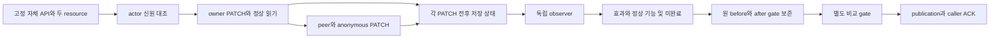

# 소유 합성 API의 PATCH 저장 효과 검증

**HTTP 응답이 차단처럼 보여도 데이터는 바뀔 수 있습니다.** 이 기능은 고정한
자체 loopback API에서 PATCH 전후의 저장 상태를 독립적으로 읽습니다. 정상
owner의 쓰기·읽기도 확인해, 모든 요청을 차단하는 변경을 성공으로 판정하지 않습니다.

0.5.0 소스 프리뷰의 별도 SDK·CLI·Action 기능입니다. 공개 npm은 아직 0.4.0이며
사용자 API나 외부 URL은 받지 않습니다. 검증 범위와 아직 확인하지 않은 delivery 환경은
아래에서 구분합니다.



## 범위와 동의

선택 가능한 입력은 여섯 개의 고정 자체 candidate입니다. URL·credential·method·
body·handler·observer callback·임의 patch를 입력하지 않습니다. 두 resource의
title 문자열 교체만 수행하고 다른 필드와 row의 불변성을 대조합니다. Anonymous
요청은 계획된 control이며 인증 실패의 fallback이 아닙니다. 대상 dependency·DB
설치, endpoint 탐색, 임의 POST/DELETE, 모델 호출이나 일반 속성 퍼징은 없습니다.

CLI는 `--active-consent`, SDK는 `activeConsent: true`가 필요합니다. 두
identity-before가 통과하지 않으면 owner control을 포함한 PATCH를 보내지 않습니다.
Resource별 정상 owner 쓰기가 실패하면 해당 resource의 무권한 PATCH를 진행하지
않습니다. 이후 신원·응답·저장 상태·정리 확인 실패도 partial입니다.

## CLI와 SDK

Node.js 22+에서 검토한 source checkout을 빌드한 뒤 별도 명령을 실행합니다.
아래 경로는 자체 예시이며 고객 API가 아닙니다.

```sh
node build/src/cli.js api-write-state \
  --candidate fixed --active-consent --timeout-ms 30000 \
  --out /path/to/new-owned-write-results
```

```js
import {
  runOwnedApiWriteStatePilot,
  deliverOwnedApiWriteStatePilot,
} from 'wakeio-security-ci';

const result = await runOwnedApiWriteStatePilot({
  candidate: 'fixed', activeConsent: true, timeoutMs: 30_000,
});
const receipt = await deliverOwnedApiWriteStatePilot(result, {
  outDir: 'results/owned-api-write',
});
// Check receipt.finalExitCode and the caller's actual process exit separately.
```

기존 `scan --api-policy`와 API v2 GET 계약은 읽기 전용으로 유지됩니다. 이
command의 consent는 외부 target 쓰기 허가나 자동 replay를 뜻하지 않습니다.

## 여섯 candidate의 의미

다음은 계약의 기대값입니다. 원 vulnerable baseline의 gate `1`을 지우지 않고
candidate와 비교 gate를 별도로 기록합니다.

| Candidate | 독립적으로 확인하는 차이 | Candidate / 비교 gate |
| --- | --- | --- |
| `fixed` | 정상 owner는 title을 저장하고 peer·anonymous의 저장 변경을 차단 | `0 / 0` |
| `ineffective` | peer에게 403을 응답하지만 실제 row는 변경 | `1 / 1` |
| `status-only` | 정상 owner는 쓰고 peer·anonymous는 200을 받지만 저장 변경 없음 | `0 / 0` |
| `all-deny` | 정상 owner 쓰기도 차단 | `2 / 2` |
| `normal-regression` | owner의 정상 값·필드가 유지되지 않음 | `2 / 2` |
| `wrong-object` | owner PATCH가 다른 row를 변경 | `2 / 2` |

200/no-change는 이 저장 window에서 무권한 효과를 관찰하지 않았다는 뜻이며 HTTP
denial 정책의 검증이 아닙니다. Wrong-object나 다른 필드 변경은 성공한 차단으로
바꾸지 않습니다. Peer가 바꾼 title을 GET이 실제 저장값과 일치하게 반환하는 것은
그 자체로 정상 기능 회귀가 아닙니다. 앞서 관찰한 무권한 변경은 별도로 유지합니다.

## 단계와 한도

한 phase는 identity-before 2회, resource별 GET-before → PATCH-owner →
GET-normal → PATCH-peer → GET-check → PATCH-anonymous → GET-check,
identity-after 2회의 고정 18단계입니다. Baseline/candidate가 공유하는 최대
HTTP 시도는 36회, PATCH는 12회입니다. Planned와 attempted/evaluated/
inconclusive/not-attempted를 구분합니다.

기본·최대 run deadline은 30초, request body 4 KiB, response 64 KiB, 전체
response 1 MiB, store 64 KiB, cleanup 대기 2초, delivery 대기 5초입니다.
전송 여부가 모호한 PATCH는 재시도하지 않습니다. 취소·timeout·부분 body·저장/
dispatch 불일치·cleanup unknown은 exit `2`이며 이미 관찰한 효과를 지우지 않습니다.

SDK deadline은 cooperative이며 모든 host I/O의 중단이나 hard wall/RAM 한도를
보장하지 않습니다. Action의 별도 supervisor는 child process group에 45초·
1 MiB output 한도를 적용하고 종료를 확인합니다. 악성 co-host sandbox나 crash
recovery 보장은 아닙니다.

## 저장 경로와 ACK

CLI stdout의 최종 JSON 한 줄은 `runId`, `deliveryAttemptId`,
`outputRelativePath`, delivery와 exit code를 담습니다. 상대 경로는
`OUT/RUN_ID/DELIVERY_ATTEMPT_ID/`를 가리킵니다.

- `before/`, `after/`, `verification/`: phase가 존재할 때 각각
  `report.json`, `agent-report.json`, `report.md`, `report.sarif`
- `api-write-manifest.json`: 모든 phase 파일의 상대 경로·UTF-8 byte count·SHA-256
- `api-write-delivery.json`: publication marker와 manifest/report digest 연결

Packet은 같은 filesystem의 private sibling staging directory에서 완성한 뒤 새
final directory로 publish합니다. Directory는 0700, 파일은 0600입니다. 원 store·
body·token·canary·원 source를 packet에 넣지 않습니다. Before/after 원 보고서와
gate는 비교 보고서로 대체하지 않습니다.

Marker의 `status: publication_only`, `requiresCallerAcknowledgement: true`,
`provesFinalProcessExit: false`를 확인하세요. 파일 존재만으로 성공을 판정하지
않으며 caller receipt와 실제 exit를 함께 확인해야 합니다. Delivery-only retry는
retained redacted bytes를 새 attempt로 publish하고 HTTP/handler를 재실행하지
않습니다. 새 run 호출은 새로운 실행이며 delivery retry가 아닙니다. 늦은 I/O나
ACK 불명은 unknown/`2`로 남습니다. Durable storage나 여러 backend transaction은
이 계약에 포함되지 않습니다.

## 별도 GitHub Action

검토한 source checkout을 `wakeio-security-ci` 경로에 둔 workflow의 예입니다.
Remote `uses:`를 사용할 때에는 새 Action 경로를 포함한 검토된 full commit SHA를
고정하세요. 아래는 remote publication 완료 기록이 아닙니다.

```yaml
- name: Check owned PATCH effects
  id: write
  uses: ./wakeio-security-ci/actions/api-write-state
  with:
    candidate: fixed
    active-consent: 'true'
    timeout-ms: '30000'
    out: owned-write-reports
```

Consent와 enum·timeout·output 경로를 Node setup 전에 검사하고 checked-in bundled
CLI를 직접 실행합니다. npm이나 scanned checkout의 script는 실행하지 않습니다.
Output은 새 workspace-relative 경로이며 absolute 경로·dot segment·symlink·기존
output을 거부합니다.

`before-exit-code`, `after-exit-code`, `verification-exit-code`는 별도 gate이며
`exit-code`는 wrapper 최종 결과입니다. `report-dir`은 확인한 고유 attempt 경로이고
`before-report`, `after-report`, `verification-report`, `report-agent`,
`publication-marker`, `receipt`가 함께 제공됩니다. Wrapper receipt는
`OUT/api-write-action-receipt.json`입니다.

Wrapper는 child exit와 최종 JSON을 맞추고 manifest의 모든 공개 파일 및
report/agent pair digest를 확인합니다. 실패·취소·해시 불일치·output fault는 최종
`2`이며 확인되지 않은 경로를 성공 receipt로 내보내지 않습니다.
`delivery-status: delivered`도 보안 검사 통과를 뜻하지 않습니다. 불완전한 검사
gate `2`인 packet도 올바르게 배송될 수 있습니다. 실제 Action outcome은 wrapper
publication receipt와 따로 확인하세요.

## 보고서와 검증 상태

Handler assets는 코드의 고정 manifest digest에 대조합니다. Observer/runtime SHA는
현재 disk bytes의 fingerprint와 실행 후 불변 확인이며, 실제 process에 먼저 로드된
코드의 외부 attestation이나 sandbox 증명이 아닙니다. 독립 readonly FD와 observer는
저장 효과를 별도 논리로 확인합니다. Distribution/source 해시의 외부 동결은 별도
검증 근거이며 같은 host의 악성 변경으로부터 격리를 보장하지 않습니다.

`CheckResult.apiWriteStateEvidence` v1은 scope·phase·execution·effect·normal·
verification·cleanup·reasons·counts·lineage 및 고정 GET/PATCH ledger를 네 형식에
보존합니다. `observed`는 자체 fixture의 실제 저장 효과이며 source candidate가
아닙니다. `scoped_fix_effect_observed`는 scoped 비교와 정상 대조의 결과이며 고객
앱의 verified fix가 아닙니다. Agent의 `vulnerabilityConfirmed`와
`remediationVerified`는 false이며 기존 verification/remediation 상태를 바꾸지 않습니다.

2026-10-13 focused 독립 acceptance 검증은 6/6 group, 0 skip, 10.6초로
통과했습니다. 여섯 candidate의 기대 gate, 원 baseline `1`, HTTP/PATCH 단계와
취소·정리·manifest·네 형식의 보고서 대조를 확인했습니다. 실제 Action wrapper도
`fixed → 0`, `ineffective → 1`, `all-deny → 2`, 동의 거부를 확인했습니다.

전체 required-engine suite도 2026-10-13에 1024/1024, 0 skip, 104.1초로
통과했습니다. 실행 전후 source snapshot이 같았습니다. Focused 6 group은 새 기능의
독립 수용 근거이고, 전체 suite는 기존 기능을 포함한 회귀 검증입니다.

2026-10-13 이 문서 동결 시점은 위 검증 완료 후, fresh installed package/source
archive consumer와 hosted GitHub workflow 실행 전입니다. 후속 delivery 검증
결과는 사용하려는 커밋의 PR·CI receipt에서 따로 확인하세요. 이 자체 fixture 결과는
생산 API 권한 정확도, 고객 취약점·수정 또는 상용 DAST 동등성을 입증하지 않습니다.

방법과 근거는 [공식 자료 조사](research/api-write-evidence-2026-10-13.md), 현재
GET/read-only 기능은 [기존 state pilot](api-state-oracle.md)을 참고하세요.
