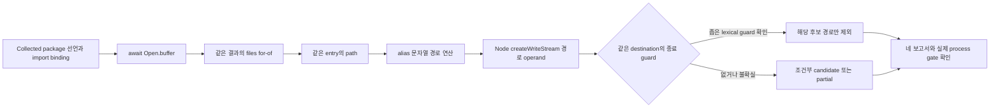

# Archive 파일명에서 쓰기 경로까지 읽는 source 검사

ZIP entry의 파일명은 파일 내용과 별개의 입력입니다. 이 검사는 `unzipper.Open.buffer`
결과를 순회하며 얻은 `entry.path`가 Node 파일 writer의 경로 operand로 이어지는지를
소스에서 연결합니다. **0.5.0 source preview에 구현됐으며 로컬 source-only 검증 범위는 아래에서 확인할 수 있습니다.**
Source/Action preview0.5.0의 범위이고 공개 npm0.4.0에 이미 들어 있다고 해석하지 않습니다.



## 무엇을 검사하는가

첫 범위는 외부 `unzipper` binding의 pristine `Open.buffer`, awaited directory 결과의
`files` for-of record, 그 record의 `path`, 안정된 Node `fs.createWriteStream` 첫
operand입니다. Archive 내용 stream이나 write data에만 파일명이 쓰이는 경우와
destination 역할을 혼동하지 않습니다. Rule은 `ast:archive-path-write`, 추가 trace
source kind는 `archive_entry_path`, conditional context kind는 `declared_package_api`입니다.
Ruleset revision은 `2026-10-13.4`입니다. Parse/event API, 다른 archive 패키지,
다른 file-write API는 이 slice의 지원 범위가 아닙니다.

가장 가까운 수집 package metadata의 `unzipper` 선언은 literal `0.12.3` 또는
`^0.12.3`만 이 계약에 포함합니다. Lock이 있으면 선언과 일치하는 reviewed exact
`0.12.3`/`0.12.5` 선택 근거가 필요합니다. Lock 없는 선언은 **조건부 package API
근거**이며 설치 버전·실제 loader identity는 unknown입니다. 다른 버전이나 새 버전을
자동 safe로 세지 않습니다. Types 선언도 런타임 identity 증명이 아닙니다.

Local fake Open/entry, package self-reference, import shadowing·mutation, entry/path replacement·escape,
충돌·누락·해석 불가 metadata와 identity는 분석 불확실성입니다. Writer의 명시적
fd/custom fs/opaque options도 경로 operand가 실제 native destination이라는 가정을
확인할 수 없으므로 partial 근거를 보존합니다. 이름이나 디렉터리에 `zip`이 있다는
이유만으로 원천을 인정하지 않습니다.

## Source CLI와 CI 보고서

검토한 Wakeio source checkout의 빌드된 CLI를 사용합니다. 대상 checkout은 데이터로
읽으며 이 명령은 대상 dependency 설치·import·hook·build·test·서버·DB를 실행하지
않습니다. 모델 호출이나 archive 추출도 하지 않습니다.

```sh
node /path/to/wakeio-security-ci/build/src/cli.js scan \
  --source /path/to/reviewed-target --tools none \
  --out /path/to/new-archive-reports
```

출력은 같은 run의 `/path/to/new-archive-reports/report.json`,
`/path/to/new-archive-reports/agent-report.json`,
`/path/to/new-archive-reports/report.md`,
`/path/to/new-archive-reports/report.sarif`입니다. Source 좌표와 conditional trace를
먼저 읽고 metadata·budget·collection gap을 함께 확인하세요. Finding evidence에는
실제 archive 파일명이나 source snippet을 넣지 않지만 source 경로·project 정보는
남을 수 있으므로 공개 전에 artifact 범위를 검토해야 합니다.

기존 passive source Action을 검토한 full commit SHA로 pin합니다. 다음 예시는
repository source만 읽고 네 보고서를 실패한 run에서도 다운로드할 수 있게 합니다.

```yaml
- name: Review source archive paths
  uses: dusen0528/wakeio-security-ci@REVIEWED_COMMIT_SHA
  with:
    source: .
    tools: none
    out: archive-path-reports

- name: Upload source reports
  if: always()
  uses: actions/upload-artifact@ea165f8d65b6e75b540449e92b4886f43607fa02
  with:
    name: archive-path-source-reports
    path: archive-path-reports
    if-no-files-found: error
```

해당 workflow run의 Artifacts에서 `archive-path-source-reports`를 내려받으면
`report.json`, `agent-report.json`, `report.md`, `report.sarif`를 확인할 수 있습니다.
Report pair digest와 실제 process/Action exit를 함께 보세요. 파일이 있다는 사실만으로
CI 성공을 판정하지 않습니다. 이 source 기능은 별도 active DAST consent·target
HTTP·replay 권한을 만들지 않습니다.

## Candidate와 정상 guard의 의미

선언된 archive API에서 writer까지 이어지는 근거는 사람이 확인할 **low-confidence
candidate**입니다. 실제 attacker control·deployment reachability·파일 overwrite를
확인한 observation이 아닙니다. Partial/error/skipped·budget 초과·불확실한 identity는
completed clean과 구분하고 exit2를 유지합니다. Candidate가 있어도 partial2일 수
있으며 `--fail-on none`이 incomplete gate를 통과시키지는 않습니다. Exit0 또한
수집한 범위의 검사 완료를 뜻하며 프로젝트 전체 안전성을 인증하지 않습니다.

아래 자체 예시는 native path flavor로 만든 immutable root/destination에 동일한
`relative` 대조를 하고, invalid 경로는 writer 전에 throw로 종료하는 형태입니다.
이 좁은 lexical pattern만 정상 exclusion 후보입니다. 아래 예시는 source-only 대조로
후보 부재와 exclusion을 확인했지만, 런타임 filesystem safety를 검증한 것은 아닙니다.

```ts
import fs from 'node:fs'
import path from 'node:path'
import unzipper from 'unzipper'

async function reviewOwnedArchive(buffer: Buffer) {
  const directory = await unzipper.Open.buffer(buffer)
  for (const entry of directory.files) {
    const root = path.resolve('owned-output')
    const destination = path.resolve(root, entry.path)
    const relative = path.relative(root, destination)
    if (relative === '..' ||
        relative.startsWith('..' + path.sep) || path.isAbsolute(relative)) {
      throw new Error('Destination is outside the declared output scope')
    }
    const writer = fs.createWriteStream(destination)
    entry.stream().pipe(writer)
  }
}
```

같은 destination·root를 검사하고 invalid branch가 terminating return/throw로
writer에 도달하지 않아야 합니다. Writer는 guard 바로 다음의 동기 direct expression
또는 단일 const initializer여야 합니다. 중간 await/opaque call이나 감싼 writer call은
이 exclusion의 지원 형태가 아닙니다. Loop의 continue 지원은 아직 별도 결정 전입니다.
다른 path flavor는 이 exclusion 계약에 포함하지 않습니다. 초기 문법은 위 세
조건의 OR와 preceding same-block guard로 좁혀져 있으며, 다른 동등한 검사를 자동
인정하는 일반 proof engine은 아닙니다. 단순 `includes`, 경계
없는 prefix, 다른 값 검사, logging만 하는 branch, callback 안의 return, guard 전
writer, guard 뒤 destination mutation은 같은 보장이 아닙니다. String intrinsic 등의
수집된 mutation/escape가 있으면 이 lexical exclusion도 인정하지 않습니다.

이 대조는 symlink·TOCTOU·쓰기 권한·stream 실패 처리·전체 extractor 안전성을
검증하지 않습니다. Origin의 conditional gap은 lexical exclusion 후에도 남으므로
후보가 없는 guarded source도 partial2일 수 있습니다. `unzipper.Extract`를 쓰거나 패키지 버전이 새롭다는 사실도 이
문서의 blanket-safe 근거가 아닙니다. 원본 entry path를 writer의 별도 문자열에
다시 넣는다면 검사한 destination과 실제 operand가 같은지 다시 검토해야 합니다.

분석 counters는 `archiveDirectoriesRecognized`, `archiveEntryPaths`,
`archiveWriteCandidates`, `archiveLexicalExclusions`, `archiveUnsupportedUses`입니다.
분석 사용 횟수이며 독립 취약점 수나 coverage 비율이 아닙니다. Advice policy10은
기존 capped projection에 source/context enum만 추가하는 계약이고, 경로·entry 값·
소스 내용이나 실행 권한을 더하지 않습니다. Live policy10 호출 성공을 주장하지 않습니다.

## 검증과 알려진 교육용 사례

고정 Juice Shop의 upload route는 알려진 arbitrary-file-write 교육용 holdout입니다.
새 OSS 취약점 발견이 아니며 해당 앱을 실행하거나 ZIP을 업로드한 결과도 아닙니다.
[공식 source·package·Node 근거와 검증 기록](research/archive-path-source-2026-10-13.md)는
이 flow와 installed-version unknown 경계를 설명합니다. 기존 seven-flow oracle와
분모는 그대로 두고 archive holdout을 별도 대조로 평가합니다.

2026-10-13 최종 로컬 실측은 다음과 같습니다. Root가 trusted scanner를 실행했고
대상 OSS는 source data로만 읽었습니다. ZIP 추출·앱 실행·실제 overwrite의 성공
기록이 아닙니다.

| 대조 | 관찰과 한계 |
| --- | --- |
| Focused suite | 40/40 통과, skip0. 전체 suite와 별도 |
| Private semantic/gate 대조 | 25개(기존19+실제 수집된 shared `.cjs`5+가이드 예시1) 모두 기대 의미와 gate 일치 |
| Shared `.cjs` 대조5개 | JavaScript code input1개를 실제 수집했음을 확인. Direct fs/path guard의 lexicalExclusions0 |
| 위 가이드 TS 예시 | Archive 후보 없음·lexicalExclusions≥1·partial/exit2. Runtime 추출 안전성은 검증하지 않음 |
| 고정 Juice Shop 전체 source | 전체 보고 항목32→33. `fileUpload.ts` source30:22→writer34:38의 archive low-confidence conditional candidate1개 추가 |
| 고정 NodeGoat 전체 source | 보고 항목5→5. 두 checkout의 기존 보고 항목37개를 모두 유지, 최종 총38개 |
| 선언된 seven-flow oracle | 5/7 observed 유지, scanComplete=false, recall/precision=null. Archive holdout은 별도 분모 |
| Required-engine 전체 suite | 1093/1093 통과. Failed/cancelled/skipped/todo 모두0. 전부 새 archive 테스트라는 의미는 아님 |

Private source 대조는 partial2를 유지했습니다. Juice Shop flow work는766255/800000,
NodeGoat은101065이며 whole-checkout 분석도 partial입니다. 기존37개에는 observation이
포함되므로 전부 취약점이나 candidate로 세지 않습니다. 새 후보1개와 전체 보고 항목
증가는 population recall/precision·실제 취약점 수·상용 효용의 측정값이 아닙니다.

### Collection 누락의 수정과 검증 경계

초기 실제 CLI 통합에서는 `.cjs` mutation 파일이 ignored였고 AST 지원만으로 실제
수집을 증명할 수 없었습니다. Collector code-extension과 coverage language-extension
두 table을 수정했습니다. 추가 독립 actual CLI4개는 보존된 pre-collection build에서
0 pass·4 fail·0 skip이었으며 최종 focused 대조에 포함됐습니다. 이전 private shared-
mutation5개를 `.cjs` 모델링 성공으로 세지 않고 이 collection 누락 근거로 보존합니다.

최종 통합·전체 suite는 같은 source fingerprint를 유지했습니다. 배포 archive의 fresh
consumer와 hosted GitHub CI는 해당 배포/PR의 특정 receipt로 확인하세요. 위 로컬
suite 결과가 이 두 실행을 대신하지 않습니다. npm 신규 publication·live 모델 호출·
외부 서비스 효과·전체 프로젝트 안전성이나 상용 동등성도 이 근거에 포함되지 않습니다.
