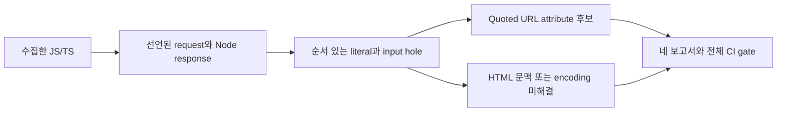

# Node HTML 출력의 URL 문맥 후보

검토한 GitHub source preview의 ruleset `2026-10-14.5` 기준이다. npm 게시나
대상 앱의 실행 검증을 뜻하지 않는다. 소스를 데이터로 읽어, 선언된 Node 응답과
HTML template의 입력 위치를 잇는다. 새로운 DAST 요청이나 browser 실행은 없다.

## 검사에서 보고서까지

검토한 Wakeio build를 사용하고 보고서는 대상 clone 밖에 저장한다.

```sh
node /path/to/wakeio-security-ci/build/src/cli.js scan \
  --source /path/to/cloned-app --tools none \
  --source-max-files 10000 --source-max-bytes 134217728 \
  --analysis-profile extended --fail-on medium \
  --out /path/outside/cloned-app/new-reports
```

`report.json`, `agent-report.json`, `report.md`, `report.sarif` 네 파일을 함께
보관한다. Markdown의 전체 gate와 partial 사유를 먼저 확인하고, agent는 digest로
연결된 두 JSON과 zero-based check index/finding ID를 사용한다. Low-confidence
candidate와 조건부 source→sink 위치는 runtime 취약점·수정 검증이 아니다.
Agent verification은 `not_run`, 두 verified boolean은 false다.



## 지원하는 선언과 판정

정확한 같은 파일의 `http`/`https` 및 `node:` runtime import, const CommonJS
namespace/destructuring load에서 `createServer(listener)`와
`createServer(closedOptions, listener)`를 인식한다. Inline callback과 변경되지
않은 같은 파일 named function/const callback의 두 plain parameter를 request와
response로 읽는다. Parameter 이름에 의존하지 않는다. Opaque options, spread,
accessor/computed options, custom IncomingMessage/ServerResponse와 변경된 factory
binding은 이 역할을 얻지 않는다. 이 범위는
[공식 Node HTTP API](https://github.com/nodejs/node/blob/v22.22.1/doc/api/http.md)와
[HTTPS API](https://github.com/nodejs/node/blob/v22.22.1/doc/api/https.md)의 모든
overload나 server/event 기능을 포괄하지 않는다.

추가로 정확한 `send` load의 `on('directory', regularCallback)`과 `pipe(response)`를
잇는 선언된 adapter가 있다. 제한된 local callback factory 반환과 capture를 읽으며,
callback의 동적 `this.req`와 response argument를 조건부로 연결한다. 임의 EventEmitter,
arrow의 동적 this, 변경된 listener, 일반 dependency 실행·설치는 지원하지 않는다.
설치된 package 정체성, 실제 callback scheduling과 public request 도달은 증명하지 않는다.
`pipe(reply)`만으로 임의 captured outer object를 소급해 Node response로 인정하지
않는다. Callback response formal과 별도로, captured 외부 응답은 독립적으로 선언된
Node 역할이 필요하다. 모든 outer response alias 형태를 지원한다는 계약이 아니다.

응답의 direct `setHeader`/closed `writeHead`에서 literal Content-Type을 읽고,
단일 body argument의 `write`/`end`를 분석한다. Literal과 inert input hole을
24개까지, literal 길이는 2,048 characters까지 보관한다. 소비 시 parser와
순회가 기존 shared flow budget을 사용한다. 한도 상실·branch 충돌·opaque 효과는
안전한 문맥을 고르지 않고 입력과 partial 근거를 남긴다. Container로 옮긴 response,
앞선 `write` 또는 뒤늦은 header 변경은 standalone output 문맥을 증명하지 않는다.

| 관찰된 출력 | 판정 |
| --- | --- |
| HTML template의 quoted href/src/action/formaction/poster 값에 input hole | `ast:html-url-input-sink`, medium candidate, 조건부 low |
| Literal URL과 literal body만 있음 | 이 입력 흐름 규칙의 후보 없음 |
| 고정 scheme/path prefix 뒤 input hole | 문맥 후보는 유지하되 입력이 scheme을 통제한다고 주장하지 않음 |
| HTML text input, encoding 근거 없음 | `ast:html-output-context-unknown`, medium/low candidate와 partial |
| MIME·markup·streaming·provenance가 미해결인 입력 | 같은 unknown 규칙과 partial; known URL 위치라고 주장하지 않음 |
| 선언된 단일 non-HTML 응답 | 이 HTML 문맥 규칙의 후보 없음; 앱 전체 안전 판정 아님 |

`escapeHtml`, `encodeURIComponent` 등의 이름만으로 sanitizer를 신뢰하지 않는다.
Text 위치와 URL 위치의 구분은 실제 값이 browser에서 어떻게 파싱되는지에 대한
증명이 아니다. [OWASP 출력 인코딩 안내](https://cheatsheetseries.owasp.org/cheatsheets/Cross_Site_Scripting_Prevention_Cheat_Sheet.html)는
HTML text/attribute와 URL 문맥을 구분하고 URL 검증과 해당 위치의 인코딩을 요구한다.
Template에 실제 값이 아닌 inert marker를 넣는 이 모델은 그 검증을 실행하지 않는다.

## CI와 수정 검토의 한계

조건부 callback/entry나 unknown output은 partial이며 전체 scan exit는 **2**다.
`--fail-on none`도 미완료를 통과시키지 않는다. Candidate가 medium threshold에
도달해도 partial gate를 1로 낮추지 않는다. URL rule 0은 다른 HTML 위험의 부재,
취약점 수정 완료 또는 프로젝트 안전을 뜻하지 않는다. Ruleset `.4`와 `.5`의
보고서를 같은 분석 의미로 비교하여 사용자 patch의 검증된 수정이라고 표시하지 않는다.

공개 serve-static advisory의 historical baseline과 pinned parent/fix는
[source-only 연구 기록](research/public-advisory-context-2026-10-14.md)에 있다.
그 기록의 completed 0/0 miss는 보존한다. 새 context 모델의 실제 전후 측정은
동일 source·caps·cohort를 사용하는 별도 검증이며 browser exploit 재현이 아니다.

## 고정 공개 advisory의 source-only 대조

독립 검증은 동일한 원본 serve-static checkout 전체를 데이터로 읽었다. 대상
dependency 설치·import·build·test·server·browser·provider 호출은 하지 않았다.
아래는 2026-10-14 최종 candidate 3의 재측정이다. Node 22.22.1에서 동결한
build의 JavaScript 89개 aggregate SHA256은
`f20611540373130cc44a965cdcc343b4f0a1a680d9beeaf142fcac633b6d1df9`다.
Captured response alias·미확정 scheduling·같은 target의 다른 capture와
지역 Node 진단이 공통 index를 무효화하던 경계를 교정한 build를 사용했다.
공식 [GHSA-cm22-4g7w-348p / CVE-2024-43800](https://github.com/expressjs/serve-static/security/advisories/GHSA-cm22-4g7w-348p)의
알려진 공개 패턴이며 새 취약점 발견이 아니다. 공격자 입력 통제와 link 클릭 등
advisory의 runtime 전제는 실행 검증하지 않았다.

| 고정 commit | 이전 `.4` URL 후보 | `.5` URL 후보 / 미해결 HTML 후보 | `.5` AST / 전체 gate |
| --- | ---: | --- | --- |
| Parent `9b5a12a76f4d70530d2d2a8c7742e9158ed3c0a4` | 0 | 1 / 0 | partial / 2 |
| Fix `0c11fad159898cdc69fd9ab63269b72468ecaf6b` | 0 | 0 / 1 | partial / 2 |

양쪽 원본 AST root 170개를 모두 시작했고 root/cap을 축소하지 않았다. Parent
URL 후보의 trace는 원본 `index.js`의 source 190, template 198, response sink
208을 연결한다. Fix는 [공식 수정](https://github.com/expressjs/serve-static/commit/0c11fad159898cdc69fd9ab63269b72468ecaf6b)에서
anchor를 없애고 같은 URL을 text로 표시한다. **URL 위치의 구분은 개선됐지만 fix의
encoding 증명이 생긴 것은 아니므로 unknown HTML 1건과 partial을 유지한다.**
Fixed source의 URL rule 0을 clean scan, verified fix 또는 true-negative 전체
보안 인증으로 세지 않는다. 기존 completed 0/0 known miss의 측정은 그대로 보존한다.

같은 최종 build에서 독립 소스/consumer control 13개 test group이 통과했다.
이는 여러 fixture를 묶은 regression group 수이며 실제 앱 탐지율의 분모가 아니다.
실제 원본 report pair의 handoff는 create 0, finish 2/`unverified`를 보존했다.
URL 후보가 사라져도 partial을 수정 인증으로 바꾸지 않는다.

## 기존 cohort와 분석 비용

동일한 synthetic v5 56개는 strict gate 0, TP 27 / FP 0 / known FN 1을 유지했다.
이 수치는 기존 labeled fixture 계약의 결과이며 새 HTML 규칙의 전체 탐지율이 아니다.
원래 production manifest·source root·수집/분석 caps도 유지했다.

| 원본 production cohort | 기존 → 최종 후보 | 시작한 원래 root / skipped | 최종 상태 / gate |
| --- | --- | --- | --- |
| Express v5.1.0 | 94 → 94 | 3,027 / 0 | partial / 2 |
| Umami v2.19.0 | 4 → 4 | 1,815 / 0 | partial / 2 |

원래 98개 site·ID·rule·severity·kind·confidence와 staticFlow가 모두 유지됐다.
97개 finding object는 동일하고, 1개는 conditional/truncated 상태를 유지한
bounded staticContext sample만 달라졌다. 모든 object가 byte-identical이라거나
production 탐지 효과가 증가했다고 말하지 않는다. 확정 취약점은 0이며 이 후보 수를
precision으로 해석하지 않는다.

비용과 미완료도 남았다. 같은 800,000 flow cap에서 Express flow work는
283,749 → 379,875, 완료 root는 2,961 → 2,952, partial root는 66 → 75다.
Umami는 계속 800,000 cap에 도달하며 완료 1,252 / partial 563을 유지했다.
Optional configured-body inspection 시작 수는 1,687 → 1,572로 줄고 dropped는
1,442 → 1,502로 늘었다. 원래 root 누락은 없지만 coverage 동등성이나 개선을
주장하지 않는다. 초기 candidate의 index 무효화로 생긴 98 → 95 손실은 실패 근거로
보존했으며 최종 결과에 합치거나 제외하지 않았다.

최종 required suite는 1,408/1,408 PASS, failure/skip/cancel/todo 0이다.
이는 제품 regression 검증이며 대상 앱을 실행한 결과가 아니다. Package QA,
GitHub 통합과 npm 게시 상태는 이 측정과 별도로 확인한다.
