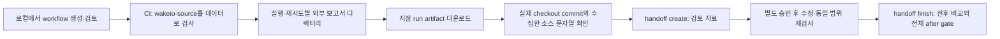

# CI 보고서를 로컬 소스 검토로 이어가기

`init --mode action`은 대상 프로젝트에 의존성을 설치하지 않고, 검토한 Wakeio Action으로 소스를 읽는 workflow를 만듭니다. checkout과 보고서를 서로 다른 디렉터리에 두므로 CI 보고서를 내려받아 같은 소스의 [handoff](source-handoff.md)를 만들 수 있습니다. 언어 분석 범위나 취약점 확인 능력이 늘어나는 기능은 아닙니다.

이 명령은 새 옵션이 포함된 **0.5.0 소스 CLI**에서 사용합니다. npm 발행본은 0.4.0이며 아래 새 옵션을 지원하지 않습니다. 예제의 Action SHA `575dbff63c6adc36e327487a2a9a2ead8337b4f0`는 기존에 검토한 scanner commit입니다. 새 init 옵션은 그 commit 이후에 추가되므로, 그 SHA의 CLI로 새 init 명령을 실행하면 안 됩니다. 자신의 환경에서 Action 코드와 호환되는 CLI·ruleset을 검토해 선택하세요.



## 1. Workflow 만들기

검토한 새 소스 checkout을 빌드해 둔 CLI 경로와 앱 경로를 넣습니다. CLI 준비는 Wakeio 자체에 대한 작업이며, 앱의 install·build·test는 필요하지 않습니다.

```sh
node /path/to/wakeio-security-ci/build/src/cli.js init \
  --source /path/to/your-app \
  --mode action \
  --action-ref 575dbff63c6adc36e327487a2a9a2ead8337b4f0 \
  --tools none \
  --out wakeio-security-reports
```

기본 생성 위치는 앱의 `.github/workflows/wakeio-security-ci.yml`입니다. 기존 파일은 덮어쓰지 않습니다. 생성한 파일을 검토하고 직접 저장소에 반영해야 CI가 실행됩니다. `init`은 검사를 실행하거나 workflow를 push하지 않습니다. 생성 결과의 전체 예제는 [examples/github-action.yml](../examples/github-action.yml)입니다.

`--mode`를 생략하면 기존 `npm` 모드입니다. 이 모드는 대상의 선언된 Wakeio 의존성과 lockfile을 사용하는 `npm ci --ignore-scripts` 템플릿을 유지합니다. 기본 `source: .`와 그 안의 보고서 경로는 handoff의 원 snapshot 조건을 충족하지 않습니다. 보고서를 나중에 밖으로 옮겨도 원래 `outputDirectoryExcluded: true`는 바뀌지 않습니다. handoff를 이어갈 CI에는 위 Action 모드를 사용하세요. `doctor`의 기본 후속 명령이 handoff용 레이아웃을 보장하지는 않습니다.

Action 모드는 `wakeio-source`에 checkout하고 workspace의 형제 디렉터리 `wakeio-security-reports/${{ github.run_id }}-${{ github.run_attempt }}`에 보고서를 만듭니다. `--out`은 이 suffix 앞의 상대 경로입니다. ASCII 경로 구성 요소만 허용하며 절대 경로, `..`, glob, 표현식, `wakeio-source` 아래 경로는 거부합니다. `--action-ref`는 정확히 40자리 hex SHA가 필수입니다. 형식 검사는 commit의 존재나 코드 신뢰성을 검증하지 않습니다.

기본 `--tools none`은 내장 검사만 선택합니다. `--source-max-files`, `--source-max-bytes`, `--analysis-profile`, `--require-code-analysis`는 Action 입력으로 전달됩니다. 더 큰 수집 한도는 분석 완료를 보장하지 않고, strict 코드 정책도 새 언어 분석기를 설치하지 않습니다. 외부 도구를 선택한 보고서는 현재 handoff 대상이 아닙니다.

## 2. 보고서 내려받기

생성된 workflow는 scan 실패 뒤에도 `if: always()`로 artifact 업로드를 시도합니다. 보고서가 없으면 업로드도 실패합니다. 취소·runner 손실 때 전달이 보장되지는 않습니다. scan exit `0/1/2`와 job 결과를 별도로 확인하세요. 업로드 성공은 scan 통과가 아닙니다.

Actions 화면에서 **해당 실행과 attempt**의 artifact를 선택하거나, GitHub CLI로 정확한 이름을 내려받습니다. `RUN_ID`와 `RUN_ATTEMPT`를 실제 값으로 바꾸고, 다운로드 디렉터리를 앱 밖의 새 경로로 지정하세요.

```sh
gh run download RUN_ID --repo OWNER/APP \
  --name wakeio-security-reports-RUN_ID-RUN_ATTEMPT \
  --dir /path/to/private/ci-before
```

하나의 named artifact는 지정 디렉터리에 풀립니다. 그 안에서 `report.json`, `agent-report.json`, `report.md`, `report.sarif`와 Action의 `action-status.json`을 확인합니다. 기본 보관 기간은 GitHub 설정에 따르며 영구 저장이 아닙니다. 보고서는 경로·패키지 식별자 등을 포함할 수 있으므로 공유 전에 검토하세요. [공식 다운로드 안내](https://docs.github.com/en/actions/how-tos/manage-workflow-runs/download-workflow-artifacts), [CLI 옵션](https://cli.github.com/manual/gh_run_download).

## 3. 검사한 소스와 handoff 연결하기

Checkout 단계 로그에서 **실제로 checkout한 SHA**를 확인합니다. 기본 `pull_request` checkout은 생성된 merge commit을 검사합니다. PR head, 최신 branch, `gh run`의 head SHA를 같은 소스라고 가정하지 마세요. 해당 이벤트의 `GITHUB_SHA`와 checkout 로그를 확인하고, 임시 merge ref가 사라졌다면 보존한 같은 소스를 확보해야 합니다. [GitHub PR 이벤트 계약](https://docs.github.com/en/actions/reference/workflows-and-actions/events-that-trigger-workflows#pull_request).

```sh
git clone --no-checkout https://github.com/OWNER/APP.git /path/to/your-app-at-ci
git -C /path/to/your-app-at-ci fetch origin ACTUAL_CHECKOUT_SHA
git -C /path/to/your-app-at-ci checkout --detach ACTUAL_CHECKOUT_SHA
```

이 명령으로 commit을 가져올 수 없는 경우 최신 commit으로 대신하지 않습니다. 같은 commit이라도 수집 대상 바이트·파일 집합·수집 조건이 달라지면 handoff가 거부될 수 있습니다. `sourceSnapshot`은 수집한 UTF-8 문자열을 확인하며 Git commit 자체를 증명하지 않습니다. CLI는 원 보고서 쌍, 도구/ruleset·scope 호환성, 완전한 수집 snapshot과 현재 소스를 확인합니다. 확인 불가 시 exit `2`이며 조건을 완화하지 않습니다.

`agent-report.json`의 선택한 `findings[]` 항목에서 `findingId`와 `checkIndex`를 그대로 사용합니다. `checkIndex`는 해당 finding이 연결된 check의 0부터 시작하는 index이며, finding 목록의 순번이 아닙니다. 입력 보고서·handoff·출력은 모두 소스 밖에 둡니다. 출력은 아직 없는 디렉터리여야 합니다.

```sh
node /path/to/wakeio-security-ci/build/src/cli.js handoff create \
  --report /path/to/private/ci-before \
  --source /path/to/your-app-at-ci \
  --finding FINDING_ID --check-index CHECK_INDEX \
  --out /path/to/private/review-packet
```

create exit `0`은 검토 자료를 만들었다는 뜻입니다. 원 AST 검사가 partial이면 그 gate `2`를 보존합니다. 패킷은 소스를 모델로 보내거나 수정·재검사·대상 실행을 승인하지 않습니다.

## 4. 별도 수정 후 같은 범위로 비교하기

검토자가 수정을 승인했다면 원 범위·정책·수집 한도를 유지해 별도로 재검사합니다. 아래는 기본 `tools none` workflow에 대응하는 예제입니다. 원본이 추가 flags를 썼다면 같은 값을 넣으세요. 프로젝트 ID도 원 Action의 `OWNER/APP`와 같아야 합니다.

```sh
node /path/to/wakeio-security-ci/build/src/cli.js scan \
  --source /path/to/your-app-at-ci --project-id OWNER/APP \
  --tools none --out /path/to/private/ci-after

node /path/to/wakeio-security-ci/build/src/cli.js handoff finish \
  --handoff /path/to/private/review-packet \
  --report /path/to/private/ci-after \
  --source /path/to/your-app-at-ci \
  --out /path/to/private/review-result
```

finish는 전후 비교와 **전체 after scan gate** 중 강한 결과를 적용합니다(`2 > 1 > 0`). 선택 항목이 없어져도 다른 high 항목이나 미완료 검사를 숨기지 않습니다. `not_observed`는 나중 보고서에 그 패턴이 없다는 뜻이며 취약점 확인이나 수정 검증이 아닙니다. [상세 handoff 계약](source-handoff.md), [설계·검증 기록](research/init-action-onboarding-2026-10-13.md).
