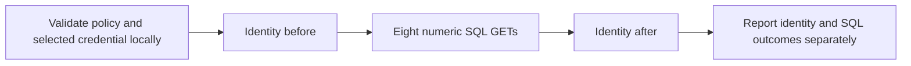

# Authenticated numeric SQL differential preview

Native DAST policy version 2 tests a protected GET endpoint using one explicitly named Authorization environment variable. A same-origin identity GET must match the configured principal before and after two numeric SQL differential rounds. Version 1 keeps its existing eight-request behavior.



Offline preparation reads only the selected environment variable locally and sends no DNS or HTTP requests. A ready plan proves configuration readiness. Runtime identity controls provide bounded observations; they do not establish uninterrupted session or tenant continuity.

Save an owner-reviewed policy as `dast-auth.json`:

```json
{
  "version": 2,
  "kind": "sql-boolean-differential",
  "baseUrl": "https://owned.example/",
  "url": "https://owned.example/items?id=1",
  "parameter": "id",
  "profile": "numeric",
  "oracle": {
    "jsonPointer": "/count",
    "expectedBaseline": 1,
    "expectedTrue": 1,
    "expectedFalse": 0
  },
  "authorizationEnv": "APP_DAST_AUTH",
  "identity": {
    "path": "/identity",
    "status": 200,
    "jsonPointer": "/principal",
    "equals": "expected-owned-principal"
  }
}
```

Supply the complete Authorization header value through `APP_DAST_AUTH` using your shell or CI secret store. The scanner never acquires or refreshes credentials, and does not fall back to anonymous access. Public targets require HTTPS; an explicitly allowed loopback HTTP target supports an owned local fixture. Existing metadata-address, redirect, DNS and pinned-connection protections still apply.

From a built source checkout or an installed reviewed package:

```sh
wakeio-security-ci plan --dast-policy dast-auth.json
wakeio-security-ci scan --dast-policy dast-auth.json --active-consent \
  --dast-max-requests 10 --out dast-auth-reports
```

Use `node build/src/cli.js` in place of `wakeio-security-ci` for a built source checkout. Add `--allow-private` explicitly for an owned loopback target. The source preview is not an npm publication receipt.

The ten-step plan is identity-before, eight SQL GETs, and identity-after. Every actual HTTP attempt, including retries, consumes the same request budget. Nine attempts can finish all SQL probes and leave the final identity control unattempted; this remains incomplete. Missing or malformed credentials prevent traffic. A failed identity-before prevents every SQL request.

| Outcome | CI exit | Public evidence |
|---|---|---|
| Both identities match; numeric differential observed | 1 at the default high threshold | Medium-confidence candidate; completed scoped check |
| Both identities match; paired control shows no differential | 0 | `probeOutcome: not_observed`; no scoped candidate |
| Identity-after fails after eight positive SQL observations | 2 | `probeOutcome: observed`, low-confidence candidate, partial check; no replay authority |
| Credential, identity-before, budget, cancellation or transport failure | 2 | Incomplete/error check; attempted steps remain recorded |

`--fail-on none` disables severity failure only; incomplete runs still exit 2. An exit 0 does not establish whole-application security or a verified fix.

Read `dast-auth-reports/report.md` for the human summary and `agent-report.json` for a digest-bound local agent handoff. `report.json` carries the same typed `dastExecution.identityControls` and `probeOutcome`; `report.sarif` preserves the ledger with findings and check metadata. Reports omit the Authorization value, its standalone hash, expected principal, query values, probe strings and raw response bodies. The declared policy digest excludes the runtime credential value. Advice receives bounded enum/count metadata and grants no action authority.

Only a complete candidate with both identity controls matched can authorize a scoped native replay. Rotate credentials in the environment as needed, then supply the same policy, finding ID and fresh output directory:

```sh
wakeio-security-ci replay --report dast-auth-reports/report.json \
  --dast-policy dast-auth.json --finding <finding-id> --active-consent \
  --out dast-auth-replay
```

Replay reads fresh credentials and repeats both identity controls. Add `--allow-private` again when needed. It preserves the original report and writes separate replay evidence. `reproduced` and `not_reproduced` are scoped scanner observations; vulnerability and remediation verification remain `not_run`.

For the separate active DAST Action, provide the environment value through a secret rather than an Action input:

```yaml
- name: Protected native DAST
  uses: dusen0528/wakeio-security-ci/dast@<reviewed-commit>
  env:
    APP_DAST_AUTH: ${{ secrets.APP_DAST_AUTH }}
  with:
    active-consent: 'true'
    allowed-origins: https://owned.example
    dast-policy: dast-auth.json
    dast-max-requests: '10'
    out: dast-auth-reports
```

Start an owned target through your own trusted job setup when needed; scanning an arbitrary source checkout never installs or executes that target. Retain report artifacts with an `if: always()` upload step. Action/process status is a separate delivery receipt from the report scan gate. This document describes the contract; acceptance receipts are recorded separately by the release verifier.
