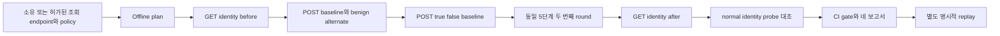

# 인증된 POST JSON numeric SQL 차등 검사

**GET query 검사만으로 POST JSON 입력을 검사했다고 볼 수 없습니다.** 이 v4
계약은 허가된 단일 endpoint의 numeric-string field 하나를 선택하고, 정상적인
다른 값도 실제 응답을 바꾸는지 확인한 뒤 true/false 응답 차이를 두 번 대조합니다.
0.5.0 source/Action 프리뷰의 별도 명시적 profile이며 npm 신규 배포를 뜻하지 않습니다.
구현된 검사 범위와 실행 검증 근거는 문서 마지막에서 구분합니다.



## 입력과 정상 동작을 먼저 선언하기

POST method 자체는 read-only가 아닙니다. 소유하거나 검사를 허가받은 staging
검색/조회 endpoint처럼 반복 probe를 허용한 계약을 선택하세요. 이 검사는 저장
effect·rollback이나 일반 write 권한을 검증하지 않습니다. API PATCH state pilot과
별도 기능입니다. Form/multipart, nested JSON, 임의 payload, quote-context 자동
탐색·UNION·stacked query·시간 지연·데이터 추출은 포함하지 않습니다.

`post-json-policy.json`의 자체 예시입니다. 응답 oracle는 실제 허가된 endpoint의
정상 동작에 맞게 선언해야 하며, 아래 count값을 모든 앱에 적용하지 않습니다.

```json
{
  "version": 4,
  "kind": "sql-boolean-differential",
  "profile": "numeric",
  "method": "POST",
  "baseUrl": "https://staging.example.test/",
  "url": "https://staging.example.test/items/search",
  "parameter": "id",
  "body": { "id": "1", "category": "owned" },
  "alternate": { "value": "2", "expected": 1 },
  "authorizationEnv": "STAGING_DAST_AUTHORIZATION",
  "identity": {
    "path": "/whoami",
    "status": 200,
    "jsonPointer": "/principal",
    "equals": "owned-review-user"
  },
  "oracle": {
    "jsonPointer": "/count",
    "expectedBaseline": 2,
    "expectedTrue": 2,
    "expectedFalse": 0
  }
}
```

URL은 query·fragment·userinfo 없이 fixed origin/path여야 합니다. Body는 최대16개
top-level own key와 scalar value만 받습니다. 문자열은 최대1024자, 매 전송 body는
4096 UTF8 bytes 이하며 array/nested object는 거부합니다. Key는 bounded identifier
grammar를 따르고 `__proto__`, `constructor`, `prototype`은 허용하지 않습니다.
선택 field의 원본·alternate는 `0` 또는 선행0 없는1–9자리 numeric string이며 서로
달라야 합니다. 다른 body field는 모든 POST에서 그대로 유지합니다.

Alternate expected scalar는 baseline과 달라야 합니다. 따라서 field를 무시해 모든
요청에 같은 답을 주는 endpoint나 모든 요청을 거부하는 endpoint는 정상 negative
대조가 아닙니다. 정상 baseline/alternate와 두 round가 맞지 않으면 partial2입니다.

Authorization은 선택한 환경 변수의 **complete header**로 준비합니다. Secret manager나
CI secret을 사용하고 값을 정책·argv·workflow에 넣지 않습니다. 필수 identity pair,
HTTPS, 명시적으로 허용한 literal loopback HTTP 예외와 snapshot·origin 경계는
[기존 인증 계약](native-dast-auth.md)을 따릅니다. Login/refresh/cookie jar/anonymous
fallback은 없으며 전후 identity도 중간 session continuity를 보장하지 않습니다.

## Plan, scan, explicit replay

검토한 source checkout을 빌드한 CLI의 명령입니다. Plan은 로컬 정책·credential
설정 검사이며 DNS·HTTP·모델 호출을 하지 않습니다. Ready는 live target 검증이 아닙니다.

```sh
node /path/to/wakeio-security-ci/build/src/cli.js plan \
  --dast-policy post-json-policy.json

node /path/to/wakeio-security-ci/build/src/cli.js scan \
  --dast-policy post-json-policy.json --active-consent \
  --allowed-origin https://staging.example.test --out post-json-reports

node /path/to/wakeio-security-ci/build/src/cli.js replay \
  --report post-json-reports/report.json --dast-policy post-json-policy.json \
  --finding FINDING_ID --active-consent --out post-json-replay
```

Private/loopback 대조는 plan/scan/replay에 `--allow-private`를 다시 명시합니다.
Replay는 원 정책과 강한 complete candidate 근거를 검사하고 fresh credential을
다시 snapshot합니다. 취소·실패한 identity·미완료 positive는 replay 권한을 얻지
않습니다. `reproduced`도 독립 exploit/fix verification이 아닙니다. 기존 numeric
GET v1/v2와 single-quoted GET v3는 자동으로 POST v4로 바뀌지 않습니다.

## 12단계와 retry 경계

기본 계획은 GET identity-before, 두 round 각각 POST baseline-before →
benign-alternate → true → false → baseline-after, GET identity-after입니다.
총12 logical steps(GET2/POST10), revision `sql-boolean-json-auth-v4`입니다.
기본 budget12/최대64, timeout 기본30초/최대120초, response당128KiB/총512KiB입니다.
모든 전송 시도는 shared request budget과 deadline을 소비합니다.

각 POST는 승인된 pinned DNS peer에 한 번만 보냅니다. Address/HTTP retry나
redirect follow가 없고 전송 여부가 모호해도 다시 보내지 않습니다. Identity GET의
기존 bounded retry는 같은 budget을 소비하므로 logical steps와 실제 attempts를
구분합니다. 오류·429/5xx·malformed/unknown oracle·부분/큰 body·drift·deadline·
cancel은 partial/exit2이며 앞서 관찰한 후보는 지우지 않습니다.

| 기본 high gate | 의미 |
| --- | --- |
| 1 | 두 round의 정상·identity controls를 통과한 반복 SQL differential candidate |
| 0 | 정상 controls를 유지했고 이 policy의 differential이 관찰되지 않음 |
| 2 | Identity/normal/oracle/transport/예산 근거가 미완료 또는 잘못됨 |

`--fail-on none`은 finding threshold만 끄며 partial2를 통과시키지 않습니다. Bound
statement에서 true/false probe 모두 known false scalar가 나오는 대조도 정상
controls가 맞으면 not_observed일 수 있습니다. 임의 다른 scalar를 clean으로 세지
않습니다. SQL safety나 전체 endpoint 보안의 인증은 아닙니다.

## CI에서 보고서를 읽기

별도 active DAST Action을 검토한 full commit으로 pin합니다. Passive source Action의
동작은 바꾸지 않으며 untrusted/fork trigger·origin·consent refusals를 유지합니다.

```yaml
- name: Check authorized POST JSON search
  uses: dusen0528/wakeio-security-ci/dast@REVIEWED_COMMIT_SHA
  env:
    STAGING_DAST_AUTHORIZATION: ${{ secrets.STAGING_DAST_AUTHORIZATION }}
  with:
    active-consent: 'true'
    allowed-origins: https://staging.example.test
    dast-policy: post-json-policy.json
    out: post-json-reports

- name: Upload POST JSON reports
  if: always()
  uses: actions/upload-artifact@ea165f8d65b6e75b540449e92b4886f43607fa02
  with:
    name: post-json-dast-reports
    path: post-json-reports
    if-no-files-found: error
```

`post-json-reports/`의 `report.json`, `agent-report.json`, `report.md`, `report.sarif`를
같은 run 묶음으로 보관합니다. JSON과 agent pair digest, method·revision·phase·
normalControls·identityControls·probeOutcome·attempt counts를 읽고, 실제 Action
status/job exit와 delivery도 따로 확인합니다. 해당 workflow run의 Artifacts에서
`post-json-dast-reports`를 다운로드하세요. 파일 존재만으로 최종 CI 성공을 판정하지
않습니다. Replay output은 원 보고서를 덮어쓰지 않는 별도 fresh directory입니다.

Ledger의 normalControls는 round1/round2 각각 matched·mismatched·inconclusive·
not_attempted enum입니다. 이 v4 보고서는 선택 parameter name, raw request body·token·
원본/alternate/probe/oracle/identity 값을 저장하지 않습니다. 다만 target path·project
정보 등이 남을 수 있으므로 CI artifact 공개 범위를 검토하세요. Policy/body/context·
normal-control 또는 effective limit이 달라지면 비교 가능한 verified fix를 주장하지
않습니다. Agent confirmation/remediation flag도 true로 바꾸지 않습니다.

## 검증 단계

2026-10-13 로컬 검증에서 focused 55/55(새 POST JSON groups16개와 기존
regressions39개), CI 지원 검사18개, required-engine 전체1067/1067이 통과했습니다.
전체 suite의 failed/skipped/cancelled/todo는 모두0이며 검사 전후 source fingerprint가
같았습니다. 전체1067개가 모두 새 POST 기능 테스트라는 의미는 아닙니다.

자체 인증된 SQLite concat/bound pair, 정상 alternate·identity·실패 대조, immutable
입력, single-attempt POST, 네 보고서의 redaction, CLI·기존 Action wrapper·명시적
replay 계약을 로컬 범위에서 확인했습니다.
[독립 수용 기준과 공식 근거](research/post-json-dast-acceptance-2026-10-13.md)는
구현 전 SQL truth lock과 이 실행 결과를 구분합니다. 배포 archive의 fresh consumer와
hosted GitHub CI는 해당 배포/PR의 별도 receipt로 확인하세요. 로컬 suite 결과가
이 두 실행의 성공을 대신하지 않습니다.

이 근거는 자체 대조와 선언된 protocol의 검증이며 외부 서비스 scan·live 모델 호출·
npm 신규 publication·새 OSS 취약점 발견·전체 endpoint 안전성 또는 상용 품질의
증명이 아닙니다. Source/Action preview0.5.0과 기존 npm0.4.0의 경계도 유지합니다.
