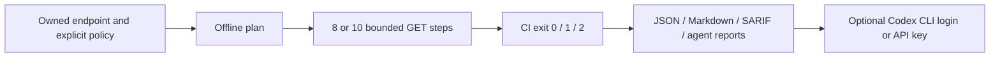

# Explicit single-quoted SQL differential preview

Policy v3 adds one manually selected `single-quoted` context for an owned GET query endpoint. It does not detect the database context automatically. Existing numeric v1/v2 policies remain numeric and keep their hashes, request counts and finding IDs. This is a GitHub source/Action 0.5.0 preview; npm 0.5.0 is not published.



Choose this profile only after reviewing that the selected value is used inside a SQL single-quoted string literal. It applies an original fixed balanced string predicate and compares the configured JSON scalar. There is no arbitrary payload input, context discovery, quote/comment search, database fingerprinting, extraction, UNION, stacked query or timing mode. It does not claim coverage of every SQL string context or database.

Save an owner-reviewed `dast-quoted.json`:

```json
{
  "version": 3,
  "kind": "sql-boolean-differential",
  "profile": "single-quoted",
  "baseUrl": "https://owned.example/",
  "url": "https://owned.example/items?name=owned_item",
  "parameter": "name",
  "oracle": {
    "jsonPointer": "/count",
    "expectedBaseline": 1,
    "expectedTrue": 1,
    "expectedFalse": 0
  }
}
```

The selected query parameter must occur exactly once. Its initial value is 1–128 printable ASCII characters, contains no single quote or backslash, and cannot be blank. The profile never searches for another parameter or adjusts the declaration after observing an error. Other query values stay unchanged. Choose baseline/true/false expectations from the owned endpoint's behavior; an HTTP error or reflected value alone is not the oracle.

Without authentication, each of two rounds sends baseline, true, false, baseline: eight logical GETs, revision `sql-boolean-single-quoted-v3`. For a protected endpoint, add **both** of the following top-level fields:

```json
{
  "authorizationEnv": "OWNED_DAST_AUTHORIZATION",
  "identity": {
    "path": "/whoami",
    "status": 200,
    "jsonPointer": "/principal",
    "equals": "expected-owned-principal"
  }
}
```

Supply the complete Authorization header through the named environment variable or CI secret store, never policy JSON or command arguments. The authenticated revision is `sql-boolean-single-quoted-auth-v3`, with identity-before, eight SQL phases, identity-after and a default ten-attempt shared budget. Authentication fields are a strict pair; there is no login, refresh, cookie handling or anonymous fallback. [Authenticated transport and identity boundaries](native-dast-auth.md) also apply: HTTPS, or explicitly permitted literal owned loopback HTTP; same-origin identity path without query/fragment; no redirect following; no guaranteed uninterrupted session continuity.

From a trusted built source checkout:

```sh
node build/src/cli.js plan --dast-policy dast-quoted.json
node build/src/cli.js scan --dast-policy dast-quoted.json --active-consent \
  --allowed-origin https://owned.example --out dast-quoted-reports
```

`plan` performs no DNS, HTTP or model call. It reads only the selected own environment property locally when authentication is declared, validates configuration and prints redacted enum phases and limits. A ready plan is not an identity or security result. Add `--allow-private` explicitly to plan/scan for an owned literal loopback fixture. Each network attempt, including a retry, consumes the same request budget; body and deadline limits cover all steps. An offline budget below eight/ten blocks the plan. Direct scans with smaller budgets remain incomplete.

| CI result | Meaning |
|---|---|
| 0 | Completed scoped check with no finding at the selected severity threshold |
| 1 | Repeated controlled differential produced a medium-confidence candidate at the chosen threshold |
| 2 | Invalid configuration, missing credential, failed identity, drift, unsupported response, transport failure, cancellation or budget exhaustion |

The default high threshold makes a completed high-severity candidate exit 1. With `--fail-on critical` or `none`, the same observed candidate can exit 0; read the ledger outcome to distinguish `observed` from `not_observed`. `--fail-on none` disables severity failure only. If eight SQL observations are positive but identity-after fails, `probeOutcome` stays `observed`, the candidate stays low confidence, and the check remains partial/exit 2 with no finding replay authority. Neither a candidate nor a completed negative proves exploitability, whole-application security or a verified fix.

Keep all four artifacts in `dast-quoted-reports`: `report.md` is the human first read, `report.json` and `agent-report.json` preserve the typed profile/attempt/control ledger, and SARIF carries it even without a finding. The local agent report is SHA-bound to `report.json`; final process/Action status remains a separate receipt. Seed, probes, raw responses, credential/environment name and identity assertion values are omitted. New finding IDs include the sanitized single-quoted revision; numeric IDs and the legacy SARIF fallback fingerprint remain unchanged. Cross-profile comparison requires the execution/scope contract, not that fallback fingerprint alone.

Use a reviewed commit for the separate active Action. Start your owned application through trusted job setup and keep its URL on the declared allowlist:

```yaml
- name: Native single-quoted DAST
  uses: dusen0528/wakeio-security-ci/dast@REVIEWED_COMMIT_SHA
  env:
    OWNED_DAST_AUTHORIZATION: ${{ secrets.OWNED_DAST_AUTHORIZATION }}
  with:
    active-consent: 'true'
    allowed-origins: https://owned.example
    dast-policy: dast-quoted.json
    out: dast-quoted-reports
- name: Retain reports after success or failure
  if: always()
  uses: actions/upload-artifact@ea165f8d65b6e75b540449e92b4886f43607fa02
  with:
    name: dast-quoted-reports
    path: dast-quoted-reports
    if-no-files-found: error
```

Omit the environment field for an unauthenticated policy. The Action rejects consent/origin/fork and insufficient fixed-plan budget before traffic. It invokes its prebuilt trusted bundle; it never installs or executes an arbitrary source checkout.

After reviewing the report, optionally request [Codex advice](agent-advice.md) with either explicit authentication mode:

```sh
node build/src/cli.js advise --report dast-quoted-reports --agent codex \
  --auth cli-login --allow-report-upload --out dast-quoted-advice-login
node build/src/cli.js advise --report dast-quoted-reports --agent codex \
  --auth api-key --allow-report-upload --out dast-quoted-advice-key
```

API-key mode reads `CODEX_API_KEY`; failure never changes authentication modes. Projection policy 6 sends bounded redacted profile/phase/control metadata and omits seed, report-location/target-URL, source and Authorization-value fields. Short titles remain untrusted text under the existing report-upload/redaction boundary; automated redaction cannot guarantee recognition of every private sentence. Advice is unverified and changes neither reports nor CI gates. No live policy-6 model call is claimed.

Only a complete matched-control candidate can authorize [same-policy replay](native-dast.md#repeat-a-native-finding-with-its-original-policy). Replay reuses the declared profile, original execution settings and fresh selected credentials, writes a new directory, and preserves original reports. Owned SQLite acceptance and fresh package/Action receipts are recorded separately; they do not establish external-target SQL coverage. The [primary-reference note](research/native-dast-quoted-references-2026-10-13.md) explains the original implementation and attribution boundary.
