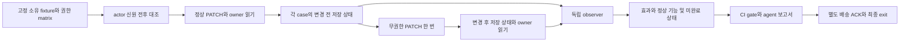

# API 쓰기 권한과 저장 효과 검증 근거 (2026-10-13)

## 판단과 현재 상태

**추천 증분은 소유한 합성 PATCH pilot이다.** 같은 actor·객체·허용 속성 관계를 고정하고, 요청 전후 저장 상태를 독립 observer로 확인한다. `403`만으로 변경 차단을 판정하지 않으며, source candidate와 실행 중 실제 관찰한 저장 효과도 구분한다. 아래 단계 runner와 규칙은 **제안**이며 아직 구현·실행·검증된 쓰기 기능이 아니다. 이 조사에선 제품·tests 수정, build/scan, 외부 코드 실행, 외부 active target 요청, maintainer 연락을 하지 않았다.

제공받은 기준은 main `54ecc43`다. [현재 API v2](api-policy-implementation.md)는 명시된 GET 요청과 identity/owner/deny 대조를 실행한다. [현재 owned state pilot](../api-state-oracle.md)은 고정한 자체 handler와 read-only 저장 resource를 독립 observer로 확인하고, 정상 기능·정리·delivery ACK를 분리한다. `ApiRequestPlanStep.method`는 GET이고 `ApiStateEvidence.scope`도 read-only다. 새 mutation 단계를 이 기존 계약에 몰래 넣지 않는다. 근거: [contracts](../../src/contracts.ts), [실행 ledger](../../src/api-execution.ts), [현재 coordinator](../../src/api-state.ts), [observer](../../src/api-state-observer.ts).

## 공식 자료에서 확인한 차이

OWASP **API1:2023 BOLA**는 객체 ID를 받아 행하는 모든 action에서 객체 권한을 검사하도록 요구한다. 읽기 성공/차단 결과는 쓰기 권한의 대체 증거가 아니다. **API3:2023 BOPLA**는 객체의 민감한 속성을 바꾸는 권한을 별도로 다루며, 속성이 응답에 없으면 부작용 분석이 필요할 수 있다고 설명한다. 따라서 다른 사용자 객체의 변경과 자신의 객체에 대한 금지 속성 변경을 별도 case로 둔다. [API1 원문](https://api-security.owasp.org/editions/2023/en/0xa1-broken-object-level-authorization/), [API3 원문](https://api-security.owasp.org/editions/2023/en/0xa3-broken-object-property-level-authorization/).

WSTG의 IDOR 절차는 직접 객체를 참조하는 입력을 매핑하고 다른 test 사용자 객체에 접근·변경할 수 있는지 확인한다. Authorization Automation Cheat Sheet는 feature·role·필요시 data 관계를 기계가 읽는 권한 matrix로 만들고 integration test 입력으로 쓰도록 제안한다. 이는 app별 권한 truth가 필요하다는 근거이며, OpenAPI나 응답 코드만으로 소유 관계를 추론하라는 지침이 아니다. [WSTG v4.2 IDOR](https://wstg.owasp.org/v4.2/4-Web_Application_Security_Testing/05-Authorization_Testing/04-Testing_for_Insecure_Direct_Object_References/), [Authorization Automation](https://cheatsheetseries.owasp.org/cheatsheets/Authorization_Testing_Automation_Cheat_Sheet.html).

PATCH는 안전하거나 본질적으로 멱등인 method가 아니며, 다른 resource에도 부작용이 생길 수 있다. RFC는 원자적 적용과 충돌 방지를 설명한다. 이 조사의 결론은 **전송 여부가 모호한 PATCH를 자동 재시도하지 않는다**는 것이다. 멱등성·ETag·transaction을 선언만 보고 실제 보장으로 승격하지 않는다. [RFC 5789 §2](https://www.rfc-editor.org/rfc/rfc5789.html#section-2).

## 이번 설계에 채택하도록 제안하는 다섯 규칙

| 규칙 | PATCH pilot에서 요구할 것 | 재사용할 현재 계약 |
| --- | --- | --- |
| 1. 권한 truth를 먼저 동결 | actor × resource × action × property matrix, 허용 title 변경과 금지 객체/속성 변경, fixture/seed/plan/observer hash를 실행 전에 고정한다. 서로 다른 token은 서로 다른 principal의 증거가 아니므로 identity 전후를 확인한다. | API v2 identity 전후 controls, canonical plan digest. 새 write scope/typed metadata는 별도 version 계약으로 명시한다. |
| 2. 응답과 저장 효과를 독립 판정 | 각 unauthorized PATCH 직전/직후 같은 resource와 owner·보호 속성·정상 데이터의 저장 snapshot을 읽는다. Observer는 scanner verdict나 handler의 “변경 없음” 주장 대신 coordinator 소유 저장 bytes와 dispatch 기록을 대조한다. Denial 상태여도 변경됐다면 효과를 보존한다. 저장 상태·일치 관계가 없으면 unknown이다. | `api-state-observer`의 독립 state/read/arrival 관계, effect/normal/execution 분리. 전체 hash 차이만으로 어느 actor가 어느 속성을 바꿨다고 단정하지 않는다. |
| 3. 정상 대조와 격리를 함께 확인 | 합법 owner PATCH가 정확한 정상 값으로 저장되고 owner GET이 그 값을 읽는지 확인한다. 금지 속성·다른 resource는 유지돼야 한다. attack case마다 baseline snapshot/고립된 seed를 둬 앞선 정상 쓰기와 무권한 효과를 섞지 않는다. 모두 차단하는 candidate와 정상 contents 삭제를 성공으로 세지 않는다. | 기존 fixed/ineffective/all-deny/normal-regression 독립 대조와 scoped verdict. Mutation용 denial-with-write와 no-op-positive-control failure를 추가한다. |
| 4. 유한 단계·예산·전송 모호성을 유지 | 고정 자체 loopback fixture만 실행하는 internal plan으로 시작한다. identity/read/PATCH/검증/정리 단계의 모든 요청·bytes·시간은 공유 예산에 포함한다. timeout/cancel/부분 body/dispatch 불일치/정리 불명은 partial이고, 이미 보낸 PATCH는 retry하지 않는다. | 기존 request/byte/deadline/cleanup accounting, fail-closed gate 2. API v2 외부 GET 정책을 write 허용으로 재해석하지 않는다. |
| 5. 실행 효과·수정 검증·배송을 분리 | 관찰한 무권한 저장 변경은 source candidate와 별도 동적 evidence로 표현한다. 수정 비교 성공에는 baseline 효과 확인, candidate에서 효과 없음, 정상 대조 통과, 같은 계획·seed 관계와 정리 확인이 모두 필요하다. 보고서 파일 존재는 최종 process 성공이 아니다. | 기존 `ApiStateEvidence` lineage와 delivery-only retry/ACK, JSON/agent/Markdown/SARIF redaction 및 원 scan gate 보존. `not_observed`는 일반 verified fix가 아니다. |

1–3의 방법 근거는 위 OWASP/WSTG 자료이며, 4의 재시도 판단은 RFC 5789에서 도출한 **우리의 bounded-runner 설계 결정**이다. 5의 provenance·ACK·redaction 조건은 이 저장소의 [CONTRIBUTING](../../CONTRIBUTING.md), [agent report](../agent-report.md), [owned state 계약](../api-state-oracle.md)을 따른다. OWASP가 Wakeio의 구체적 stage/schema/exit code를 표준으로 정한 것은 아니다.

## 제안한 최소 실행 흐름

이 그림은 **미구현 제안**이다. 신원 전후·정리 확인은 전체 실행을 감싸는 필수 controls다. 단계 순서와 resource 관계를 담는 작은 typed plan/executor를 internal seam으로 만들고, transport/capture/observer/report delivery를 분리한다. 첫 PATCH handler와 observer는 고정한 자체 코드로 한정한다. 임의 URL·handler·observer callback·script·동적 JSON workflow를 받는 공개 runner는 이번 증분의 목표가 아니다. GET ledger를 직접 확장하기보다 새 mutation plan parser/ledger를 엄격히 versioning해 기존 SDK/CLI 의미를 보존하는 방안을 추천한다.

## 성숙 OSS에서 가져올 방법과 라이선스 경계

| 1차 자료 | 유용한 방식 | 이번 작업의 경계 |
| --- | --- | --- |
| [ZAP Access Control Testing](https://www.zaproxy.org/docs/desktop/addons/access-control-testing/) | 명시적인 user/context의 allowed·denied·unknown 규칙과 사용자별 대조. | URL 접근 대조를 저장 write-effect oracle로 자동 승격하지 않는다. ZAP식 discovery/full attack을 owned pilot에 추가하지 않는다. |
| [Schemathesis stateful guide](https://schemathesis.readthedocs.io/en/stable/guides/stateful-testing/)와 [실제 state-machine 코드](https://github.com/schemathesis/schemathesis/blob/master/src/schemathesis/generation/stateful/state_machine.py) | scenario별 setup/teardown, producer→consumer 연결, 제한한 단계 수. | 알려진 seed와 cleanup, 단계/사례 분리를 참고한다. 생성된 workflow가 business 권한 truth나 독립 persisted-state 확인을 제공한다고 가정하지 않는다. |

라이선스도 구분한다. Schemathesis의 실제 코드 저장소 [LICENSE](https://github.com/schemathesis/schemathesis/blob/master/LICENSE)는 **MIT**다. ZAP access-control [실제 코드 header](https://github.com/zaproxy/zap-extensions/blob/main/addOns/accessControl/src/main/java/org/zaproxy/zap/extension/accessControl/AccessControlScannerThread.java)와 [extensions LICENSE](https://github.com/zaproxy/zap-extensions/blob/main/LICENSE)는 **Apache-2.0**다. OWASP Cheat Sheet [문서 LICENSE](https://github.com/OWASP/CheatSheetSeries/blob/master/LICENSE.md)는 **CC-BY-SA-4.0**이며 MIT 코드 원천으로 취급하지 않는다. 링크들은 2026-10-13에 확인한 moving upstream 자료이므로 실제 코드 복사 시에는 정확한 commit/file/license를 다시 고정해야 한다.

이번 문서는 외부 코드·payload·표를 복사하지 않고 동작 계약을 독립적으로 정리했다. MIT 라이선스라는 이유만으로 새 코드를 가져오거나 dependency를 추가할 필요는 없다. 실제 재사용 시 [CONTRIBUTING의 attribution/notice 규칙](../../CONTRIBUTING.md#rules-data-and-licensing)을 적용한다.

## Root가 승인한 첫 구현 경계

이 초안 작성 후 root는 `feat/api-write-state`의 **owned-only SDK와 CLI 구현**을 승인했다. 승인된 유한 matrix는 phase당 18 HTTP 단계, baseline/candidate 합계 최대 36단계와 최대 12 PATCH다. 두 resource 각각 owner·peer·anonymous 관계를 확인하며 mutation retry는 없다. 기본/최대 30초, request body 4 KiB, response 64 KiB, 총 response 1 MiB, 저장 state 64 KiB, cleanup 2초를 제한으로 삼는다. 이는 구현 승인/설계 입력이며 현재 실행 성공이나 public API 완성의 증거가 아니다. Producer의 최종 protocol과 독립 QA/Standards 및 root 실행 receipt가 다음 authority다. 기존 API v2 GET 기능이나 외부 target의 쓰기를 허용하는 승인이 아니다.

## 다음 수용 근거

먼저 own fixture의 응답-only 회귀·denial-with-persisted-write·올바른 차단·모두 차단·정상 쓰기 no-op·정상 데이터 손상·body/deadline/취소·정리 실패를 독립 정답으로 동결한다. Root만 실제 실행과 검증을 수행한다. Before/after 원 gate, observer 판정, 배송 ACK와 최종 process exit를 따로 남기고 frozen mutation input을 결과에 맞춰 수정하지 않는다.

이 증분은 CI에서 특정 write 권한 효과와 정상 회귀를 설명하는 근거를 추가할 수 있다. 아직 고객 API 재현, 외부 권한 테스트, 비동기·여러 DB transaction의 완전한 효과 검증, 상용 DAST 제품 동등성, 생산 안전성 또는 수익을 입증하지 않는다.

## 구현 후 focused 수용 근거 (2026-10-13)

앞 절은 구현 전 조사와 제안 시점을 보존한다. 이후 별도 owned-only SDK·CLI·Action이
구현됐으며 [사용자 계약](../api-write-state.md)에 현재 범위를 기록했다. Root가 실행한
focused v4 acceptance는 6/6 group, 0 skip, 10.6초였고 실제 Action wrapper의
fixed `0`·ineffective `1`·all-deny `2`·동의 거부를 포함했다. 원 baseline gate `1`,
wire 단계·lifecycle·manifest·네 보고 형식의 controls도 해당 focused 근거에 포함된다.

초기 통합 실행에서 SDK의 중간 report directory가 0755여서 Action의 private700
검증을 통과하지 못했고, 저장 효과가 observed인데 finding이 비어 있는 외부 보고서를
clean으로 정규화할 수 있는 결함이 확인됐다. SDK는 새 own directory를 명시적으로
0700으로 만들고, report sanitizer는 completed effect와 finding의 불일치를 partial로
처리하도록 수정됐다. Action의 권한 검증이나 frozen 기대 gate는 완화하지 않았다.
이는 제품 통합 결함 수정이며 외부 서비스의 취약점 발견이 아니다.

후속 required-engine suite는 2026-10-13에 1024/1024, 0 skip,
104119.652625 ms로 통과했다. 로컬 전용 receipt 경로는
`artifacts/ci/required-engine-LnNnVk/receipt.json`이며 공개 배포 문서의 링크가 아니다.
실행 전후 source snapshot SHA-256은 모두
`13d716ca7c6b9f6f02c3eb2a5add20b918481c25fa186c5fd899fe4055761cc9`였다.
Focused 6 group과 전체 회귀 suite는 서로 다른 검증 범위로 기록한다.

2026-10-13 이 문서의 동결 단계는 전체 suite 완료 후이며 fresh package/source
archive consumer와 hosted workflow 실행 전이다. 그 이후의 delivery 검증은 해당
커밋의 PR·CI receipt에서 별도로 확인한다. Handler는 고정 manifest hash에 대조하지만
observer/runtime hash는 현재 disk fingerprint와 실행 후 불변 확인이다. 외부 사전
attestation이나 sandbox 격리의 증거로 취급하지 않는다.
