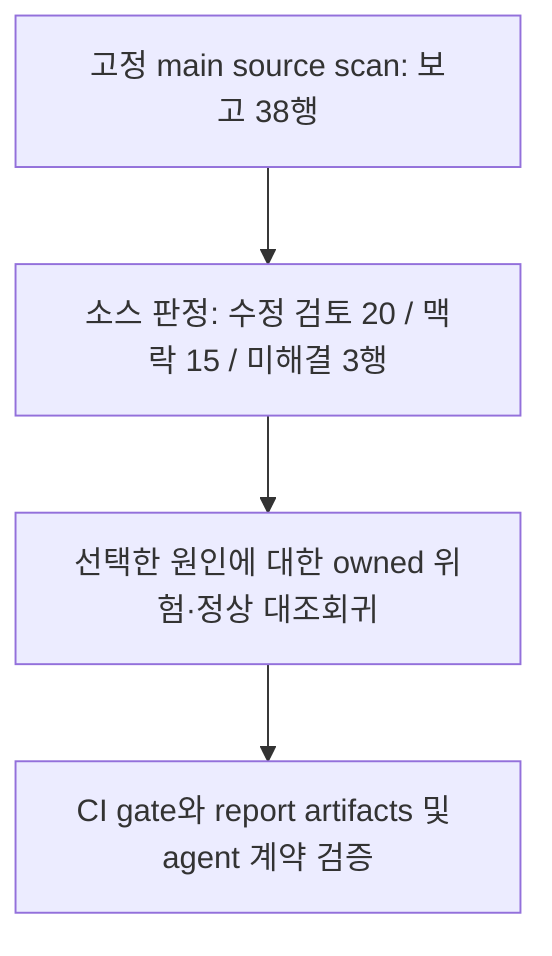

# 고정 OSS 보고서 38행의 소스 판정

2026-10-14. Main `a8f6ebaecd87c6a5767abc9242a5c22a49ebe162`가 만든 두 교육용 OSS checkout 보고서 **38행 전부**를 소스와 대조했다. **두 저장소 모두 의도적으로 취약하게 만든 교육용 앱**이다. 일반 production OSS 표본이나 새 취약점 발견 결과로 해석하지 않는다. [고정 Juice Shop README](https://github.com/juice-shop/juice-shop/blob/e39a3bdb8c61295c31fa4e0a03485e68a8ca12a4/README.md#L27-L31), [고정 NodeGoat README](https://github.com/OWASP/NodeGoat/blob/c5cb68a7084e4ae7dcc60e6a98768720a81841e8/README.md#L1-L17).

결과는 **수정 검토할 소스 패턴 20행, 맥락 정보 15행, 미해결 3행**이다. 38행은 candidate 37개와 observation 1개이며, candidate만 보면 20/14/3이다. 이 수치는 취약점 수, 수정 성공 수, precision 또는 recall이 아니다. 모든 행의 runtime verification은 `not_run`이다.

이번 결과의 효용은 어떤 경고가 실제 등록 경로의 수정 검토로 이어지는지, 어떤 경고가 교육 조각·테스트·정상 사용 맥락인지, 어떤 추가 근거가 필요한지를 전체 목록에서 확인한 것이다. 기존 1241개 테스트·CI 완료는 제품 계약과 회귀의 근거다. 이 소스 판정이나 실제 사용자 프로젝트의 탐지 효과를 대신하지 않는다.

이 판정에서 선택한 direct browser-location binding 개선은 로컬 회귀와 required suite **1263/1263**으로 검증했다. 같은 OSS를 재검사한 결과 38개 finding 객체와 행 식별자는 모두 그대로였으며, J04–J07도 제거·수정되거나 confidence가 낮아지지 않았다. 패키지 소비·GitHub 통합은 별도 릴리스 검증 기록에서 확인한다.

## 고정 입력과 검토 방법

| 구분 | 고정 값 |
| --- | --- |
| Wakeio baseline | `a8f6ebaecd87c6a5767abc9242a5c22a49ebe162` |
| Baseline engine build SHA-256 | `50d0dabcc89f24e4f3f07807df6923673bef0537bf7ac00a8f4770b9e3c3d035` (built JS 83 files) |
| 실행·parser·tool | Node `v22.22.1`, TypeScript `5.9.3`, Wakeio source `0.5.0` |
| Juice Shop | `e39a3bdb8c61295c31fa4e0a03485e68a8ca12a4`, tree `730757366a3564c5c7ca556cf5f59e6111eb635b` |
| NodeGoat | `c5cb68a7084e4ae7dcc60e6a98768720a81841e8`, tree `839d7b6856ec6da992d649b2423d5f9fcefdcf1f` |
| Benchmark JSON SHA-256 | `38f066730873d324a8ad07021c5de60ef2b877fe1619d7043d06f97a60a7cc97` |
| 검토 입력 SHA-256 | `fd12f6db4a58a71689e826e95e2950dac50ee7c13f646ed4f580d2f606d705ed` |
| Juice Shop report SHA-256 | `9656fa79be76c2dac4759703ec1376d3075f5b5c207c4d3d27500aaf79de62bd` |
| NodeGoat report SHA-256 | `5aa1c1f80aecfb7341689781cff5facef0a6ce148b4a650cd2ce96b1ae05e039` |

실행 담당이 기존 checkout을 데이터로 읽는 source-only benchmark를 수행했다. 같은 팀의 세 검토 에이전트가 서로 겹치지 않는 16/17/5행을 판정하고, 통합 담당이 전체 행의 단일 포함과 근거를 검증했다. **같은 팀의 모델 보조 검토이며, 제삼자 독립 평가나 blind holdout이 아니다.** 판정 전에 detector 출력을 읽었으므로 개발 후 경고 검토라는 성격도 유지한다. 이후 제품 변경으로 이 baseline 표를 다시 라벨링하지 않는다.

각 행은 report digest와 `checkIndex`·`findingIndex`로 식별했다. Finding ID나 semantic key를 단독으로 사용해 중복 행을 합치지 않았다. 총 204개 source reference, 41개 파일의 전체 파일 hash와 줄 범위가 검증됐다. 대상 dependency 설치·import·build·test·server·DB·네트워크 검증 및 모델 provider 호출은 수행하지 않았다. 소스에 선언된 route와 실제 실행된 route를 구분한다.

행별 판정과 hash/range 통합 확인은 로컬 전용 `artifacts/goal-next-2026-10-14/review-a.json`·`review-b.json`·`review-c.json` 및 `review-verification.json`에 보존한다. 이 파일들은 공개 배포 자료가 아니며 아래 원천 링크는 고정 upstream source를 가리킨다.

정밀하게 성격을 정의한 합성 사례, 공개 CVE의 취약/수정 쌍, 실제 경고 검토는 서로 다른 평가 원천이다. NIST SATE V도 도구 순위보다 경고의 정확성·보안 관련성·우선순위와 고정 입력/환경을 다루도록 설명한다. 이번 38행은 그중 경고 검토에 해당한다. [NIST SATE V](https://www.nist.gov/itl/csd/secure-systems-and-applications/static-analysis-tool-exposition-sate-v). 알려진 양성·음성 기대값을 가진 [OWASP Benchmark](https://owasp.github.io/www-project-benchmark/)의 평가 원리와 달리, 이 목록은 모든 행의 취약/안전 정답을 runtime으로 확인한 집합이 아니다.

## 판정 축

- `sourceClaim`: 보고서가 표현한 입력 provenance가 지지됨/모순됨/미해결/미주장인지 판정한다. 요청이 캐시·DB·파일의 항목을 선택한다는 사실을, 요청의 원문 bytes가 반환 값으로 흘렀다는 증명으로 바꾸지 않는다.
- `sinkClaim`: 주장한 연산의 binding·구문 형태를 판정한다. JSON 연산의 존재와 HTML MIME 해석, eval 구문과 실제 실행은 각각 다른 주장이다.
- `pathFeasibility`: guard를 포함한 정적 연결, 정적으로 막힌 경로, 미해결, 해당 없음으로 구분한다. Source와 sink 구문이 모두 존재해도 guard가 sink 전에 경로를 막을 수 있다.
- `actionability`: 보안 목적의 소스 수정 검토가 필요한 패턴, 맥락 정보만 확인한 행, 보안 관련성 미해결로 구분한다.
- `context`와 `runtimeVerification`: 등록된 실행 경로/테스트·교육 조각/미확인을 구분하고, runtime 검증 여부를 별도로 기록한다. `runtime_path`는 정적 route·호출 연결이며 실행 확인이 아니다.

Source 축은 25행 지지·9행 미해결·4행 미주장, sink 축은 34행 지지·4행 모순이다. 서로 다른 주장 수준을 섞은 이 두 집계로 TP/FP나 precision을 계산하지 않는다. Path 축은 정적 연결 26행·정적 차단 1행·미해결 7행·해당 없음 4행이다.

아래 표의 `Jnn`은 `juice-shop:1:nn`, `Nnn`은 `nodegoat:1:nn`이다. S=지지, X=모순, U=미해결, —=미주장이다. Path의 연결/차단/U/—는 각각 `static_connected`/`statically_blocked`/`unresolved`/`not_applicable`이다. 수정= `actionable_source_pattern`, 맥락= `context_only`다. 모든 행은 runtime `not_run`이다.

Source 판정은 위의 같은 팀 소스 검토다. 선택한 원인에 대한 제품 회귀는 아래에 별도로 기록하며, 미해결을 제거하거나 취약점 수로 바꾸는 자동 분류를 뜻하지 않는다.

## Juice Shop 33행

| 행 | 고정 source 위치 | Source / sink | Path | 용도 | 맥락 |
| --- | --- | --- | --- | --- | --- |
| J00 | [dbSchemaChallenge_1.ts:5](https://github.com/juice-shop/juice-shop/blob/e39a3bdb8c61295c31fa4e0a03485e68a8ca12a4/data/static/codefixes/dbSchemaChallenge_1.ts#L5) | S / S | 연결 | 맥락 | 미등록 교육 조각 |
| J01 | [dbSchemaChallenge_3.ts:11](https://github.com/juice-shop/juice-shop/blob/e39a3bdb8c61295c31fa4e0a03485e68a8ca12a4/data/static/codefixes/dbSchemaChallenge_3.ts#L11) | S / S | 연결 | 맥락 | 미등록 교육 조각 |
| J02 | [unionSqlInjectionChallenge_1.ts:6](https://github.com/juice-shop/juice-shop/blob/e39a3bdb8c61295c31fa4e0a03485e68a8ca12a4/data/static/codefixes/unionSqlInjectionChallenge_1.ts#L6) | S / S | 연결 | 맥락 | 미등록 교육 조각 |
| J03 | [unionSqlInjectionChallenge_3.ts:10](https://github.com/juice-shop/juice-shop/blob/e39a3bdb8c61295c31fa4e0a03485e68a8ca12a4/data/static/codefixes/unionSqlInjectionChallenge_3.ts#L10) | S / S | 차단 | 맥락 | 미등록 교육 조각 |
| J04 | [navbar.component.spec.ts:565](https://github.com/juice-shop/juice-shop/blob/e39a3bdb8c61295c31fa4e0a03485e68a8ca12a4/frontend/src/app/navbar/navbar.component.spec.ts#L565) | U / X | U | 맥락 | 테스트 mock 대입 |
| J05 | [navbar.component.spec.ts:568](https://github.com/juice-shop/juice-shop/blob/e39a3bdb8c61295c31fa4e0a03485e68a8ca12a4/frontend/src/app/navbar/navbar.component.spec.ts#L568) | U / X | U | 맥락 | 테스트 mock 복원 |
| J06 | [navbar.component.spec.ts:575](https://github.com/juice-shop/juice-shop/blob/e39a3bdb8c61295c31fa4e0a03485e68a8ca12a4/frontend/src/app/navbar/navbar.component.spec.ts#L575) | U / X | U | 맥락 | 테스트 mock 대입 |
| J07 | [navbar.component.spec.ts:578](https://github.com/juice-shop/juice-shop/blob/e39a3bdb8c61295c31fa4e0a03485e68a8ca12a4/frontend/src/app/navbar/navbar.component.spec.ts#L578) | U / X | U | 맥락 | 테스트 mock 복원 |
| J08 | [lib/xml.ts:12](https://github.com/juice-shop/juice-shop/blob/e39a3bdb8c61295c31fa4e0a03485e68a8ca12a4/lib/xml.ts#L12) | — / S | — | 맥락 | 등록 XML 경로의 고정 import wrapper; observation |
| J09 | [routes/captcha.ts:22](https://github.com/juice-shop/juice-shop/blob/e39a3bdb8c61295c31fa4e0a03485e68a8ca12a4/routes/captcha.ts#L22) | — / S | — | 맥락 | 등록 경로의 로컬 산술 operand |
| J10 | [routes/dataExport.ts:33](https://github.com/juice-shop/juice-shop/blob/e39a3bdb8c61295c31fa4e0a03485e68a8ca12a4/routes/dataExport.ts#L33) | U / S | 연결 | 맥락 | 인증 profile의 문자열 selector |
| J11 | [routes/dataExport.ts:40](https://github.com/juice-shop/juice-shop/blob/e39a3bdb8c61295c31fa4e0a03485e68a8ca12a4/routes/dataExport.ts#L40) | U / S | 연결 | 맥락 | 인증 profile의 문자열 selector |
| J12 | [routes/fileUpload.ts:34](https://github.com/juice-shop/juice-shop/blob/e39a3bdb8c61295c31fa4e0a03485e68a8ca12a4/routes/fileUpload.ts#L34) | S / S | 연결 | 수정 | 등록 경로의 조건부 archive destination |
| J13 | [routes/likeProductReviews.ts:25](https://github.com/juice-shop/juice-shop/blob/e39a3bdb8c61295c31fa4e0a03485e68a8ca12a4/routes/likeProductReviews.ts#L25) | S / S | 연결 | 수정 | 등록 경로의 body selector |
| J14 | [routes/likeProductReviews.ts:35](https://github.com/juice-shop/juice-shop/blob/e39a3bdb8c61295c31fa4e0a03485e68a8ca12a4/routes/likeProductReviews.ts#L35) | S / S | 연결 | 수정 | 같은 handler의 body selector |
| J15 | [routes/likeProductReviews.ts:43](https://github.com/juice-shop/juice-shop/blob/e39a3bdb8c61295c31fa4e0a03485e68a8ca12a4/routes/likeProductReviews.ts#L43) | S / S | 연결 | 수정 | 같은 handler의 body selector |
| J16 | [routes/likeProductReviews.ts:50](https://github.com/juice-shop/juice-shop/blob/e39a3bdb8c61295c31fa4e0a03485e68a8ca12a4/routes/likeProductReviews.ts#L50) | S / S | 연결 | 수정 | 같은 handler의 body selector |
| J17 | [routes/login.ts:34](https://github.com/juice-shop/juice-shop/blob/e39a3bdb8c61295c31fa4e0a03485e68a8ca12a4/routes/login.ts#L34) | S / S | 연결 | 수정 | 등록 login의 email SQL 보간 |
| J18 | [routes/orderHistory.ts:17](https://github.com/juice-shop/juice-shop/blob/e39a3bdb8c61295c31fa4e0a03485e68a8ca12a4/routes/orderHistory.ts#L17) | U / S | 연결 | 맥락 | 인증 profile의 문자열 selector |
| J19 | [routes/orderHistory.ts:36](https://github.com/juice-shop/juice-shop/blob/e39a3bdb8c61295c31fa4e0a03485e68a8ca12a4/routes/orderHistory.ts#L36) | S / S | 연결 | 맥락 | URL 문자열의 고정 selector; 연산자 주입 미입증 |
| J20 | [routes/profileImageUrlUpload.ts:24](https://github.com/juice-shop/juice-shop/blob/e39a3bdb8c61295c31fa4e0a03485e68a8ca12a4/routes/profileImageUrlUpload.ts#L24) | S / S | 연결 | 수정 | 등록 경로의 body URL→fetch target |
| J21 | [routes/redirect.ts:18](https://github.com/juice-shop/juice-shop/blob/e39a3bdb8c61295c31fa4e0a03485e68a8ca12a4/routes/redirect.ts#L18) | S / S | 연결 | 수정 | 부분 문자열 allowlist 뒤 redirect |
| J22 | [routes/search.ts:23](https://github.com/juice-shop/juice-shop/blob/e39a3bdb8c61295c31fa4e0a03485e68a8ca12a4/routes/search.ts#L23) | S / S | 연결 | 수정 | 등록 search의 query SQL 보간 |
| J23 | [routes/showProductReviews.ts:36](https://github.com/juice-shop/juice-shop/blob/e39a3bdb8c61295c31fa4e0a03485e68a8ca12a4/routes/showProductReviews.ts#L36) | S / S | 연결 | 수정 | 조건부 `$where` 문자열 |
| J24 | [routes/trackOrder.ts:18](https://github.com/juice-shop/juice-shop/blob/e39a3bdb8c61295c31fa4e0a03485e68a8ca12a4/routes/trackOrder.ts#L18) | S / S | 연결 | 수정 | 조건부 `$where` 문자열 |
| J25 | [routes/updateProductReviews.ts:17](https://github.com/juice-shop/juice-shop/blob/e39a3bdb8c61295c31fa4e0a03485e68a8ca12a4/routes/updateProductReviews.ts#L17) | S / S | 연결 | 수정 | 등록 PATCH의 raw body selector |
| J26 | [routes/userProfile.ts:65](https://github.com/juice-shop/juice-shop/blob/e39a3bdb8c61295c31fa4e0a03485e68a8ca12a4/routes/userProfile.ts#L65) | U / S | 연결 | 수정 | 조건부 저장 username→eval |
| J27 | [routes/userProfile.ts:101](https://github.com/juice-shop/juice-shop/blob/e39a3bdb8c61295c31fa4e0a03485e68a8ca12a4/routes/userProfile.ts#L101) | U / S | 연결 | 수정 | 같은 저장 입력→template/render/send |
| J28 | [routes/vulnCodeFixes.ts:89](https://github.com/juice-shop/juice-shop/blob/e39a3bdb8c61295c31fa4e0a03485e68a8ca12a4/routes/vulnCodeFixes.ts#L89) | S / S | U | 미해결 | 등록 JSON verdict; MIME 미해결 |
| J29 | [routes/vulnCodeFixes.ts:95](https://github.com/juice-shop/juice-shop/blob/e39a3bdb8c61295c31fa4e0a03485e68a8ca12a4/routes/vulnCodeFixes.ts#L95) | S / S | U | 미해결 | 같은 JSON verdict의 다른 branch |
| J30 | [routes/vulnCodeSnippet.ts:111](https://github.com/juice-shop/juice-shop/blob/e39a3bdb8c61295c31fa4e0a03485e68a8ca12a4/routes/vulnCodeSnippet.ts#L111) | S / S | U | 미해결 | 등록 JSON hint; MIME 미해결 |
| J31 | [contact.spec.ts:267](https://github.com/juice-shop/juice-shop/blob/e39a3bdb8c61295c31fa4e0a03485e68a8ca12a4/test/cypress/e2e/contact.spec.ts#L267) | — / S | — | 맥락 | 테스트의 CAPTCHA 답 계산 |
| J32 | [lib/insecurity.ts:21](https://github.com/juice-shop/juice-shop/blob/e39a3bdb8c61295c31fa4e0a03485e68a8ca12a4/lib/insecurity.ts#L21) | — / S | — | 수정 | 서명에 쓰는 key 형태 상수; 유효성 미검증 |

## NodeGoat 5행

| 행 | 고정 source 위치 | Source / sink | Path | 용도 | 맥락 |
| --- | --- | --- | --- | --- | --- |
| N00 | [allocations-dao.js:78](https://github.com/OWASP/NodeGoat/blob/c5cb68a7084e4ae7dcc60e6a98768720a81841e8/app/data/allocations-dao.js#L78) | S / S | 연결 | 수정 | 조건부 handler/DAO의 `$where` 문자열 |
| N01 | [contributions.js:32](https://github.com/OWASP/NodeGoat/blob/c5cb68a7084e4ae7dcc60e6a98768720a81841e8/app/routes/contributions.js#L32) | S / S | 연결 | 수정 | 등록 handler의 body→eval |
| N02 | [contributions.js:33](https://github.com/OWASP/NodeGoat/blob/c5cb68a7084e4ae7dcc60e6a98768720a81841e8/app/routes/contributions.js#L33) | S / S | 연결 | 수정 | 같은 handler의 두 번째 operand |
| N03 | [contributions.js:34](https://github.com/OWASP/NodeGoat/blob/c5cb68a7084e4ae7dcc60e6a98768720a81841e8/app/routes/contributions.js#L34) | S / S | 연결 | 수정 | 같은 handler의 세 번째 operand |
| N04 | [routes/index.js:72](https://github.com/OWASP/NodeGoat/blob/c5cb68a7084e4ae7dcc60e6a98768720a81841e8/app/routes/index.js#L72) | S / S | 연결 | 수정 | 로그인 뒤에도 query 목적지 제한 없음 |

## 수정 검토와 불확실성의 구분

수정 검토 20행을 20개 취약점으로 세지 않는다. J13–J16은 같은 handler의 selector 검증 경계를 공유하고, J26/J27은 같은 저장 입력 경로의 다른 sink다. N01–N03 역시 기존 seven-flow oracle에서 한 흐름으로 묶는다. 인증 middleware는 전제 조건이지 SQL 구조·selector operator·redirect 목적지의 검증을 자동으로 대신하지 않는다.

J03은 source/sink 구문이 모두 있어도 일반 primitive string과 표준 method 의미에서 두 상호 배타적 접두사 거절 조건의 OR가 query 전에 항상 거절하는 사례다. 이 좁은 guard 판단을 임의 객체·비표준 method 또는 모든 SQL 문자열 검사에 확대하지 않는다. J04–J07은 테스트 mock의 대입/복원을 앱 navigation과 구별해야 하지만 URL 관련 provenance나 host binding을 모두 닫힌 사실로 만들지는 않는다. [고정 guard](https://github.com/juice-shop/juice-shop/blob/e39a3bdb8c61295c31fa4e0a03485e68a8ca12a4/data/static/codefixes/unionSqlInjectionChallenge_3.ts#L1-L10), [고정 mock 맥락](https://github.com/juice-shop/juice-shop/blob/e39a3bdb8c61295c31fa4e0a03485e68a8ca12a4/frontend/src/app/navbar/navbar.component.spec.ts#L560-L578).

J26/J27의 scanner trace는 cookie token→인증 record→ORM 조회에서 시작하고 잘렸다. Token bytes가 code/HTML이라고 확인한 것은 아니다. 별도 source review는 [POST username 저장](https://github.com/juice-shop/juice-shop/blob/e39a3bdb8c61295c31fa4e0a03485e68a8ca12a4/routes/updateUserProfile.ts#L24-L44), [model setter](https://github.com/juice-shop/juice-shop/blob/e39a3bdb8c61295c31fa4e0a03485e68a8ca12a4/models/user.ts#L44-L54), [조건부 template/eval](https://github.com/juice-shop/juice-shop/blob/e39a3bdb8c61295c31fa4e0a03485e68a8ca12a4/routes/userProfile.ts#L52-L101)을 연결한다. Setter의 HTML sanitize, challenge enablement, disabled branch를 보존한 상태에서 source 수정 검토가 필요하다고 판정했다. Runtime binding·challenge 설정·browser 효과는 미검증이다.

J28–J30은 등록된 JSON verdict API다. 요청 key는 고정 local YAML/코드 challenge metadata를 선택하고 번역된 explanation/hint로 이어진다. JSON call 형태가 지지된다는 판정은 HTML MIME이나 arbitrary request-text 반사가 지지된다는 뜻이 아니다. 같은 response의 opaque `res.__` 호출과 middleware/binding 효과가 미해결이므로 세 행은 `unresolved`로 유지한다. `.json` 또는 localization 이름만으로 일괄 제외하거나 확정 XSS/오탐으로 바꾸지 않는다. [Fix verdict](https://github.com/juice-shop/juice-shop/blob/e39a3bdb8c61295c31fa4e0a03485e68a8ca12a4/routes/vulnCodeFixes.ts#L72-L98), [snippet verdict](https://github.com/juice-shop/juice-shop/blob/e39a3bdb8c61295c31fa4e0a03485e68a8ca12a4/routes/vulnCodeSnippet.ts#L70-L114), [i18n 등록](https://github.com/juice-shop/juice-shop/blob/e39a3bdb8c61295c31fa4e0a03485e68a8ca12a4/server.ts#L325-L333).

## 측정이 입증한 것과 남은 공백

Fresh baseline도 seven-flow **5/7 관찰**, source partial·exit 2다. 잔여 candidate 30개와 observation 1개를 그대로 보존했다. 본 판정은 이 잔여와 기존 matching 행을 모두 검토했지만, 기존 oracle·분모·원 보고서를 수정하지 않았다. `supportedRecall`, `precision`, `falsePositives`는 여전히 null이다. 미완료 범위의 미관찰, known unsupported, 정적 주장 모순, 맥락 전용 경고를 모두 FP/FN으로 합치는 계산은 하지 않는다. [Benchmark 해석 계약](../oss-benchmark.md), [사전 source 기준표](oss-source-efficacy-2026-10-13.md).

합성 50-case corpus는 고정된 취약/정상 패턴과 회귀를 검증하며 blind holdout이 아니다. Glob의 실제 advisory parent/fix 흐름 추가와 archive entry→destination의 실제 fileUpload witness는 이미 완료된 별도 증거다. 이를 새로운 다음 기능이나 이번 38행 판정의 추가 검출로 다시 세지 않는다. 두 경우의 conditional/partial 결과도 runtime exploit·수정 효과·상용 유용성을 증명하지 않는다. [합성 corpus](../../benchmarks/README.md), [glob 결과](../source-filesystem-flow.md#scoped-replay-and-validation-status), [archive 결과](archive-path-acceptance-2026-10-13.md#2026-10-13-최종-로컬-통합과-전체-suite).

남은 실제 사용자 동선의 공백은 이 경고를 읽은 사용자가 적절한 수정 대상을 골랐는지, 잘못된 수정 요청을 줄였는지, 동일 scope의 재검사와 미해결 gap을 이해했는지다. Source handoff의 합성 SQL pair와 CI/패키지 검증은 연결 계약의 근거이며 실제 사용자 성공률·현실 precision/recall·유료 도구 대체 효과는 아니다. 다음 측정은 고정 warning set의 정확한 source 전제와 수정 관련성을 먼저 확인하고, runtime 검증과 사용자 결과를 별도 원천으로 수집해야 한다.

## 선택한 개선: direct browser-location binding

이번 source review에서 browser navigation과 mock/local object assignment의 구분이 필요한 근거가 생겼다. 별도 owned source-only counterexample에서는 닫힌 로컬 object가 `window`라는 이름을 가진 것만으로 browser navigation이라는 medium-confidence 주장으로 보고되는 결과가 재현됐다. 진짜 global window positive는 남아야 한다. 이것은 새 실제 OSS 취약점 발견이 아니라 detector binding 주장의 반례다.

채택한 작은 구현 범위는 **dot 표기의 direct `window.location` certificate만**이다. Literal bracket 표기는 기존 검출 동작을 유지하며 새 제외 증명의 범위 밖이다. `.href` 확장·테스트 경로 일괄 제외는 하지 않는다.

Closed-object 제외는 **module-private 또는 function-local**의 fresh object에서 own data `location`과 닫힌 사용을 증명한 경우에만 적용한다. Top-level script global은 다른 실행자가 값을 바꿀 수 있으므로 이름과 object 구문만으로 제외하지 않고 unknown으로 남긴다. Alias/escape/export/mutation/accessor/spread/동적 receiver는 증명을 취소하며, evaluator의 Identifier/static-string 이름과 computed binding name도 보수적으로 veto한다. 이는 일반 callable-effect나 realm 격리 증명이 아니다.

Opaque parameter는 browser binding 미해결의 낮은 confidence 후보를 유지하고, 모호한 합류가 제외를 덮어쓰지 않게 한다. 고정한 global positive, closed-local negative, opaque parameter, mutation/escape/alias 및 branch counterexample를 내부 AST 분석기의 동일 진입점 `runBuiltinAst`로 검증했다. Private scope를 좁히기 전 구현은 22개 회귀 중 16개 통과·6개 실패했고, 최종 구현은 22/22 통과했다. 이 red/green은 좁은 binding 계약을 구별하는 근거다.

| 최종 로컬 검증 | 결과 |
| --- | --- |
| Required suite | Node `v22.22.1`, Python `3.12.13`; 1263/1263 통과, fail/cancelled/skipped/todo 0, exit 0 |
| 고정 source SHA-256 | `3ffa0dd1236e46c07a6bb4dda3f1df2d749c3badddf558505e8b4801dcbe269d` (301 files, 3,898,053 bytes) |
| 최종 engine build SHA-256 | `4aba74c053228ff6171627a1699ccef56e4eac467503f10b5a95fda4ffb471ca` (built JS 84 files) |
| 합성 corpus | 50/50 완료; TP 24, FP 0, FN 1, known miss 1, supported expected 24/24로 기존 결과 유지 |
| Whole OSS 재검사 | 38 finding 객체·행 식별자 변경 없음; declared flow 5/7, `scanComplete: false`, exit 2, precision/recall 측정 미완료 |
| 패키지 소비·GitHub 통합 | 별도 릴리스 검증 기록에서 확인 |

검증 근거는 로컬 전용 `artifacts/goal-next-2026-10-14/final-verification.json`과 `artifacts/goal-next-2026-10-14/required-private-final/required-engine-Ymq7J6/receipt.json`에 보존한다. Source fingerprint와 전체 suite, 합성 corpus 및 OSS 재검사 결과를 통합 receipt에서 확인했다. 합성 TP/FP/FN은 이 고정 50-case corpus에만 해당하며 실제 OSS precision을 뜻하지 않는다.

이 소규모 binding 개선의 로컬 코드 검증은 완료됐다. **OSS J04–J07 네 경고는 그대로**이며, baseline 38행 표와 판정·5/7 분모를 바꾸지 않는다. Whole OSS의 `supportedRecall`, `precision`, `falsePositives`는 여전히 null이다. 이 결과는 대상 앱의 runtime 취약점 발견·수정 효과나 실제 사용자 프로젝트의 탐지 성능, 유료 도구 대체를 입증하지 않는다.

이후 검토 순서는 관측된 제외와 coverage의 관계, CI 결과에서 명시적으로 선택한 advice와 실행·전달 receipt로 이어지는 연결이다. 이들은 후속 우선순위이며 이번에 구현·검증한 새 기능으로 주장하지 않는다.
