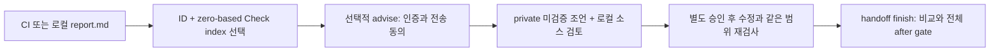

# 선택한 보고서 행을 advisory로 연결하기

2026-10-14. 이 변경은 `report.md`에서 고른 행을 명시적 advisory 요청으로
넘기는 동선을 연결한다. 기존 human 보고서는 finding ID와 check ID만
표시했지만 handoff와 agent projection의 정확한 참조에는 zero-based
`checkIndex`가 필요했다. 모든 finding에 숫자 Check index를 추가하고,
`advise`에서 선택한 `(checkIndex, findingId)`만 요청할 수 있게 한다.
탐지 규칙·취약점 확인 능력·자동 수정 기능의 변경은 아니다.

## 채택한 계약

- `advise --finding SHA256 --check-index N`은 두 옵션을 함께 받는다.
  Finding ID는 lowercase hex 64자, index는 canonical nonnegative safe
  integer이며 실제 canonical report에서 검증한다. 잘못된 선택과 같은
  check 안의 반복 ID는 provider 준비 전에 거부한다.
- Policy 12의 focused projection은 선택한 finding과 parent check만
  포함한다. Full-report gate/counts와 omission accounting은 유지한다.
  32 KiB cap을 넘으면 `report_projection_too_large`로 실패하며 선택한
  근거를 조용히 버리지 않는다. Receipt의 `input.selection`과 원 report-pair
  hashes가 선택을 연결한다.
- Default projection은 같은 `(checkIndex, findingId)`가 반복되는 모든
  행을 finding references에서 제외하고 uploaded projection의 numeric
  `ambiguousFindingRows`에 전체 보고서의 해당 행 수를 기록한다. 이 count는
  advice receipt의 `input` 필드가 아니다. Check-level diagnostics는 유지한다.
  서로 다른 check의 같은 finding ID는 구별한다.
- `cli-login`과 `api-key`는 기존 명시적 두 인증 방식으로 유지하며
  자동 fallback을 추가하지 않는다. Advice는 private·unverified이며
  scan gate나 source handoff의 candidate·snapshot·scope 조건을 바꾸지 않는다.

구현 근거: [projection](../../src/agent-advice-context.ts),
[CLI와 receipt](../../src/agent-advice.ts),
[Markdown report](../../src/report.ts).

## 사용자 동선



실제 명령과 출력 위치는 [advice](../agent-advice.md#advice-for-one-selected-row)와
[source handoff](../source-handoff.md#complete-example)에 둔다. Advice는
어떤 finding kind든 선택할 수 있지만 handoff는 기존 supported source
candidate만 받는다. Source text·위치·target values는 advisory upload에
추가하지 않으며, source 검토와 재검사는 따로 수행한다. `not_observed`나
advice exit 0은 취약점 수정 증명이 아니다.

## 검증 기준과 현재 근거

| 검증 대상 | 수용 기준 | 근거 상태 |
| --- | --- | --- |
| Report selector | 빈 check와 여러 finding, 반복 check ID·cross-check same ID에서도 canonical agent index와 일치; 반복 행 보존 | [selector 2 tests](../../tests/report-selector.test.ts) 통과 |
| Focused selection | Default cap 밖의 유일 행과 parent check만 참조; 전체 gate/counts 유지; observation도 정확히 선택 | [selection 9 tests](../../tests/agent-advice-selection.test.ts) 통과 |
| Refusal | Unpaired/malformed/out-of-range/missing/duplicate pair 및 noncanonical sibling을 provider 준비 전에 거부; oversize는 명시적 실패 | selection tests 통과 |
| Ambiguity | Cap 적용 전 같은 check의 반복 ID 전부 제외·정확한 행 수 기록; cross-check same ID는 별도 참조 | selection tests 통과 |
| Boundaries | Fake CLI의 두 auth modes, privacy, receipt hashes/selection, omitted nextRead check와 잘못된 route 거부 | selection tests 통과 |
| Native replay prerequisites | 유일 native metadata는 replay route 유지; cap 밖 추가 finding·중복 native check는 focused 선택에도 replay 거부 | [replay 3 tests](../../tests/agent-advice-selection-replay.test.ts) 통과 |

Node.js 22에서 다음 focused build와 suite를 실행해 **71/71 통과**했다.
새 테스트 14개(selection 9·replay 3·selector 2)와 기존 57개가 모두
통과했고 fail/cancelled/skipped/todo는 0이다. 실행 log는 로컬 전용
`artifacts/selected-agent-advice-2026-10-14/focused.log`에 보존한다.

```sh
npm run build
node --test build/tests/agent-advice*.test.js build/tests/report*.test.js \
  build/tests/agent-report.test.js build/tests/schemathesis-auth-report.test.js
```

Oversize 회귀는 직접 구성한 typed SDK 입력으로 projection의 32 KiB 경계를
검증한다. Canonical producer가 만든 실제 execution ledger의 재현이라고
주장하지 않는다. 패키지 소비와 전체 required suite·GitHub 통합은 이
focused 결과와 별도 릴리스 검증 기록에서 확인한다.

새 실제 provider 호출은 이 변경의 검증 범위에 포함하지 않는다. 역사적인
policy-2 `cli-login` 실호출은 policy 12나 API-key 실인증을 입증하지 않는다.
Deterministic projection·fake-CLI 결과와 실제 provider 실행 근거를 구분한다.
이 문서는 검토한 0.5.0 GitHub source
기능을 설명하며 이번 변경의 npm 발행을 주장하지 않는다.
