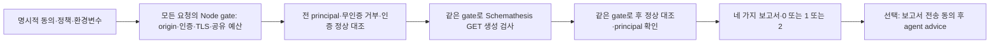

# 보호된 GET API를 생성 입력으로 검사하기

`--schemathesis-auth-policy`는 한 계정의 고정 Authorization으로 보호된 GET에 도달한 뒤 Schemathesis 입력을 생성하는 명시적 검사입니다. 정상 요청이 성공하는지, 같은 요청을 무인증으로 보내면 거부되는지, 검사 전후 principal이 일치하는지를 함께 확인합니다. 모든 요청이 401/403인 실행을 깨끗한 검사로 처리하지 않습니다.

이 계약은 **0.5.0 소스 preview**용입니다. npm 공개판은 0.4.0이며 새 옵션을 지원하지 않습니다. 검토한 소스 CLI와 따로 준비한 Python 3.12.13·`workers/schemathesis/requirements.lock.txt` 환경을 사용하세요. 검사 중 대상 앱 의존성을 설치하거나 대상 코드·build·test를 실행하지 않습니다. 구현 검증의 단계별 근거는 [연구·검증 기록](research/schemathesis-auth-controls.md)과 [독립 acceptance](schemathesis-auth-acceptance.md)에 남깁니다.



## 1. 인증과 정상 동작을 선언하기

[합성 정책 예제](../examples/schemathesis-auth-policy.json)를 비공개 위치에 복사하고 허가받은 staging에 맞게 수정합니다. `.invalid` URL은 실제 서비스가 아닙니다. 토큰은 정책 파일에 넣지 않습니다. `authorizationEnv`가 가리키는 환경변수에 **전체 Authorization 헤더 값**을 비공개 secret 관리 방식으로 준비합니다. Bearer 접두사를 자동으로 붙이지 않습니다.

| 필드 | 의미 |
| --- | --- |
| `baseUrl` | `--api-base`와 같은 하나의 origin. OpenAPI의 servers를 따라가지 않음 |
| `identity` | 검사 전후의 같은 principal을 확인할 구체적인 GET 경로·정확한 2xx status·JSON pointer·기대 scalar |
| `operations[].path` | 명시적으로 선택한 OpenAPI GET template |
| `operations[].normal` | 해당 template에 대응하는 정상 요청의 구체적인 path/query와 정확한 2xx status·JSON scalar 대조 |

기대 scalar는 비어 있지 않은 문자열, 유한한 숫자 또는 boolean입니다. null·객체·배열을 쓰지 않습니다. 예제의 `/items?quantity=1`은 정상 입력이고 `/count`의 `1`은 합성 protected marker입니다. 같은 무인증 요청은 401/403이며 **유효한 UTF-8 JSON**에서 이 marker가 보이지 않아야 합니다. 빈 본문·깨진 JSON·non-UTF-8 응답은 marker 부재를 증명하지 못해 partial·exit 2입니다. status만 맞는 응답이나 로그인 페이지의 200은 정상 대조를 통과하지 않습니다. 생성 검사에서 사용할 GET에도 부작용이 없는지 서비스 소유자가 확인해야 합니다.

## 2. 명시적으로 검사하기

아래 경로와 origin을 실제 검토한 값으로 바꿉니다. OpenAPI는 로컬 JSON이며 원격·파일 외부 reference를 가져오지 않습니다. 정책의 operation 집합은 `--operation` 선택과 정확히 맞아야 합니다. 정책 배열의 순서는 달라도 엔진이 선택한 operation 순서에 맞춰 실행 index를 정렬합니다. policy digest는 원래 검증한 정책의 순서를 보존하므로 전후 비교에는 같은 정책을 유지하세요. 예제 환경변수의 secret 값은 이 명령에 적거나 출력하지 않습니다.

```sh
node /path/to/wakeio-security-ci/build/src/cli.js scan \
  --openapi /path/to/private/openapi.json \
  --api-base https://staging.example.invalid/ \
  --operation /items \
  --schemathesis-auth-policy /path/to/private/auth-policy.json \
  --schemathesis-python /path/to/prepared-venv/bin/python \
  --api-max-requests 32 \
  --active-consent --tools none --fail-on medium \
  --out /path/to/private/auth-reports
```

계정·origin·operation을 사용할 권한과 `--active-consent`가 필요합니다. private/loopback 주소에는 추가로 `--allow-private`가 필요하며 metadata 보호는 유지됩니다. 인증된 plain HTTP는 `--allow-private`를 지정한 **literal loopback**만 지원합니다. `localhost`나 일반 private HTTP를 이 예외로 취급하지 않습니다. HTTPS는 Node가 대상에 직접 TLS 연결을 만들고 정상 CA·hostname/SNI·고정 peer를 확인합니다. 인증서 검증을 끄는 옵션은 없습니다.

operation N개에는 전후 identity 2개와 operation마다 무인증 대조·전후 정상 대조 3개가 필요합니다. 제어 요청은 `2+3N`, operation마다 최소 생성 요청 하나까지 포함한 최소 request budget은 `2+4N`입니다. 모든 단계가 같은 요청·응답 byte·시간 예산을 사용합니다. CLI 기본은 32 requests·30초, SDK 기본은 32 requests·60초이며 상한은 64 requests·120초입니다. 응답 상한은 한 건 2 MiB·전체 10 MiB입니다. redirect·자동 로그인·token refresh·HTTP 재시도·상태를 이어가는 cookie 인증은 지원하지 않습니다.

SDK에서는 `runSchemathesisLive({ document, baseUrl, operations, consent: true, authPolicy, env })`로 같은 계약을 사용합니다. `parseSchemathesisAuthPolicy(input)`은 검증한 `policy`와 `policySha256`을 반환합니다. `env`에서 선택한 Authorization을 한 번 읽어 검사 동안 보존합니다. 인증 정책을 생략한 기존 credential-free 모드는 별도로 유지됩니다.

## 3. CI와 보고서 읽기

전용 `dast` Action의 `schemathesis-auth-policy` 입력도 같은 정책 파일을 받습니다. 계정 secret은 신뢰한 검사 step의 환경변수로만 제공하고, 검토한 Action SHA와 명시적 consent·allowed origin을 유지합니다. passive source Action은 이 검사를 시작하지 않습니다. [DAST Action 설정](../README.md#active-dast-preview-opt-in)에서 주변 checkout·허용 이벤트·보고서 업로드 설정을 함께 검토하세요.

출력 디렉터리에는 다음 네 파일이 있습니다.

- `/path/to/private/auth-reports/report.json`: typed controls·counts·digests와 검사 상태
- `/path/to/private/auth-reports/agent-report.json`: 원 scan gate와 연결된 검토 항목
- `/path/to/private/auth-reports/report.md`: 사람이 읽는 결과와 한계
- `/path/to/private/auth-reports/report.sarif`: 구조화된 도구 결과

`schemathesisAuth`의 `profileRevision: schemathesis-get-auth-v1`은 인증 대조가 있는 실행을 구분합니다. 원 보고서는 policy/schema/worker provenance와 연결됩니다. token·환경변수 이름·identity/기대값·정상 query 값·raw body는 보고서에 넣지 않습니다. 입력 fingerprint는 생성 입력을 식별하는 제한된 근거이며 정확한 요청 replay 자료가 아닙니다. 같은 seed라도 상태가 다른 서비스의 동일 결과를 보장하지 않습니다.

| 결과 | 의미 |
| --- | --- |
| `0` | 대조와 선택한 bounded 검사 완료, 설정 threshold에 해당하는 관찰 없음 |
| `1` | 설정 threshold에 해당하는 관찰 있음. 생성된 5xx는 medium이므로 예제의 `--fail-on medium`에서 1 |
| `2` | 인증·정상 대조 불일치, 생성 401/403, credential 무시, drift, 예산·전송·수집 미완료 등 |

앞서 관찰한 오류가 있어도 뒤의 대조 실패를 숨기지 않습니다. 성공한 인증 GET이나 5xx 관찰은 BOLA·SQL injection·exploit 또는 API 전체 안전을 증명하지 않습니다. `--fail-on high`만 쓰면 medium 5xx가 threshold에 걸리지 않을 수 있으므로 정책에 맞게 threshold를 선택하세요. CI artifact 업로드 성공도 원 gate와 별개의 전달 상태입니다.

## 4. 원하면 에이전트에게 보고서만 전달하기

scan은 모델을 부르지 않습니다. 검토한 보고서 쌍에 대해 명시적으로 전송에 동의할 때 기존 `advise`를 사용할 수 있습니다.

```sh
node /path/to/wakeio-security-ci/build/src/cli.js advise \
  --report /path/to/private/auth-reports \
  --agent codex --auth cli-login --allow-report-upload \
  --out /path/to/private/auth-advice
```

API-key 방식은 별도로 `--auth api-key`와 `CODEX_API_KEY`를 사용합니다. 어느 방식도 자동 fallback하지 않습니다. 전달하는 것은 제한된 redacted 보고서 projection이며 raw source·credential·oracle·body가 아닙니다. 모델은 진단 검토를 제안할 뿐 재검사·수정·대상 실행을 수행하지 않습니다. 모델 비용과 공개할 정보를 검토한 뒤 opt-in하세요. 이 기능의 로컬 검증과 live Codex 호출은 서로 다른 근거이며 이번 slice의 live 호출을 주장하지 않습니다. [agent advice 계약](agent-advice.md).

Node는 생성 Authorization/Cookie와 응답 Set-Cookie를 제거하고 고정 credential을 대상 전송에만 주입합니다. 대상이 token을 응답에 반영하면 worker가 그 응답을 일시적으로 볼 수 있습니다. raw 응답·예외/cURL 내용을 보고서에 복사하지 않는 경계와 실행의 제한이 필요하며, 이 구조를 임의 worker 코드의 OS·network sandbox라고 해석하지 않습니다.

소유 합성 API의 실제 CLI에서는 보호된 V/F의 생성 입력에 도달해 결과를 구분하고, all-deny와 trailing principal drift는 미완료로 남겼습니다. 원 baseline·수정 이력·로컬 검증 범위는 [검증 기록](research/schemathesis-auth-controls.md#후속-구현로컬-검증--2026-10-13)을 참고하세요. 이 근거가 자신의 staging이나 배포된 archive·hosted CI의 성공을 대신하지는 않습니다.
