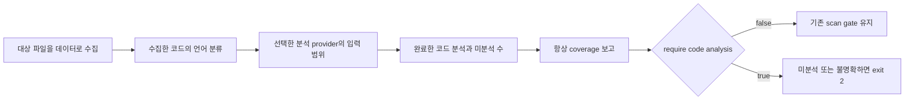

# 수집한 코드의 분석 범위 확인

**파일을 수집했다는 사실과 그 언어를 보안 분석했다는 사실은 다릅니다.** Python과
JavaScript가 함께 있는 저장소에서 내장 JavaScript 분석이 완료돼도 Python 분석까지
완료된 것은 아닙니다. `source.code-coverage`는 수집한 코드의 언어별 분석 범위를
항상 보고하고, `--require-code-analysis`는 미분석 코드를 CI에서 막는 별도 선택입니다.

현재 0.5.0 소스 프리뷰에 구현된 계약입니다. 아래 예시는 검토한 source checkout의
빌드된 CLI 기준이며 공개 npm의 새 배포를 뜻하지 않습니다. 로컬 검증 범위와 후속
배포 검증 단계는 문서 마지막에서 구분합니다.



## Clone에서 CI gate까지

대상 앱의 설치·import·build·test·server를 실행하지 않고 파일 데이터만 읽습니다.
보고서는 대상 source 밖의 새 경로에 둡니다.

```sh
node /path/to/wakeio-security-ci/build/src/cli.js scan \
  --source /path/to/cloned-app --tools none \
  --require-code-analysis --out /path/to/new-reports
```

Python과 JavaScript가 함께 있는 저장소에서는 별도로 준비한 **신뢰하는 Bandit
실행 파일**을 명시적으로 선택할 수 있습니다. 이 경로는 분석 도구이며 대상 앱의
실행 파일이 아닙니다. Wakeio가 Bandit이나 대상 dependency를 자동 설치하지 않습니다.

```sh
node /path/to/wakeio-security-ci/build/src/cli.js scan \
  --source /path/to/python-and-js-app \
  --tools bandit --bandit /path/to/prepared-bandit \
  --require-code-analysis --out /path/to/new-mixed-reports
```

Bandit이 Python 입력을 받더라도 완료 근거가 없으면 uncovered가 남습니다. 도구
누락·부분 결과·오류·timeout도 엄격한 선택에서 통과하지 않습니다. 내장 JS 분석과
선택한 Python 분석의 완료를 각각 보고서에서 확인하세요.

기본값은 informational입니다. 기존 selected-check gate를 유지하면서 미분석 범위를
보고합니다. 엄격한 선택은 source가 있는 `scan`, `doctor`, `init`에서
`--require-code-analysis`로 전달합니다. SDK는 `requireCodeAnalysis: true`, Action은
`require-code-analysis: 'true'`를 사용합니다. Action 기본값은 `'false'`이며 다른 값은
거부합니다. Doctor와 init에 지정한 정책도 다음 scan/CI 설정으로 전달됩니다.

| 자체 입력·선택 | 기본 gate의 의미 | require 선택의 의미 |
| --- | --- | --- |
| Python만, `--tools none` | 기존 내장 AST 미완료로 exit 2 | 미분석 코드로 exit 2 |
| Python + 정상 JS, `--tools none` | JS 완료에 따라 기존 gate가 0일 수 있음; Python 분석을 뜻하지 않음 | Python 미분석이 있어 exit 2 |
| 선택 provider가 해당 수집 코드를 모두 완료 | 기존 finding·미완료 gate 적용 | coverage 요건을 만족해도 다른 finding·미완료 gate는 유지 |
| 코드 없음·수집 미완료·accounting 불명확 | 기존 gate 유지 | 요건을 입증하지 못하므로 exit 2 |

`--fail-on none`도 require 선택의 미완료를 통과시키지 않습니다. 엄격한 옵션은 새
언어 분석기를 실행하거나 도구를 자동 설치하지 않습니다. 실제 필요한 provider를
별도로 선택하고 가용성·실행 상태를 확인해야 합니다.

## 네 보고 형식의 coverage 근거

결과는 지정한 output directory의 `report.json`, `agent-report.json`, `report.md`,
`report.sarif`에 저장됩니다. 먼저 `report.md`의 gate와 coverage를 읽고, 자동화는
`report.json`과 digest로 연결된 `agent-report.json`을 함께 확인합니다. SARIF는
GitHub code-scanning 등 도구 연동용이며 파일 존재만으로 CI 통과를 판단하지 않습니다.

Action에서도 `tools: bandit`, `bandit-path: /path/to/prepared-bandit`,
`require-code-analysis: 'true'`를 명시합니다. Bandit은 runner에 미리 준비해야 합니다.
[기존 workflow 예시](../examples/github-action.yml)처럼 `if: always()`인 upload step으로
output directory를 보관한 뒤 Actions run의 **Artifacts →
`wakeio-security-ci-reports`**를 다운로드해 위 네 파일을 함께 읽으세요. 이 이름은
예시의 artifact 이름이며 workflow에서 바꿀 수 있습니다. Action의 `action-status.json`과
실제 step/job exit도 별도로 확인합니다. 업로드된 보고서가 pass나 완료를 보증하지
않으며 경로·package 식별자 등이 남을 수 있으므로 artifact 공개 범위를 검토하세요.

`CheckResult.codeCoverage` version 1의 basis는 `collected_code_inputs`입니다.
JSON·agent JSON·Markdown과 `summary.scope.codeCoverage`에서 같은 범위를
읽습니다. SARIF는 invocation properties의 `codeCoverages`에 check별 근거를 둡니다. `requireCodeAnalysis`, `collectionComplete`, `accounting`과 언어별
`collected`, `eligible`, `completed`, `uncovered` 및 totals를 제공합니다. 불명확한
숫자는 `null`이며 추정한 0으로 채우지 않습니다.

언어 순서는 javascript, typescript, python, c, cpp, csharp, go, java, kotlin, php,
ruby, rust, shell, swift, vue입니다. 수집 수가 있는 언어만 기록하고 각 언어에
`builtin_ast`, `bandit`, `opengrep_native`의 selected·status·eligible·completed를
기록합니다. Provider는 실행 상태와 해당 언어 입력을 함께 대조합니다.

- `collected`: collector가 선택한 코드 파일 수
- `eligible`: 선택 provider가 받는 입력의 합집합; 분석 실행·성공 수가 아님
- `completed`: 해당 입력 모두를 완료한 유효한 code adapter 결과에만 부여한 수
- `uncovered`: collected에서 completed를 뺀 수; partial provider는 보수적으로 완료 0

Secret·dependency·config 검사 완료는 코드 분석 완료의 대체 근거가 아닙니다.
여러 provider가 같은 파일을 받아도 파일 수를 중복 합산하지 않습니다. `completed`는
선택한 bounded 분석이 끝났다는 뜻이며 모든 위험·실행 경로·언어 문법을 지원한다는
뜻이 아닙니다. Koa 같은 미지원 source shape도 이 수만으로 탐지 가능해지지 않습니다.

## Scope와 비교의 경계

이 근거는 **수집한 코드**에만 적용합니다. Collector 제외 파일, 미지원 확장자,
embedded code, 생성물, source 밖 모듈이나 프로젝트 전체 coverage를 보증하지
않습니다. 기존 collection issue·AST parse/work gap·check status도 함께 확인하세요.

CLI의 require 정책은 `code-coverage-v1` scope identity에 연결됩니다. 정책 변경이나
필수 metadata 누락을 비교 가능한 clean/fixed 결과로 바꾸지 않습니다. SDK의 독립
check 결과도 strict flag와 coverage 근거를 유지해야 하며, scope가 없는 외부 보고서에서
check 전체를 삭제하면 원 strict 의도를 추론할 수 없습니다. Advice policy 8은 진단용
enum·수치 범위만 전달하며 도구 설치·추가 실행 권한을 부여하지 않습니다.

## 로컬 검증과 후속 delivery 단계

2026-10-13의 동결된 소스에서 통합 required-engine suite는 1051/1051로
통과했고 failed·skipped·cancelled·todo는 모두 0이었습니다. 실행 전후 source
snapshot도 같았습니다. 이 suite에는 기존 기능과 cancellation 회귀 대조가 포함되며,
새 coverage 수용 기준의 개수나 실제 프로젝트 탐지율로 해석하지 않습니다. 별도의
focused 검증은 31/31, 관련 support 검증은 18개가 통과했습니다. 준비한 실제 Bandit을
사용한 SDK의 자체 4개 사례도 입력·완료 coverage 대조를 통과했습니다.

[독립 수용 기준과 동결 이력](research/code-coverage-acceptance-2026-10-13.md) 및
[CI receipt의 검증 범위](verification-ci-2026-10-05.md)를 함께 확인하세요. CI receipt는
해당 snapshot과 실행 환경의 결과이며 이후 커밋에 자동 승계되는 성공 기록이 아닙니다.

2026-10-13 이 문서의 동결 단계는 위 로컬 검증 완료 후, fresh package/source
archive consumer와 hosted GitHub 검증 전입니다. 후속 delivery 결과는 사용하려는
커밋의 PR·CI receipt에서 따로 확인하세요. npm 신규 publication이나 live policy-8
모델 호출은 이 근거에 포함되지 않습니다.

Coverage 기능은 새 언어 탐지 규칙을 추가하지 않습니다. 선택한 Bandit의 개별
finding과 이 기능의 분석 완료 accounting은 서로 다른 근거입니다. 자체 대조의 성공은
외부 앱 취약점 확인, 프로젝트 전체 안전성 또는 상용 탐지 성능을 입증하지 않습니다.

[수집 한도](source-collection.md), [AST 범위](source-flow.md),
[agent 보고서](agent-report.md)를 함께 읽으세요.
