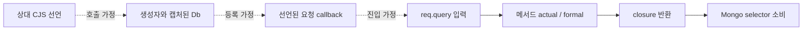

# 조건부 소스 경로를 읽는 법

이 문서는 현재 GitHub 소스 프리뷰의 조건부 근거 계약과 첫 고정 OSS 재측정을 설명한다. 전체 gate·패키지·배포 검증은 별도이며, 새 npm 배포나 실제 MongoDB 실행 검증을 뜻하지 않는다.

이 변경의 source ruleset은 `2026-10-13.1`이다. CLI source scope fingerprint는 이전 분석 의미와 구분되며, 패키지 버전이나 npm 배포 상태가 바뀐다는 뜻은 아니다.

정적 검사에서 소스 입력의 전달 경로와 호출 대상의 확실성은 다른 근거다. 요청의 `req.query` 값은 메서드의 actual/formal 인자→closure 반환→Mongo selector로 전달된다. 상대 CommonJS 선언→생성자와 캡처된 Db→callback 등록은 그 요청 입력이 생기기 전의 호출 가정이다. 동적 loader가 export나 receiver를 바꿀 수 있으면 선언된 몸체가 실제 호출된다고 확정할 수 없다.

실선은 보고된 값 전달 단계이며 점선은 별도로 검토할 호출 가정이다. 생성자나 등록 근거를 입력 source로 표시하지 않는다.

`Finding.staticContext`는 이런 호출 가정을 입력 trace와 별도로 표현한다. `revision: static-context-v1`, `authority: conditional`, 최대 8개 `items`와 `truncated`를 사용한다. 각 item은 다음 kind와 로컬 소스 위치, 필요한 경우 선언된 target 위치를 가진다.

| kind | 검토할 가정 |
| --- | --- |
| `unresolved_cjs_dispatch` | 상대 CommonJS 선언은 찾았지만 실제 dispatch identity가 닫혀 있지 않음 |
| `constructor_continuation` | 선언된 생성자 몸체를 따라가기 위해 남은 가정 |
| `declared_callback_entry` | 선언된 callback 몸체의 진입·호출 조건 |
| `unqualified_mongo_origin` | 수집된 driver/Db/collection 근거가 실제 receiver를 확정하지 못함 |

이 metadata는 새 taint source가 아니다. 보고된 `staticFlow.steps`에서 실제 요청 입력과 actual/formal 전달, selector를 만드는 식, 실제 소비하는 sink를 별도로 확인한다. `threshold`라는 변수 이름이나 `$where` 토큰, `find` 메서드 이름만으로 이 경로를 만들지 않는다. 관찰한 함수 몸체 안에서 selector가 고정값을 쓰고 입력 인자를 사용하지 않는다면, 그 몸체의 sink에 입력 경로를 만들어 붙여서는 안 된다.

호출자에서 `query(conditionalFixed(req.query.x))`처럼 불명확한 함수의 반환값을 소비하는 경우는 별도다. 관찰한 선언이 상수를 반환해도 실제 호출 identity가 확정되지 않았으므로 이를 sanitizer로 취급하지 않는다. 호출 경계에서 들어온 입력의 불확실성을 별도 fallback으로 보존하고, 호출자의 sink에서는 low confidence 후보가 남을 수 있다. 이 fallback을 선언된 몸체 내부의 실제 값 전달 trace에 끼워 넣어서는 안 된다. 고정 literal을 메서드에 직접 전달하는 대조군과도 구분한다.

조건부 후보는 low confidence이며 check는 partial이다. 호환성상 `staticFlow.truncated: true`를 유지하므로, 이 플래그는 표시된 source→sink 단계가 일부 빠졌다는 의미만으로 해석하지 않는다. 별도의 `staticContext.truncated`는 context cap 때문에 가정 item이 생략됐는지를 뜻한다. 어느 쪽도 실행·취약점 확인이나 전체 분석 완료를 증명하지 않는다. 이미 확인된 export/메서드 덮어쓰기, 잘못된 callback Db 인자, 변경된 constructor 권한은 단순히 선언된 옛 몸체를 계속 따라갈 근거가 아니다.

## 보고서와 에이전트

`report.json`의 후보에서 `staticFlow`와 `staticContext`를 함께 읽고, `agent-report.json`의 finding/check 연결과 `scanGate`를 확인한다. Markdown과 SARIF에도 같은 조건부 근거가 유지되어야 한다. 보고서 pair의 해시 결속은 내용의 연결을 확인하며 실제 실행을 인증하지 않는다. partial은 후보가 있어도 exit `2`이고 `--fail-on none`으로 완료가 되지 않는다.

선택적인 `advise` 전송에는 위치·target 경로 대신 context kind, 개수와 생략 여부만 포함한다. 기존 보고서 전송 동의가 필요하고 스캔은 모델을 자동 호출하지 않는다. 세부 인증·전송 계약은 [agent advice](agent-advice.md)를 참고한다. 에이전트 조언은 동적 loader·receiver·호출 조건을 검토할 다음 근거를 제안할 수 있지만, 미검증 가정을 확인된 취약점·수정이나 자동 재실행 권한으로 바꾸지 않는다.

## NodeGoat N2와 독립 수용 기준

고정 NodeGoat 소스의 기대 경로는 [handler의 req.query threshold](https://github.com/OWASP/NodeGoat/blob/c5cb68a7084e4ae7dcc60e6a98768720a81841e8/app/routes/allocations.js#L16-L24) → DAO 인자·closure → [`$where` 표현식과 find](https://github.com/OWASP/NodeGoat/blob/c5cb68a7084e4ae7dcc60e6a98768720a81841e8/app/data/allocations-dao.js#L57-L86)다. [설정의 동적 require](https://github.com/OWASP/NodeGoat/blob/c5cb68a7084e4ae7dcc60e6a98768720a81841e8/config/config.js#L7-L8)는 dispatch 가정과 구분해서 기록해야 한다. userId의 parseInt나 주석으로 된 threshold 수정 예는 실제 threshold 보호 근거가 아니다.

현재 공식 [7-flow corpus](../benchmarks/oss-corpus.json)의 N2는 `known_unsupported`를 유지한다. 새 조건부 후보가 생겨도 별도 독립 검토 기록이며 이를 위해 oracle·대상 hash·분모를 바꾸지 않는다. 합성 fixture는 고정 문자열 대조군, producer 덮어쓰기, callback 인자 권한, constructor guard, 앞선 불명확한 입력, 누락된 actual/capture, factory 반환, native 변경, 복수 입력·allocation context·예산 소진을 검사한다. 전체 OSS에서는 기존 여섯 경로 보존과 새 후보의 근거·미완료 상태도 검토해야 한다. 이것은 일반적 탐지율·정밀도를 나타내는 평가가 아니다.

첫 전체 재측정은 기존 `oss-collection-final`과 같은 대상 commit·tree, oracle, `--tools none`, extended, 수집 10,000개/128 MiB 조건으로 진행했다. 공식 매칭은 **6/7→5/7**, 두 결과 모두 **partial·exit 2**다. 기존 여섯 경로의 rule·site·입력 근거는 남았지만 NodeGoat redirect N3에 CJS dispatch와 callback 진입 가정이 추가되며 medium→low, `staticFlow.truncated: false→true`로 바뀌었다. 따라서 기존 oracle의 완전한 trace 조건을 충족하지 못해 `unevaluable_scope`가 됐다. 점수를 복구하려고 context를 제거하거나 confidence·oracle을 바꾸지 않았다.

새 N2는 threshold source `21:13`→call `23:9`→DAO parameter `57:45`→`$where` `78:21`→find `86:9`를 표시한다. 여섯 conditional context item과 low confidence를 가진 수동 검토 후보이며 공식 unsupported 기대값의 매치로 승격하지 않는다. Juice Shop의 32개 finding은 이전 결과와 같고, NodeGoat의 기존 네 후보 중 삭제된 것은 없다. 미검토 후보 **27→29**는 새 N2 한 개와 더 이상 매칭되지 않는 N3 한 개의 합이며, 새 취약점 두 개나 탐지 성능 개선을 뜻하지 않는다. 독립 비교 기록은 로컬 `artifacts/oss-efficacy-2026-10-13/conditional-first-efficacy-review.{md,json}`에 있으며 패키지에는 포함하지 않는다.

최종 `oss-conditional-final` 재측정도 같은 oracle·대상·예산에서 **5/7·partial·exit 2**였으며, Juice Shop 32개와 NodeGoat 5개 finding 객체가 첫 조건부 측정과 같았다. 최종 독립 기록 `conditional-final-efficacy-review.{md,json}`은 네 보고서의 해시, agent pair 결속, N2 trace/context를 확인한다. required-engine gate는 **869/869·skip 0**, CI 계약은 **18/18**을 통과했다. strict 합성 corpus 50개는 지원 positive 24개·fixed 25개·known miss 1개이며 strict regression은 0이다. 이 숫자는 해당 fixture와 계약의 결과다.

gate receipt는 로컬 `artifacts/ci/required-engine-gqNo8X/receipt.json`이며, 검사 전후 source hash는 `4c9b99c2b64014966c24b605ad40a061948c9bbf8043c29759f7b25aa02f5797`로 같다. 이 검증은 패키징·설치·공개 배포 성공을 증명하지 않는다. 최종 패키지 소비자 검증은 별도 receipt로 기록하며, 이 문서 동결 시점에는 아직 실행 전이다. 로컬 검증 기록은 패키지에 포함하지 않는다.
