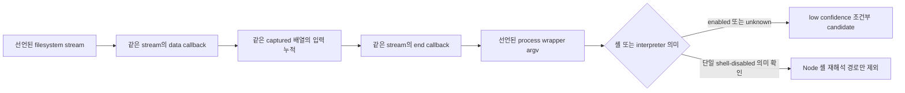

# Filesystem filename flow to process arguments

## 한글 요약

파일명도 보안 검토가 필요한 입력입니다. 예를 들어 다른 사람이 추가한 파일을
CLI가 모아 프로그램 인자로 넘길 때, 그 인자를 셸이 다시 해석하면 원래 파일명과
다른 동작을 할 수 있습니다. 이 확장은 파일명 원천, 같은 stream의 callback,
배열에 모이는 값, process wrapper의 argv를 소스만 읽어 연결하는 계약입니다.

**0.5.0 소스 프리뷰에 구현된 기능입니다.** 소스 검증 결과와 package consumer
검증의 별도 경계는 아래 상태를 확인하세요. 공개 npm은 아직 0.4.0입니다. 후보에는 filename origin과
조건부 가정이 함께 남습니다. CLI 옵션이나 실제 모듈·배열·셸 동작을 확인하지
못했다면 unknown/partial을 보존하며, 원래 검사를 통과로 바꾸지 않습니다.



공개 glob advisory는 **이미 알려진 문제**의 실제 parent/fix 기준입니다. 새
발견이 아닙니다. 수정 소스에도 사용자가 켠 unsafe shell 분기가 남으므로 전체
fixed 소스의 무후보를 기대해서는 안 됩니다. Default의 별도 argv와 known-shell
positional 경로도 해당 조건에서만 검토합니다. 기존 7-flow·DVNA 평가와 별도이며,
실제 detector 추가 관찰과 일반 정확도·상용 효용은 각각 별도 근거가 필요합니다.

## Status and input boundary

The following describes the adopted implementation contract for source ruleset
`2026-10-13.3`, implemented in the 0.5.0 source preview. Source validation and
the separate package-consumer boundary are described below. The published npm
package remains 0.4.0. Report schema 1.0 remains additive.

The scanner reads collected source/dependency metadata as data. It does not
install or import target dependencies, run target hooks/builds/tests, start an
application, execute a command, or call a model to resolve the flow. The model
adds no network scan or replay authority.

## Declared support

The bounded qualification currently covers these exact reviewed versions:

| Source/package boundary | Supported version and required source evidence |
| --- | --- |
| External ESM `globStream` API from `glob` | `glob` **10.4.5** only, with a compatible dependency declaration and coherent exact lock selection |
| Collected local glob implementation | Root package `glob` **10.4.5**, with the connected local export/constructor/read/path/write/returned-stream graph and coherent dependency/lock metadata for **Minipass 7.1.2** and **PathScurry 1.11.1** |
| Declared `foregroundChild` wrapper | `foreground-child` **3.2.1**, with a compatible dependency declaration, coherent exact lock selection and supported import/operand shape |

Other versions, including newer releases, are unsupported by this model.
Missing or conflicting metadata and unsupported source shapes retain an
analysis gap or conditional unknown evidence; they do not automatically
qualify as safe or completed clean. These source-only qualifications do not
prove installed package identity, runtime behavior or exploitability.

- Resolve one local exported function implementation together with its
  bodyless overload signatures from the same lexical symbol. Duplicate actual
  bodies, opaque exports, mutation and unresolved bindings retain uncertainty.
- Recognise a declared glob filesystem-result stream through the collected
  local implementation/constructor/stream chain, or a selected ESM package API
  with coherent reviewed dependency/lock metadata. An arbitrary `.on('data')`
  callback, root package name or advisory-specific file hash is not an origin.
- Connect literal data/end registrations on the same stream allocation,
  callback actual parameters and captured symbols. Event scheduling and
  filesystem attacker control remain declared semantic assumptions.
- Track filename content through a scan/context-local captured accumulator.
  Push/spread/unshift observations are value-flow witnesses, not proof of an
  actual Array intrinsic or a parser-returned list's runtime type. Shared
  content is a conservative monotonic union; it does not prove overwrite order
  or path-sensitive exclusions. Mutable content bypasses summary cache reuse.
- Model the reviewed foreground-child package contract from coherent declared
  dependency/lock metadata and the selected import/overload. Lock selection is
  not installed package or loader identity. The reviewed POSIX Node spawn
  meaning is separate from Windows cross-spawn and explicit interpreter
  semantics. Package shape/version alone never grants native runtime proof.

Known escape, alias, replacement, mutation, missing metadata and unsupported
shapes revoke safety qualifications without erasing earlier filename evidence.
Index/flow/summary/depth/alias/trace work uses the existing bounded budgets.
No separate unbounded target walk or target execution is added.

## Findings, context and metrics

`ast:filesystem-shell-input` is a **high-severity, low-confidence candidate**.
It describes filename input reaching argv with enabled/unknown shell or
unresolved interpreter meaning. Other command/executable inputs retain their
separate existing rules; they are not substituted for the filename origin.

Optional `StaticFlow.sourceKind: filesystem_filename` identifies the selected
trace's origin. It does not mean HTTP request input, runtime attacker control,
or every feasible source. Legacy absence remains unknown. JSON, local agent
JSON, Markdown and SARIF preserve the same sanitised source-kind metadata.

The existing bounded `static-context-v1` can carry four additional kinds:
`declared_filesystem_stream_origin`, `declared_stream_callback_schedule`,
`conditional_array_accumulator`, and `declared_process_wrapper`. They preserve
actual collected positions and observed local targets, with authority
`conditional`. A wrapper outside the collected snapshot is not inserted as an
invented local trace hop. Positive paths remain low confidence with truncated
static evidence and runtime/fix verification not run. Context drift retains
the existing comparison's unverified state.

Check metrics use `filesystemStreamModel: glob-stream-filename-v1` and counters
`filesystemStreamsRecognized`, `filesystemFilenameCallbacks`,
`filesystemAccumulatorWrites`, `filesystemWrapperArgvUses`,
`filesystemShellEnabledUses`, `filesystemShellUnknownUses`,
`filesystemInterpreterUnknownUses`, `filesystemShellDisabledExclusions`, and
`filesystemUnsupportedUses`. These count analysis uses, not unique
vulnerabilities, complete coverage or verified fixes. Existing typed gaps and
exact budget accounting remain authoritative; omitted or missing evidence
cannot establish a clean result.

## Reading shell outcomes

| Declared operand outcome | Meaning and limitation |
| --- | --- |
| `argv_shell_input` | Filename content reaches argv with enabled shell under the package contract; candidate, not exploit confirmation |
| `argv_shell_unknown` | Shell value/identity cannot be resolved; retain candidate and uncertainty |
| `direct_argv_interpreter_unknown` | Separate argv still reaches an explicit interpreter whose argument roles are unresolved; review remains necessary |
| `argv_only_shell_disabled` | The declared Node shell interpretation path is excluded; executable, program-option and interpreter safety remain separate |

CLI flag declarations do not prove the value of every invocation. A default
false option and an explicit unsafe opt-in can share one source sink. The
merged source analysis must not silently choose the safe mode.

## Independent known-advisory evidence

The [independent evidence note](research/glob-advisory-evidence-2026-10-13.md)
freezes the actual public glob advisory parent/fix, file hashes and locked
foreground-child 3.2.1 source/registry artifact. It distinguishes the parent
filename→shell argv path, fixed default-separated argv, fixed explicit unsafe
shell, and fixed known-shell positional path. Target source and upstream tests
were read as data; no upstream program/test execution is evidence here.

The whole fixed checkout is **not** a zero-finding negative. Unknown CLI mode,
package binding and explicit interpreter semantics remain review conditions.
The replay results below are limited to the frozen inputs and declared
analysis scope; passing owned fixtures does not establish production accuracy
or commercial benefit. The previous 7-flow and DVNA oracles/denominators remain separate.

## Scoped replay and validation status

The independently frozen parent/fix inputs and expectations were retained
while the baseline and source-preview scanners used the same declared input
bytes and scan policy. This table counts filename candidates for the new
filesystem rule only; it is not a vulnerability count or population recall.

| Frozen whole-source input | Baseline filename candidates | Source-preview filename candidates | Check/gate |
| --- | --- | --- | --- |
| Public glob advisory parent | 0 | 1: filename callback → accumulation → shell-enabled argv | Partial / exit 2 |
| Direct fix source | 0 | 2: explicit-interpreter boundary and dynamic-shell fallback | Partial / exit 2 |

Both source-preview results preserve low confidence, conditional context,
truncated static traces and vulnerability/remediation verification not run.
The added witness explains a previously unsupported source path. It does not
establish a new vulnerability, runtime reachability, exploit success or a
verified fix. The fixed-source candidates reflect retained unsafe/unknown
branches; the whole fixed source is not a clean negative.

The final root-owned focused suite passed 20 groups, including the for-in/of
write-boundary extension. The final required suite passed 1,018 tests with no
failures or skips and confirmed unchanged collected project inputs during the
run. The refreshed immutable source-pair replay preserved the 1/2 filename
witnesses and partial/exit 2 shown above. Earlier implementation-freeze runs
remain interim evidence and are superseded by these final source-validation
receipts.

Fresh packaged CLI/prebuilt Action consumer verification is a separate step:
its private receipt is recorded after documentation freeze. At this freeze,
that consumer verification is pending. Source-suite success does not establish
that package-consumer step. No npm publication or production/commercial
benefit is claimed.

The receipts are local-only ignored artifacts, including
`artifacts/glob-advisory-2026-10-13/current-pair-release/receipt.json` and
`artifacts/ci/required-engine-SebJd7/receipt.json`; they are not shipped with the
public repository or package. No external source or real-system report is
embedded here. Target code/dependencies were not executed or installed for
the source replay, and no model was called to establish the flow.

## Generic source-only use

When using the reviewed source build, supply your own authorised source
directory and an output outside it. This example is a generic command, not a
recorded execution or a real external-source report.

```sh
node build/src/cli.js scan \
  --source /path/to/owned-cli-fixture --project-id owned-cli-fixture \
  --tools none --analysis-profile extended \
  --source-max-files 10000 --source-max-bytes 134217728 \
  --timeout-ms 30000 --fail-on high \
  --out /path/outside/owned-cli-fixture/reports
```

The output directory receives `report.json`, `agent-report.json`, `report.md`
and `report.sarif`. Read the source-kind, static context and check gaps together.
Exit `2` still means failed/incomplete work even when a candidate exists;
otherwise the existing threshold gate returns `1` for a blocking finding or
`0` for complete declared checks without a threshold finding. `not_observed`
is not a verified fix. [Local source handoff](source-handoff.md) keeps review
and separately performed rechecks distinct.

Optional [advice policy 7](agent-advice.md) sends only bounded source-kind and
context enums/counts. Source paths, positions, content, concrete target values
and commands stay outside that projection. The existing
`review_static_flow_or_budget` route does not execute or authorise a replay.
