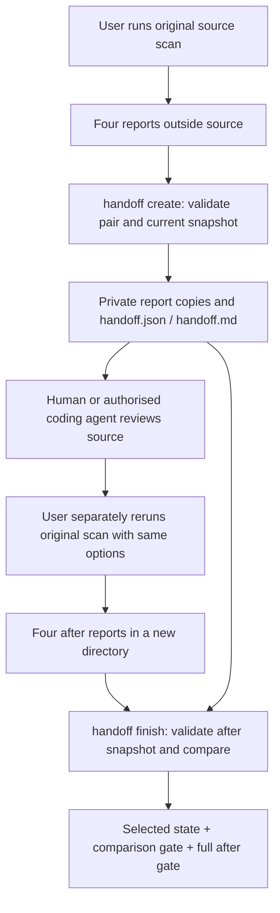

# Local source handoff

The reviewed 0.5.0 source preview provides a data-only packet for handing a
source candidate to a human or an explicitly authorised coding agent. The
published npm 0.4.0 package does not provide these commands. Use the CLI from
your reviewed source build or its locally prepared package.

`handoff create` reads a source report pair, binds one finding to the currently
collected source strings, and writes a new private packet. `handoff finish`
reads a separately produced after report and records the existing comparison
and the full after scan gate. Neither command scans, invokes a model, generates
or executes a scan recipe/argv, or proposes/applies a patch. Creating a packet
does not authorise an agent to modify source or run the application.



## Where reports and packets go

All example directories must be fresh where output is requested. Keep the
original reports, after reports, handoff input and new handoff output **outside
the source tree**. Do not reuse output directories or overwrite old evidence.

| Directory | Contents |
| --- | --- |
| `/path/outside/your-app/before` | Original `report.json`, `agent-report.json`, `report.md`, `report.sarif` from the scan |
| `/path/outside/your-app/review` | Exact private copies of original `report.json` and `agent-report.json`, plus `handoff.json` and `handoff.md` |
| `/path/outside/your-app/after` | Four newly generated scan reports after the separately authorised source change |
| `/path/outside/your-app/recheck` | New `handoff.json` and `handoff.md`, with private after report copies |

Packet directories use mode `0700`, files `0600`. Symlink/hardlink and unsafe
input/output paths are refused. Permission checks are local delivery controls,
not encryption or proof of who wrote the original report.

## Complete example

Run these scan commands yourself with the reviewed CLI. The example declares
source, project, tools, threshold, analysis profile, collection caps, timeout
and output explicitly. Record your original command/options separately;
handoff never reconstructs them from a report fingerprint.

```sh
wakeio-security-ci scan \
  --source /path/to/your-app \
  --project-id your-app \
  --tools none --fail-on high \
  --analysis-profile extended \
  --source-max-files 10000 --source-max-bytes 134217728 \
  --timeout-ms 30000 \
  --out /path/outside/your-app/before
```

Inspect the original reports. Replace `FINDING_ID` and `CHECK_INDEX` below with
the selected finding's `ID` and numeric `Check index` in `report.md`, or its
`findingId` and `checkIndex` in `agent-report.json`.
The check index is zero-based, not the finding-list row number.
The index disambiguates check membership; a rule name or unrelated finding
from the same file is not a substitute.

```sh
wakeio-security-ci handoff create \
  --report /path/outside/your-app/before \
  --source /path/to/your-app \
  --finding FINDING_ID --check-index CHECK_INDEX \
  --out /path/outside/your-app/review
```

Read `review/handoff.md` with the two copied reports. A reviewer uses the
reported locations to inspect the local source and decides which security
assertion and normal-behaviour control need independent validation. Source
content and scanner/model guidance remain untrusted data. The packet does not
execute their instructions. Source edits and application/control execution
require their own authorisation and remain outside handoff.

For optional model advice on this exact row, use the reviewed source CLI and
the same selector with explicit upload consent:

```sh
node /path/to/wakeio-security-ci/build/src/cli.js advise \
  --report /path/outside/your-app/before \
  --finding FINDING_ID --check-index CHECK_INDEX \
  --agent codex --auth cli-login --allow-report-upload \
  --out /path/outside/your-app/selected-advice
```

`--auth api-key` is the explicit alternative, with no automatic fallback.
This uploads bounded report metadata for the selected row and its parent
check; source text and positions remain local. The full original gate and
counts remain visible. Read the private, unverified advice with the local
reports; it does not modify the handoff packet, authorise a patch, execute a
target or rescan, or turn a candidate into a confirmed vulnerability.
Selection and cap refusal details are in the [advice contract](agent-advice.md#advice-for-one-selected-row).

After the separately authorised change, rerun your original scan with the
same options and a new output directory:

```sh
wakeio-security-ci scan \
  --source /path/to/your-app \
  --project-id your-app \
  --tools none --fail-on high \
  --analysis-profile extended \
  --source-max-files 10000 --source-max-bytes 134217728 \
  --timeout-ms 30000 \
  --out /path/outside/your-app/after

wakeio-security-ci handoff finish \
  --handoff /path/outside/your-app/review \
  --report /path/outside/your-app/after \
  --source /path/to/your-app \
  --out /path/outside/your-app/recheck
```

## What is bound, and what stays unknown

V1 accepts only source-only scans with `tools=none`, the fixed built-in
inventory/AST/framework check set, known revisions and coherent typed budgets.
URL/API/native/external-engine or legacy unknown binding is unsupported.

`source.inventory.sourceSnapshot` carries one `source-snapshot-v1` SHA-256
aggregate, with `basis=collected_utf8_strings`, selected file/byte counts,
completeness and `outputDirectoryExcluded`. It binds the immutable strings
actually supplied by the collector, including their declared selection and
effective collection budget. There is no per-file hash/list or source text in
this field. This is decoded collected-string equality, not a raw-byte
filesystem snapshot, scanner signature, runtime execution or atomic protection
against concurrent changes. The old tree provenance `sourceContentHash`, scope
fingerprint and semantic finding anchor are separate identities.
The aggregate is independent of an absolute checkout root: equal collected
content does not authenticate which original checkout produced the report.

Create re-collects the currently supplied source under the recorded effective
collection budget and requires the same complete aggregate. Reports produced
by excluding an output directory inside source are refused in v1. A complete
collector with a partial AST can still create a review packet containing a
candidate: the original incomplete gate and gaps remain visible. An incomplete
collector, stale source, unknown/malformed snapshot, tampered pair or ambiguous
selection produces exit `2`.

Finish validates the private original pair/selected identity and the fresh
after pair, binds the current source to the after snapshot, then applies the
existing strict report comparison. It preserves scope, ruleset, known budget,
provenance, static-context and ambiguity checks. It cannot repair missing
execution/delivery receipts or authenticate a report's author.

## Reading exits and receipts

| Operation / exit | Meaning |
| --- | --- |
| Create `0` | A bound review packet was created; original scan gate may still be `1` or `2` |
| Create `2` | Refused, unsupported, changed/unknown input or incomplete delivery |
| Finish `0` | Comparable declared recheck with a complete after scan and no finding at its selected threshold |
| Finish `1` | After scan or comparison has a threshold-blocking finding/change; unchanged high findings still block |
| Finish `2` | Incomplete before/after scan, source/scope/budget/provenance/context drift, ambiguity or delivery failure |

Finish applies `2 > 1 > 0` to comparison and the **full after scan gate**. A
selected finding's disappearance cannot hide a new high finding elsewhere.
`--fail-on none` retains the original policy and never converts incomplete
work into a pass.

A refused operation may leave only an `incomplete` `handoff.json` in its new
directory. It is not a ready/rechecked packet; missing successful artifacts or
the presence of an output path cannot establish successful delivery.

`handoff.json` records `operation`, `status`, `reason`, `exitCode`, exact report
pair hashes, selected check/finding/rule, declared scope, `sourceBinding` and
`originalScanGate`. Finish adds `after`, `comparison` and `selectedState`.
`not_observed` means the selected pattern was not observed in the comparable
after result. It is **not a verified fix**. Every packet keeps
`vulnerabilityConfirmed=false`, `remediationVerified=false`, and security and
normal controls `not_run`, even when finish exits `0`.

The composite GitHub Action produces scan reports; it does not expose handoff
inputs. Use the corresponding reviewed package CLI for create/finish on those
artifacts and the same source snapshot. See the [agent report contract](agent-report.md)
and [comparison contract](preview-0.4-comparison.md).

For a CI-to-local path, use the explicit [pinned Action init workflow](init-action-onboarding.md).
It separates `wakeio-source` from fresh run/attempt report directories. An original
scan that placed reports inside source retains `outputDirectoryExcluded: true`;
moving the downloaded files later cannot make that report eligible for handoff.
Use the actual checkout commit (a merge commit for default PR checkout), matching
collected source bytes and a compatible reviewed CLI/ruleset.
