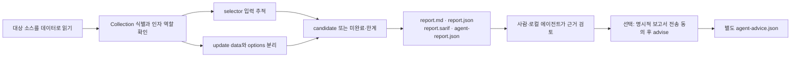

# NoSQL 소스 검사 사용법과 한계

이 문서는 NoSQL 변경이 포함된 **0.5.0 소스 프리뷰 checkout을 로컬에서 빌드한 CLI**를 기준으로 한다. 공개 npm `0.4.0`의 기능 설명이 아니다. JavaScript/TypeScript의 선언된 **MarsDB Collection selector** 검사와, 합성 소스 fixture로 검증한 좁은 **legacy MongoDB 2.x** 모델이 구현되어 있다. 후자는 실제 DB 실행이나 NodeGoat 전체 경로 탐지를 뜻하지 않는다. 고정된 NodeGoat N2 `$where` 흐름은 여전히 `known_unsupported`다.

## 로컬에서 검사하기

Wakeio의 검토한 소스 checkout을 빌드한 뒤 그 디렉터리에서 실행한다. `--source`에는 이미 준비된 대상 clone을, `--out`에는 **그 clone 밖의 새 경로**를 지정한다.

```sh
node build/src/cli.js scan \
  --source /absolute/path/to/cloned-app \
  --tools none \
  --analysis-profile extended \
  --fail-on high \
  --out /absolute/path/to/new-nosql-report
```

대상 파일은 데이터로 읽는다. 이 명령은 대상 앱의 설치·build·test·서버·DB를 실행하지 않으며 LLM이나 외부 scanner도 호출하지 않는다. `--tools none`을 생략하면 외부 도구 기본값이 적용되므로 내장 검사만 할 때는 반드시 지정한다.

`extended`는 AST 분석 작업량을 늘리는 프로필이다. CLI의 파일 수집 한도까지 바꾸지는 않는다. 현재 기본 수집 한도는 파일 1,000개·총 25 MiB이며, 큰 프로젝트는 수집 또는 분석 한도로 `partial`이 될 수 있다. 아래 고정 OSS 비교는 별도 harness가 SDK 수집 한도 10,000개·128 MiB를 명시한 결과이므로 이 CLI 명령과 같은 설정으로 간주하지 않는다. [분석 budget과 미완료 계약](source-flow.md)을 참고한다.



## 무엇을 탐지하는가

선언된 MarsDB import와 Collection 생성·상대 모듈의 const export를 제한된 정적 모델로 연결한다. selector를 받는 `find`, `findOne`, `update`, `remove`, `count`, `ids`가 대상이다. 이름이 같다는 이유로 `Array.find`나 임의 객체를 데이터베이스로 인정하지 않는다. 실제 설치된 패키지나 런타임 객체 identity를 검증하는 기능은 아니다.

MongoDB 모델은 수집된 package/lock의 2.x 계약과 정적으로 식별한 `MongoClient.connect` callback의 Db 인자에서 시작해 `db.collection`과 selector를 연결한다. 생성자 안에서 선언한 own-arrow 메서드와 변경되지 않은 capture를 추적하는 제한된 예외도 합성 fixture로 검증했다. 일반적인 closure·동적 dispatch·최신 MongoDB driver 지원으로 확대 해석하지 않는다. 변경·escape·동적 CommonJS 참조로 역할을 증명하지 못하거나 작업량 한도에 도달하면 미완료/불명확 상태를 유지한다.

예를 들어 `update({ _id: req.body.id }, { $set: { message: req.body.message } }, { multi: true })`에서는 첫 번째 인자가 selector다. `_id`의 입력은 연산자 객체가 될 가능성을 검토하지만, 두 번째 인자의 message나 세 번째 options를 같은 selector 흐름으로 보고하지 않는다. `multi`가 없어도 selector 입력 자체는 검토 대상이다.

`ast:nosql-input-sink`의 `candidate`는 소스에서 발견한 검토 대상이다. `staticFlow`의 source·sink 위치, `truncated`, check 상태와 `analysisGaps`를 함께 확인해야 한다. 역할이나 receiver를 충분히 판별하지 못하면 low-confidence unresolved 후보로 남을 수 있다. 끊기지 않은 입력 trace도 데이터베이스 실행, 실제 연산자 제어, 취약점 확인을 뜻하지 않는다.

## 문자열 guard와 `$where`는 구분한다

고정 field의 연산자 객체 주입을 제한하는 문자열 검사는 다음처럼 **한 번 읽어 둔 local const**에 적용해야 한다. scanner의 제한된 제외 판단에는 receiver identity, 지배적인 종료 guard, 변경·escape와 분석 범위 조건도 필요하다.

```js
const id = req.body.id;
if (typeof id !== 'string') return;
collection.find({ _id: id });
```

반면 `typeof req.body.id`를 검사한 뒤 `req.body.id`를 다시 읽으면 getter가 다른 값을 반환할 수 있다. 요청 모양의 변수가 곧 불변 데이터라는 보장은 없으므로 이런 재읽기를 안전 제외 근거로 삼지 않는다. 교육용 codefix의 직접 member guard도 실행 확인된 안전한 route나 scanner negative proof가 아니다.

문자열이라는 사실은 **코드에 삽입해도 안전하다는 뜻이 아니다**. 같은 `id`가 `$where: id` 또는 `$where` 문자열 조합에 들어가면 JavaScript selector의 입력으로 계속 검토한다. 문자열 guard로 일반 SQL·eval·HTML taint를 지우지도 않는다. 동적 key, prototype 변경, alias mutation, 불명확한 호출과 부분 분석은 안전 판정으로 바꾸지 않는다. [공식 구현 근거와 두 OSS 경로](research/nosql-source-model-2026-10-13.md)에 세부 의미를 정리했다.

## 결과와 에이전트가 읽을 순서

출력 디렉터리의 `report.md`로 요약을 보고, `report.json`에서 해당 finding의 위치·`staticFlow`와 check의 상태·`analysisGaps`를 확인한다. `report.sarif`는 code-scanning 연동용이며 `agent-report.json`은 finding/check 연결, scan gate, 미검증 상태를 에이전트가 읽는 계약이다. 네 파일을 함께 보관한다. [에이전트 보고서 계약](agent-report.md)을 참고한다.

| 종료 코드 | 의미 |
| --- | --- |
| `0` | 적용 가능한 검사가 완료됐고 지정한 severity 기준 이상의 발견이 없음. 프로젝트 전체가 안전하다는 인증은 아님. |
| `1` | 지정 기준 이상의 발견이 있음. 기본 기준은 high이며 후보도 gate에 반영될 수 있음. |
| `2` | 설정·전달 오류, 실패·미완료 검사 또는 적용 가능한 검사 부재. 후보가 함께 있어도 완료로 취급하지 않음. |

`--fail-on none`으로도 미완료 검사는 통과하지 않는다. 수정 후 같은 범위·설정으로 다시 검사했을 때 후보가 사라져도 해당 정적 신호가 관찰되지 않은 결과이며 자동 수정 인증은 아니다. 현재 NoSQL 소스 후보에 native DAST finding replay를 적용하는 명령은 제공하지 않는다.

선택적으로 이미 생성한 보고서를 Codex에게 설명하게 할 수 있다. 다음 명령은 **별도 실행·보고서 전송 동의**이며 scan이 자동으로 호출하지 않는다. Codex CLI가 설치되고 기존 로그인이 준비되어 있어야 한다.

```sh
node build/src/cli.js advise \
  --report /absolute/path/to/new-nosql-report \
  --agent codex \
  --auth cli-login \
  --allow-report-upload \
  --out /absolute/path/to/new-nosql-advice
```

API key 인증을 선택할 때는 `--auth api-key`와 별도 환경변수 `CODEX_API_KEY`를 사용한다. `advise`는 보고서의 제한된 projection을 전송하며 대상 소스를 수집·업로드하지 않는다. 경로 같은 보고서 metadata가 포함될 수 있으므로 전송 범위를 확인한다. 결과는 별도 private `agent-advice.json`이며 원래 판정과 보고서를 바꾸거나 코드를 자동 수정하지 않는다. 에이전트 조언은 탐지·수정 검증과 구분한다.

## 현재 확인한 OSS 결과

고정된 두 교육용 OSS의 **같은 7개 소스 흐름**을 대상으로, 저장된 이전 결과와 Phase 1 v2 결과를 J3만 수정한 동일 oracle로 사후 재평가했다. 관찰된 흐름은 **5/7 → 6/7**이며 둘 다 **partial·exit 2**다. 새 J3는 `req.body.id` source 18:14 → update sink 17:5의 untruncated trace를 가진 low-confidence 후보로, corpus에서는 `exploratory`로 분류한다. NodeGoat `$where`는 이 비교에서 여전히 unsupported다.

이 비교는 과거 엔진을 다시 실행하거나 예산을 늘린 측정이 아니다. 원래 보고서와 oracle 기록을 보존하며, 소스 commit·tree·파일 hash·7개 flow ID를 유지했다. 정밀도·일반적 재현율·운영 서비스 탐지 성능을 나타내는 숫자로 사용하지 않는다. 명령과 oracle 해석은 [OSS benchmark 안내](oss-benchmark.md), 최초 독립 기대 경로는 [소스 효용 검토](research/oss-source-efficacy-2026-10-13.md)에 있다.

최종 root 검증의 별도 whole-checkout 측정 `nosql-root-final-corpus`도 같은 oracle·수집/분석 예산에서 **6/7, partial·exit 2**를 기록했다. NodeGoat N2는 `server.js:132`의 `routes(app, db)` 경계부터 연결되지 않았다. 수집된 전역 `require`의 비정형·동적 참조가 CommonJS identity 증명을 막아, DAO까지의 소스 흐름을 입증하지 못했다. 합성 MongoDB fixture의 통과로 이 경로를 지원으로 바꾸지 않았으며 corpus도 변경하지 않았다. 이 후속 측정은 위의 저장된 결과를 이용한 5→6 사후 비교와 별개다.

## 로컬 검증 상태 (2026-10-13)

Node 22.22.1 required-engine gate는 **811/811 통과, skip 0**으로 완료했다. 영수증은 `artifacts/ci/required-engine-bFT5sa/receipt.json`이며, 선언된 runtime/test 입력 범위의 실행 전후 SHA-256은 `3d2061f09cba6256a4d84bfa74e6c2ebc248223dd064eee399bc5b5043bdd2d7`로 같다. 문서·corpus·배포 tarball은 이 입력 hash의 범위가 아니므로 별도 결속해야 한다.

최종 OSS 영수증은 `artifacts/oss-efficacy-2026-10-13/nosql-root-final-corpus/oss-benchmark.json`이다. 6개 일치 외에 **27개 미검토 candidate**, 1개 observation이 남고, trace mismatch는 0이다. 부분 분석 상태이므로 미검토 항목을 참/거짓 양성으로 집계하거나 정밀도를 계산하지 않는다. 지역 const guard와 property 재읽기 구분, selector alias/nested mutation, 인자 평가 순서, receiver 변경·escape 및 budget 미완료 처리는 합성 회귀검증의 범위다. 실제 MongoDB/NodeGoat 실행이나 N2 탐지 증거로 승격하지 않는다.

gate 통과와 그 입력 hash는 패키징·설치·공개 배포 성공을 입증하지 않는다. 배포 tarball의 오프라인 소비자 QA는 해당 아카이브 hash에 결속된 별도 영수증으로 확인한다. 위 `artifacts` 영수증은 로컬 검증 기록이며 배포 소스에 포함하지 않는다.
